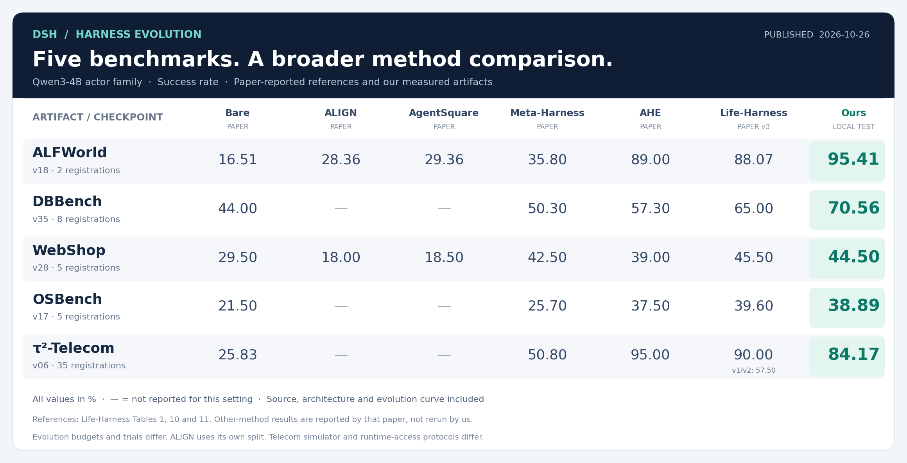
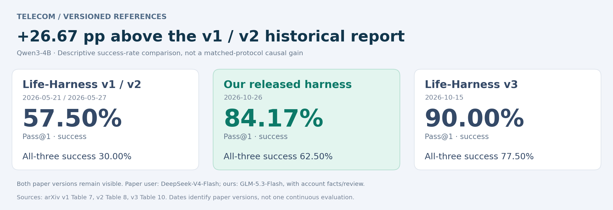
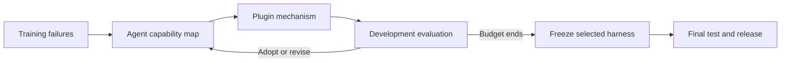

# DSH Harness Evolution

**English** | [简体中文](README.zh-CN.md)

**Five benchmarks. Native plugins. Measured results.**

Evolved [DSH](https://github.com/deepseek-ai/deepseek-harness) harnesses for a frozen **Qwen3-4B** actor. Each artifact includes working plugin source, an architecture diagram, its evolution curve, and the measured evaluation protocol.

[**Leaderboard**](LEADERBOARD.md) · [**Evolution curves**](docs/CURVES.md) · [**Download**](https://github.com/HuangShengZeBlueSky/dsh-harness-evolution/archive/refs/heads/main.zip) · [**Run**](docs/RUNNING.md) · [**Publish an update**](docs/PUBLISHING.md)

**Read the scores:** compare **Bare, ALIGN, AgentSquare, Meta-Harness, AHE, Life-Harness and Ours**. Green marks our released artifacts; other columns are results reported by the Life-Harness authors. Missing results stay empty. Evolution budgets, trials, ALIGN task splits and Telecom protocols differ. [Metric definitions and comparison scope →](docs/METRICS.md)

<!-- TELECOM-HISTORY:START -->

## Telecom: historical waterlines and our release

**Our Pass@1 is 26.67 pp higher than the v1/v2 report; all-three success is 32.50 pp higher.** The newer v3 result remains visible. These are cross-report numerical differences, not matched-protocol causal gains.

Sources: [v1 Table 7](https://arxiv.org/html/2605.22166v1), [v2 Table 8](https://arxiv.org/html/2605.22166v2), [v3 Table 10](https://arxiv.org/html/2605.22166v3). These are Qwen3-4B rows, not the 18-model averages. Both old and new papers use DeepSeek-V4-Flash users; ours uses GLM-5.3-Flash plus account-facts/review integration. Differences cannot be attributed to the loop alone.

<!-- TELECOM-HISTORY:END -->

## Choose a harness

Pick a task, see what the harness does, then open its **source**, **diagram**, or **curve**. 插件源码、框图、进化曲线均可直接进入。

<!-- LEADERBOARD:START -->

| Harness · success | What it solves | Selected artifact | Explore |
|---|---|---|---|
| **ALFWorld · 95.41%** | Household procedures + visible-state guidance | [v18 · 2 registrations](harnesses/alfworld/20261026-method1-sol61-v18) | [Source](harnesses/alfworld/20261026-method1-sol61-v18/plugins) · [Diagram](harnesses/alfworld/20261026-method1-sol61-v18#architecture) · [Curve](harnesses/alfworld/20261026-method1-sol61-v18#evolution) |
| **DBBench · 70.56%** | SQL grounding, execution, recovery and submission | [v35 · 8 registrations](harnesses/dbbench/20261026-l4-h0-sol61-v35) | [Source](harnesses/dbbench/20261026-l4-h0-sol61-v35/plugins) · [Diagram](harnesses/dbbench/20261026-l4-h0-sol61-v35#architecture) · [Curve](harnesses/dbbench/20261026-l4-h0-sol61-v35#evolution) |
| **WebShop · 44.50%** | Search, product options and budget-aware checkout | [v28 · 5 registrations](harnesses/webshop/20261026-l5-h0-sol61-v28) | [Source](harnesses/webshop/20261026-l5-h0-sol61-v28/plugins) · [Diagram](harnesses/webshop/20261026-l5-h0-sol61-v28#architecture) · [Curve](harnesses/webshop/20261026-l5-h0-sol61-v28#evolution) |
| **OSBench · 38.89%** | File inspection, shell-task contracts and recovery | [v17 · 5 registrations](harnesses/osbench/20261026-l4-h0-sol61-v17) | [Source](harnesses/osbench/20261026-l4-h0-sol61-v17/plugins) · [Diagram](harnesses/osbench/20261026-l4-h0-sol61-v17#architecture) · [Curve](harnesses/osbench/20261026-l4-h0-sol61-v17#evolution) |
| **τ²-Telecom · 84.17%** | Customer identity, device diagnosis and account review | [v06 · 35 registrations](harnesses/telecom/20261026-start-luna-repaired-v06) | [Source](harnesses/telecom/20261026-start-luna-repaired-v06/plugins) · [Diagram](harnesses/telecom/20261026-start-luna-repaired-v06#architecture) · [Curve](harnesses/telecom/20261026-start-luna-repaired-v06#evolution) |

<!-- LEADERBOARD:END -->

WebShop ranks by **strict success**, not partial reward. Its mean reward is shown separately. Registration counts describe implementation, not independent causal gains. A version such as `v35` is the selected checkpoint within its experiment, not the number of completed rounds.

## How the harness evolves

**Map the current agent → identify a recurring problem → give a plugin an explicit responsibility → evaluate → adopt or reject.**

One problem class should have an explicit plugin responsibility; plugins can cooperate and redundant guidance can be removed. This repository shares the method overview and final products, not unpublished paper details. [Method overview →](docs/METHOD.md)

## Publish once, update the leaderboard

**New harness + test data + curve → versioned release → refreshed leaderboard.**

The publication tool preserves previous artifacts. GitHub Actions rebuilds the overview, scores, artifact pages and curves when release data changes. No private experiment service is polled. [Publication guide →](docs/PUBLISHING.md)

Evaluation provenance and acknowledgements

Scores come from completed, training-selected final artifacts. Choosing the best artifact across experiments for publication is retrospective selection, not a new untouched evaluation. The portable package has been checked for loading; reported scores come from the original completed runs.

Paper waterlines, local baseline/full measurements and published artifact scores remain separate in the [full leaderboard](LEADERBOARD.md). Unmeasured costs are shown as missing, not zero.

Built on [DeepSeek Harness](https://github.com/deepseek-ai/deepseek-harness). Benchmarks and reference protocols draw on [Life-Harness](https://github.com/Tianshi-Xu/Life-Harness), [AgentBench](https://github.com/THUDM/AgentBench), [ALFWorld](https://github.com/alfworld/alfworld), [WebShop](https://github.com/princeton-nlp/WebShop), and [τ²-bench](https://github.com/sierra-research/tau2-bench). [MIT license](LICENSE) · [Third-party notices](docs/THIRD_PARTY.md)

