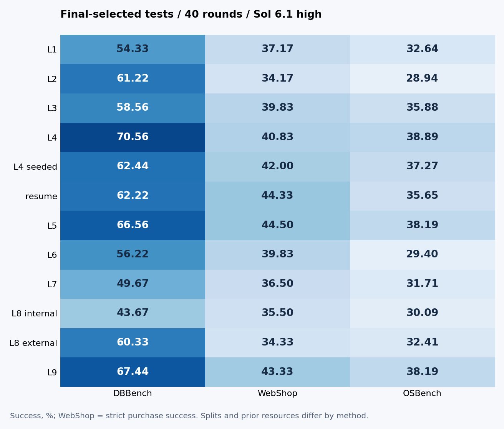

# DSH Harness Evolution

**English** | [简体中文](README.zh-CN.md)

**Methods, evolution curves, reproducible configurations, and measured plugin artifacts.**

Freeze the actor and evolve its runtime harness. Inspect what each loop changes, how candidates are selected, what happened, and which reproduction steps are actually supported.

[**Interactive summary and all curves**](https://huangshengzebluesky.github.io/dsh-harness-evolution/?lang=en) · [**Methods**](docs/METHODS.md) · [**Reproduce**](docs/REPRODUCING.md) · [**Leaderboard**](LEADERBOARD.md)

## Five benchmark artifacts

| Benchmark | Best released final-selected artifact | Retrospective high point | Life-Harness v3 reference |
|---|---:|---:|---:|
| ALFWorld | [95.41% · v18](harnesses/alfworld/20261026-method1-sol61-v18) | — | 88.07% |
| DBBench | [70.56% · v35](harnesses/dbbench/20261026-l4-h0-sol61-v35) | — | 65.00% |
| WebShop | [44.50% · v28](harnesses/webshop/20261026-l5-h0-sol61-v28) | [47.00% · v12](harnesses/webshop/20261027-original-best-sol61-v12) | 45.50% |
| OSBench | [38.89% · v17](harnesses/osbench/20261026-l4-h0-sol61-v17) | [39.35% · v03](harnesses/osbench/20261030-l4-h0-sol61-v03) | 39.60% |
| Telecom | [84.17% · v06](harnesses/telecom/20261026-start-luna-repaired-v06) | — | 90.00% |

These artifacts come from different methods and protocols, not one unified algorithm. Each final artifact follows its campaign selection rule; cross-campaign ranking and retrospective peaks use observed tests. Paper budgets, repeats, and Telecom simulator/access differ. The full leaderboard retains ALIGN, AgentSquare, Meta-Harness, AHE, and historical Life-Harness versions.

## What the audit established

- **More loop machinery did not reliably improve results.** L4/L5 remain strong; L8 delivered experience without consistent gains, and L9 did not dominate the earlier checkpoints.
- **Protocol changes are additional variables.** DB/Web L4 use 300 training tasks and no separate validation; L5 uses 240+60. Their score difference is not a clean component ablation.
- **Selection leaves headroom.** Web retrospective 47.00% exceeds that campaign final 44.33%; OS early 39.35% exceeds final 38.89%. Original selections are preserved.
- **Overall gain and mechanism support are separate.** Loading, triggering, and experience delivery are execution facts; intended repairs and global outcome changes require additional evidence.

- **Mean success and reliability can diverge.** OS mechanism feedback reached 32.87% versus summary 29.40%, yet all-three success was 25.00% versus 26.39%. This is a single-search observation.



## Reproduce from a shared core

`evolution/` supplies shared three-benchmark L1–L9 code, 36 profiles, task IDs and a small offline example. Each method documents inputs → edits → evaluation → adoption → final selection, with explicit reproduction coverage.

```bash
python -m pip install -e evolution
dsh-evolve profiles
python evolution/scripts/smoke.py ./workspaces/smoke
```

This scripted-model example exercises real DSH hooks and one adoption cycle; it does not remeasure benchmark scores. Formal runs require models, data and environments. ALFWorld/Telecom and feedback-extension integration boundaries are documented.

## Read and update the data

[Round records and detailed statistics](results/research/README.md) · [Metric definitions](docs/METRICS.md) · [All artifacts](LEADERBOARD.md) · [Publishing](docs/PUBLISHING.md)

Training, validation and test measurements remain separate. Inspect repeats, valid coverage, adoption/regression, models and splits. Time fields state their scope; missing costs stay null; three test trials are not three independent searches. New measured records rebuild the site, which shows a collection date rather than pretending to be a live monitor.

[MIT](LICENSE) · [Third-party notices](docs/THIRD_PARTY.md) · [DSH](https://github.com/deepseek-ai/deepseek-harness)
