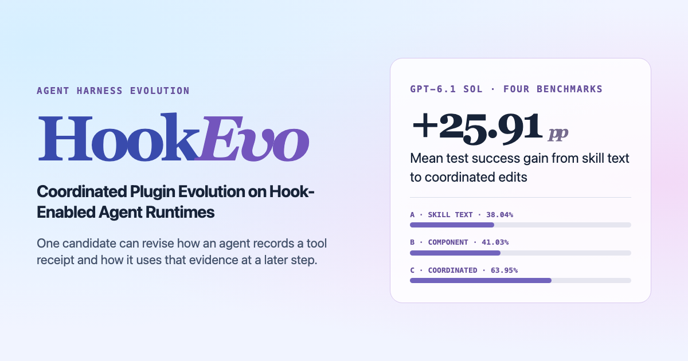
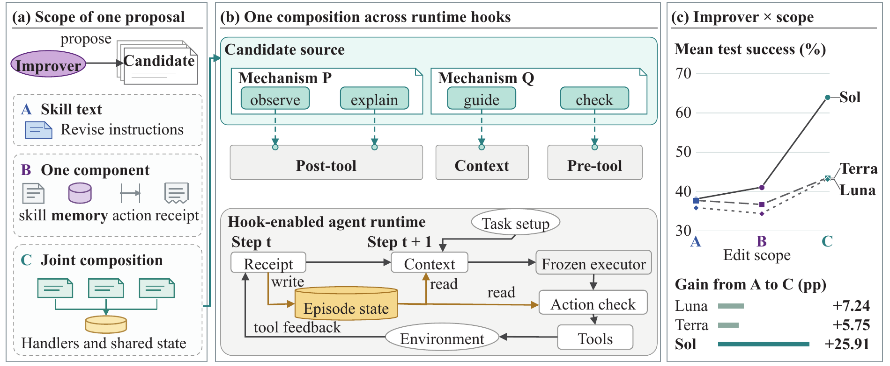
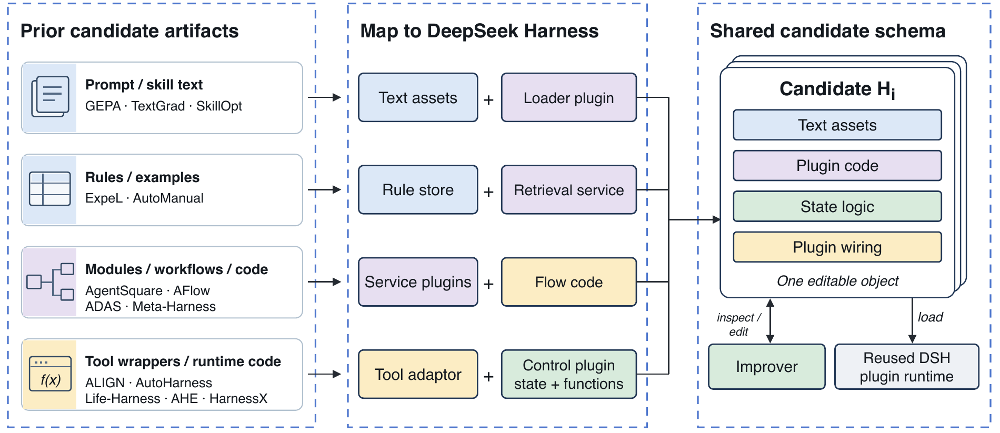
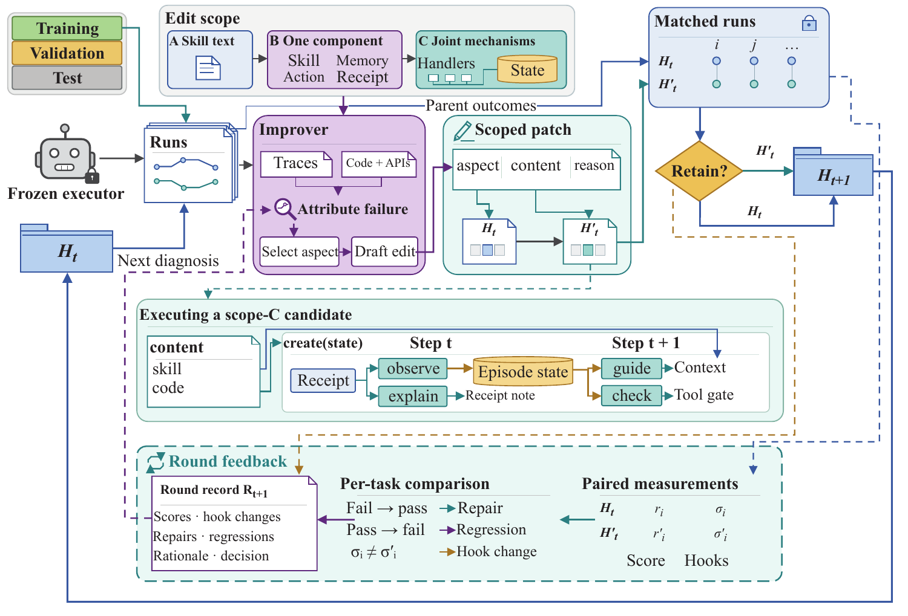

# HookEvo

**A Framework for Coordinated Plugin Evolution on Hook-Enabled Agent Runtimes**

HookEvo searches for task-specific plugins around a frozen language-model agent. A separate improver reads execution traces and proposes a patch. One patch can change both the handler that records a tool result and the handler that uses it later in the episode. DeepSeek Harness provides the runtime and lifecycle hooks.

[Project page](https://huangshengzebluesky.github.io/dsh-harness-evolution/) · [Main leaderboard](#main-leaderboard) · [Round replay](https://huangshengzebluesky.github.io/dsh-harness-evolution/replay.html) · [Explore a harness](https://huangshengzebluesky.github.io/dsh-harness-evolution/#checkpoints) · [Download checkpoints](artifacts/) · [Installation](#installation) · [Evaluation and search](REPRODUCING.md) · [Controller source](evolution/src/dsh_evolve/abc.py)

**Figure 1. What a candidate can change.** Skill text, an independent component, and coordinated handlers give the improver three different edit scopes.

## Main leaderboard

HookEvo achieves the highest held-out success among the Qwen3-4B-family methods in the table on all four benchmarks. On DBBench it reaches **70.56%**, up **6.45 percentage points** from the local Life-Harness rerun.

| Method | ALFWorld | DBBench | WebShop | OSBench | Evaluation |
| --- | ---: | ---: | ---: | ---: | --- |
| **HookEvo (Sol, scope C)** | **95.41 ± 0.00** | **70.56 ± 0.38** | **48.17 ± 0.29** | **41.67 ± 1.84** | Local |
| Life-Harness (local) | 87.77 ± 1.91 | 64.11 ± 0.38 | 41.33 ± 0.29 | 36.81 ± 0.00 | Local |
| Life-Harness | 88.07 | 65.00 | 45.50 | 39.60 | Published |
| Bare | 16.51 | 44.00 | 29.50 | 21.50 | Published |
| ALIGN | 28.36 | — | 18.00 | — | Life-Harness |
| AgentSquare | 29.36 | — | 18.50 | — | Life-Harness |
| Meta-Harness (Life rerun) | 35.80 | 50.30 | 42.50 | 25.70 | Life-Harness |
| AHE (Life rerun) | 89.00 | 57.30 | 39.00 | 37.50 | Life-Harness |
| Harness-R1 (paper) | 29.10 | 55.70 | 38.60 | — | Published |

Local results show mean held-out success (%) ± sample SD over three executions. A dash indicates an unreported result. Life-Harness reports ALIGN and AgentSquare in Table 11 and its Meta-Harness and AHE reruns in Table 1. Harness-R1 specifies Qwen3-4B and uses 500 WebShop tasks; our evaluation uses 200. [Life-Harness](https://arxiv.org/abs/2605.22166v3) · [Harness-R1](https://arxiv.org/abs/2608.02276)

## Released harnesses

The executor is Qwen3-4B-Instruct-2507. Each row gives the highest measured checkpoint reported for that benchmark, with mean held-out success and sample standard deviation across three executions.

| Benchmark | Artifact | Held-out tasks | Success (%) | What to inspect |
| --- | --- | ---: | ---: | --- |
| ALFWorld | [View harness](artifacts/alfworld) | 109 | 95.41 ± 0.00 | [Action hints](artifacts/alfworld/plugins/action-hint.mjs) turn accepted receipts into episode state for context and action checks. [Architecture](figures/alfworld-architecture.png) |
| DBBench | [View harness](artifacts/dbbench) | 300 | 70.56 ± 0.38 | The [write workflow](artifacts/dbbench/plugins/write-workflow.mjs) and [result bridge](artifacts/dbbench/plugins/result-bridge.mjs) use SQL receipts to guide later calls and answers. [Architecture](figures/dbbench-architecture.png) |
| WebShop | [View harness](artifacts/webshop) | 200 | 48.17 ± 0.29 | The [option ledger](artifacts/webshop/plugins/option-ledger.mjs) and [search evidence](artifacts/webshop/plugins/search-evidence.mjs) track product and option evidence. [Architecture](figures/webshop-architecture.png) |
| OSBench | [View harness](artifacts/osbench) | 144 | 41.67 ± 1.84 | The retained change is the skill text in [composition.json](artifacts/osbench/composition.json). Its executable composition is empty. [Architecture](figures/osbench-architecture.png) |

## How the search works

**Figure 2. How candidate representations fit together.** The diagram maps earlier optimization targets to DeepSeek Harness interfaces and shows what one HookEvo candidate can edit.

**Figure 3. One evolution round.** The controller evaluates parent and candidate on matched tasks, then returns its retention decision and measured changes.

1. Run the parent harness on a training batch. Save its scores, hook outputs, and successful and failed trajectories.
2. Give the improver sampled trajectories, parent source, runtime interfaces, and the previous decision. It proposes one replacement and a rationale. Scope A edits skill text, B edits one independent component, and C permits coordinated edits that share episode-local state.
3. Compare the candidate and parent on matching tasks, trials, and seeds. Retain a candidate when the training objective improves, an emitted hook output changes, and validation performance holds or improves when validation is configured.
4. Feed the decision, repairs, and regressions into the next round. Accepted code persists across rounds. Each new episode starts with fresh runtime state.

[Reported evolution curves](figures/best-harness-evolution.png) · [Scope C hook implementation](evolution/src/dsh_evolve/assets/slot-c.mjs)

## Installation

From the repository root on Linux or macOS, use Python 3.10–3.12 and Node.js 22.19 or later with npm.

~~~bash
python3 -m venv .venv
source .venv/bin/activate
python -m pip install -e evolution
python evolution/scripts/smoke.py ./runs/smoke
~~~

The smoke run uses the real DSH runtime, a scripted actor, and a synthetic task. It installs Node dependencies and exercises A/B/C proposals, selection, and held-out evaluation without a model account. Choose a fresh output directory for another smoke run.

Use the reproduction guide to [evaluate a released harness](REPRODUCING.md#evaluate-a-released-checkpoint) or [run a controlled search](REPRODUCING.md#run-a-controlled-search).

## Citation

[Paper citation and BibTeX](https://huangshengzebluesky.github.io/dsh-harness-evolution/#citation) · [Software citation](CITATION.cff)

## License

The repository uses the [MIT license](LICENSE). Bundled benchmark scoring code carries its [upstream license notices](evolution/benchmark_sources/README.md).
