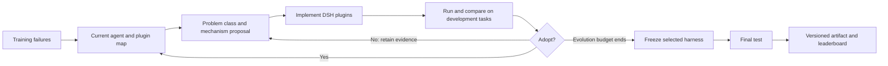

# DSH Harness Evolution

**Evolve the harness. Keep the actor model frozen. Release the working plugins.**

A growing collection of evolved [DeepSeek Harness (DSH)](https://github.com/deepseek-ai/deepseek-harness) artifacts across **ALFWorld · DBBench · WebShop · OSBench · τ²-Telecom**. Every release includes executable plugins, its composition, evaluation protocol, evolution curve, and a Mermaid architecture diagram.

[**Full leaderboard**](LEADERBOARD.md) · [**Evolution curves**](docs/CURVES.md) · [**Method overview**](docs/METHOD.md) · [**Run a harness**](docs/RUNNING.md) · [**Publish a release**](docs/PUBLISHING.md) · [**Metric definitions**](docs/METRICS.md)

## Current published results

<!-- LEADERBOARD:START -->

| Benchmark | Released artifact | Ours Pass@1 | Life-Harness paper | Numerical gap |
|---|---|---:|---:|---:|
| ALFWorld | [v18 · 方法2 · Astra自由方案](harnesses/alfworld/20261026-method1-sol61-v18) | **95.41%** | 88.07% | +7.34 pp |
| DBBench | [v35 · L4 · Agent结构与多插件职责](harnesses/dbbench/20261026-l4-h0-sol61-v35) | **70.56%** | 65.00% | +5.56 pp |
| WebShop | [v28 · L5 · 场景专用循环](harnesses/webshop/20261026-l5-h0-sol61-v28) | **44.50%** | 45.50% | -1.00 pp |
| OSBench | [v17 · L4 · Agent结构与多插件职责](harnesses/osbench/20261026-l4-h0-sol61-v17) | **38.89%** | 39.60% | -0.71 pp |
| τ²-Telecom | [v06 · 方法2消融 · Luna修复版起点](harnesses/telecom/20261026-start-luna-repaired-v06) | **84.17%** | 90.00% | -5.83 pp |

Updated from published release records. Numerical differences are descriptive, not protocol-matched superiority claims.

<!-- LEADERBOARD:END -->

Scores are selected from **completed, training-selected final artifacts**. The best artifact across experiments is selected retrospectively for publication; this is a release leaderboard, not an independent confirmatory evaluation. Actor: **Qwen3-4B-Instruct-2507**. Optimizer models are listed separately on each artifact page.

**Comparison scope:** Life-Harness paper numbers are reference waterlines, not our measurements. AgentBench: paper one trial vs our three; Telecom: paper DeepSeek-V4-Flash user vs our GLM-5.3-Flash user, with additional account-facts/review integration. No overall “beats Life-Harness” claim is made. [Protocol details](docs/METRICS.md)

## The idea

One recurring problem class should have an explicit plugin responsibility. Inspect the current agent and its existing capabilities before proposing another plugin. Keep changes only when their real execution and configured training/validation criteria support adoption.

This public repository presents the method at a high level and releases final products. Detailed paper claims and unpublished research designs are not included. Plugin counts describe implementation, not independent causal gains.

## A release-driven leaderboard

Publish a harness directory and its measured result; `tools/publish.py` adds an immutable release record, regenerates the leaderboard, and plots the supplied curve. Previous releases remain available. Data and artifacts move together in the same Git commit. No private experiment service is polled and no unfinished result is automatically published.

## 中文说明

这里公开五个场景的最终 harness 产物、插件职责框图、真实进化曲线，以及与 Life-Harness 论文和本地复测水位的对照。方法核心是 **基于 DSH 的插件进化：先梳理当前 Agent 能力，再让一类插件解决一类问题，通过实际评测决定采用**。后续发布新产物并提供数据即可更新榜单，旧版本保留。

## Acknowledgements

Built on [DeepSeek Harness](https://github.com/deepseek-ai/deepseek-harness). Benchmarks and comparison protocols draw on [Life-Harness](https://github.com/Tianshi-Xu/Life-Harness), [AgentBench](https://github.com/THUDM/AgentBench), [ALFWorld](https://github.com/alfworld/alfworld), [WebShop](https://github.com/princeton-nlp/WebShop), and [τ²-bench](https://github.com/sierra-research/tau2-bench). See [third-party notices](docs/THIRD_PARTY.md).
