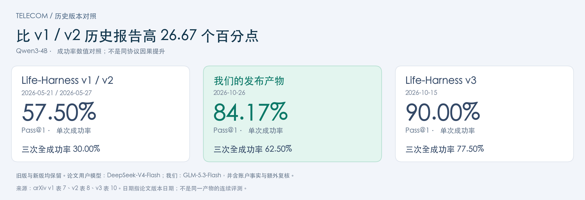

# DSH Harness Evolution

[English](README.md) | **简体中文**

**五个场景，多种方法对照，可直接查看的插件产物。**

基于 DSH 的 harness 进化，固定 Qwen3-4B 做题模型。每个产物包含插件源码、运行接口、Mermaid 框图、真实进化曲线和测试配置。

[**完整榜单**](LEADERBOARD.zh-CN.md) · [**进化曲线**](docs/CURVES.zh-CN.md) · [**方法概览**](docs/METHOD.zh-CN.md) · [**下载全部产物**](https://github.com/HuangShengZeBlueSky/dsh-harness-evolution/archive/refs/heads/main.zip)

榜单包含裸模型、ALIGN、AgentSquare、Meta-Harness、AHE、Life-Harness 和我们。我们的主列展示最佳已测晋升点，可能来自回溯补测；训练最终版另列。其他方法使用论文报告值；缺失的场景留空。

<!-- LATEST:START -->

## 最新发布 · 2026-10-27

| 场景 | 产物 / 成功率 | 发布依据 | 直接查看 |
|---|---|---|---|
| WebShop | [v12 · **47.00%**](harnesses/webshop/20261027-original-best-sol61-v12/README.zh-CN.md) | 回溯补测 | [方法流程](harnesses/webshop/20261027-original-best-sol61-v12/README.zh-CN.md#方法流程图) · [Harness框图](harnesses/webshop/20261027-original-best-sol61-v12/README.zh-CN.md#结构框图) · [曲线](harnesses/webshop/20261027-original-best-sol61-v12/README.zh-CN.md#进化曲线) |
| DBBench | [v32 · **70.33%**](harnesses/dbbench/20261027-l4-h0-sol61-v32/README.zh-CN.md) | 回溯补测 | [方法流程](harnesses/dbbench/20261027-l4-h0-sol61-v32/README.zh-CN.md#方法流程图) · [Harness框图](harnesses/dbbench/20261027-l4-h0-sol61-v32/README.zh-CN.md#结构框图) · [曲线](harnesses/dbbench/20261027-l4-h0-sol61-v32/README.zh-CN.md#进化曲线) |
| OSBench | [v08 · **38.66%**](harnesses/osbench/20261027-l5-h0-sol61-v08/README.zh-CN.md) | 回溯补测 | [方法流程](harnesses/osbench/20261027-l5-h0-sol61-v08/README.zh-CN.md#方法流程图) · [Harness框图](harnesses/osbench/20261027-l5-h0-sol61-v08/README.zh-CN.md#结构框图) · [曲线](harnesses/osbench/20261027-l5-h0-sol61-v08/README.zh-CN.md#进化曲线) |

<!-- LATEST:END -->

<!-- TELECOM-HISTORY:START -->

## Telecom：历史水位与当前产物

**相对 v1/v2 的报告值，我们的成功率高 26.67 个百分点，三次全成功率高 32.50 个百分点。**新版 v3 仍并列展示；这是跨报告的数值差，不是同协议因果增益。

来源：[v1 表 7](https://arxiv.org/html/2605.22166v1)、[v2 表 8](https://arxiv.org/html/2605.22166v2)、[v3 表 10](https://arxiv.org/html/2605.22166v3)。均取 Qwen3-4B 行，不混入 18 模型均值。旧新版论文均使用 DeepSeek-V4-Flash 用户模型；我们使用 GLM-5.3-Flash，另有账户事实与额外复核接口，不能直接归因于 loop。

<!-- TELECOM-HISTORY:END -->

## 选择 Harness 产物

| 场景与成绩 | 解决的问题 | 检查点 | 直接查看 |
|---|---|---|---|
| **ALFWorld · 95.41%** | 家务任务流程与可见状态指导 | [v18 · 训练最终版](harnesses/alfworld/20261026-method1-sol61-v18/README.zh-CN.md) | [源码](harnesses/alfworld/20261026-method1-sol61-v18/plugins) · [框图](harnesses/alfworld/20261026-method1-sol61-v18/README.zh-CN.md#结构框图) · [曲线](harnesses/alfworld/20261026-method1-sol61-v18/README.zh-CN.md#进化曲线) |
| **DBBench · 70.56%** | 数据库结构与取值对齐、SQL 执行和结果提交 | [v35 · 训练最终版](harnesses/dbbench/20261026-l4-h0-sol61-v35/README.zh-CN.md) | [源码](harnesses/dbbench/20261026-l4-h0-sol61-v35/plugins) · [框图](harnesses/dbbench/20261026-l4-h0-sol61-v35/README.zh-CN.md#结构框图) · [曲线](harnesses/dbbench/20261026-l4-h0-sol61-v35/README.zh-CN.md#进化曲线) |
| **WebShop · 47.00%** | 商品检索、规格选择、价格核验与购买 | [v12 · 回溯补测](harnesses/webshop/20261027-original-best-sol61-v12/README.zh-CN.md) | [源码](harnesses/webshop/20261027-original-best-sol61-v12/plugins) · [框图](harnesses/webshop/20261027-original-best-sol61-v12/README.zh-CN.md#结构框图) · [曲线](harnesses/webshop/20261027-original-best-sol61-v12/README.zh-CN.md#进化曲线) |
| **OSBench · 38.89%** | 文件检查、命令语义、全局统计与重复恢复 | [v17 · 训练最终版](harnesses/osbench/20261026-l4-h0-sol61-v17/README.zh-CN.md) | [源码](harnesses/osbench/20261026-l4-h0-sol61-v17/plugins) · [框图](harnesses/osbench/20261026-l4-h0-sol61-v17/README.zh-CN.md#结构框图) · [曲线](harnesses/osbench/20261026-l4-h0-sol61-v17/README.zh-CN.md#进化曲线) |
| **τ²-Telecom · 84.17%** | 客户线路身份、设备诊断、账单与账户复核 | [v06 · 训练最终版](harnesses/telecom/20261026-start-luna-repaired-v06/README.zh-CN.md) | [源码](harnesses/telecom/20261026-start-luna-repaired-v06/plugins) · [框图](harnesses/telecom/20261026-start-luna-repaired-v06/README.zh-CN.md#结构框图) · [曲线](harnesses/telecom/20261026-start-luna-repaired-v06/README.zh-CN.md#进化曲线) |

WebShop 按严格成功率排序，平均奖励单独展示。插件注册数量不代表独立证明有效的机制数量。

## 方法概览

先维护当前 Agent 的能力和插件职责，再从训练失败中找问题类，提出插件改动，通过实际评测决定采用。允许插件协作，也允许删除重复或有副作用的指导。这里只公开方法概览和产物，不展开尚未公开的论文细节。

## 后续如何更新

**新 harness＋测试数据＋进化曲线 → 发布新版本 → 自动更新中英文榜单。**

使用 `tools/publish.py` 添加产物；推送后 GitHub Actions 自动生成中英文首页总览、榜单和产物页，旧版本保留。提供新的产物和实测数据即可更新，不需要公开内部实验日志。[发布说明](docs/PUBLISHING.zh-CN.md) · [运行说明](docs/RUNNING.zh-CN.md)

## 如何理解比较

论文采用的优化模型、六轮预算和测试重复次数与我们不同；ALIGN 使用自身发布划分；Telecom 还存在用户模拟器、账户事实接口与额外复核调用的差异。主榜是来源明确的数值对照，不把所有结果包装成严格同协议排名。原始测试成绩沿用已完成实验，本次发布不代表重新跑完评测。

[MIT 许可证](LICENSE) · [致谢与第三方声明](docs/THIRD_PARTY.md)
