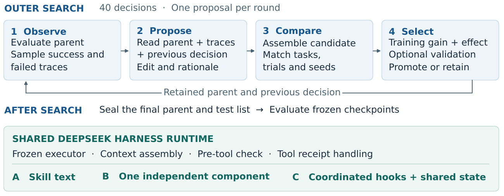

# DSH Harness Evolution

[English](README.md) · [简体中文](README.zh-CN.md)

**基于 DeepSeek Harness，把执行轨迹转成可运行的插件改进。**

[主榜与曲线](https://huangshengzebluesky.github.io/dsh-harness-evolution/?lang=zh) · [复现步骤](docs/REPRODUCING.zh-CN.md) · [论文图集](paper/README.md) · [测试数据](LEADERBOARD.zh-CN.md)

冻结执行模型，进化外围的 Harness。主线保留两种方法。

| 方法 | 做什么 | 入口 |
|---|---|---|
| L4 | 梳理当前能力和插件职责，再依据轨迹提出修改、评测和晋升 | [代码](evolution/src/dsh_evolve/loops/l4.py) · [配置](configs/l4) |
| A/B/C | A改技能文本，B每轮改一个独立部件，C通过任务内状态协调钩子 | [控制器](evolution/src/dsh_evolve/abc.py) · [40套配置](configs/abc) |

## 论文主榜

<!-- paper-table:start -->
| 场景 | 历史产物已测高点 | 历史最终选版 |
|---|---:|---:|
| ALFWorld | 95.41% | 95.41% |
| DBBench | 70.56% | 70.56% |
| WebShop · historical | 47.00% | 44.33% |
| WebShop · frozen | 48.17% | — |
| OSBench | 39.35% | 38.89% |
| Telecom | 87.50% | 84.17% |
<!-- paper-table:end -->

沿用论文当前历史产物口径。ALFWorld是20轮历史搜索，DBBench、OSBench包含L4，WebShop包含历史续跑。另一题单的OSBench C高点41.67%保留在图集和原数据中。[来源与配置](docs/REPRODUCING.zh-CN.md) · [完整榜单](LEADERBOARD.zh-CN.md)。

同协议四十轮A/B/C的终选结果在网站单列，并保留[完整数值](paper/data/controlled-abc.json)。

## 看曲线

四个场景都提供 **8组C模型／推理强度曲线**，以及 **9组模型×修改面曲线**。飞书论文文档中的27张图完整收入，再附本轮对齐的A/B/C算法图。

[浏览28张图](paper/README.md) · [图与配置对应关系](paper/data/curve-manifest.json) · [逐轮训练和测试](paper/data/trajectories.json)

## 开始复现

~~~bash
python -m pip install -e evolution
dsh-evolve profiles
dsh-evolve init ./runs/db-c --profile abc/dbbench/C-sol61 --assets /data/dbbench
# 按复现文档设置执行模型和数据库连接。
dsh-evolve setup ./runs/db-c/experiment.yaml
dsh-evolve run ./runs/db-c/experiment.yaml
~~~

L4和A/B/C共用执行基础。A/B/C在40轮决定完成并封存后测试所有晋升版。[复现说明](docs/REPRODUCING.zh-CN.md)给出环境、题单、模型、起点和预算。

## 目录

- [evolution](evolution/) — 共同执行层、L4、A/B/C。
- [configs](configs/) — L4、A/B/C及历史高分配置。
- [harnesses](harnesses/) — 五场景产物、装配、协议与框图。
- [paper](paper/) — 论文图、表、数值及逐轮曲线。
- [tools](tools/) — 榜单生成与产物发布。

早期方法保留在[整理前的历史版本](https://github.com/HuangShengZeBlueSky/dsh-harness-evolution/tree/archive/pre-paper-cleanup-20261111)。后续通过[发布步骤](docs/PUBLISHING.md)更新数据并重建榜单。

[MIT](LICENSE) · [第三方说明](docs/THIRD_PARTY.md) · [DeepSeek Harness](https://github.com/deepseek-ai/deepseek-harness)
