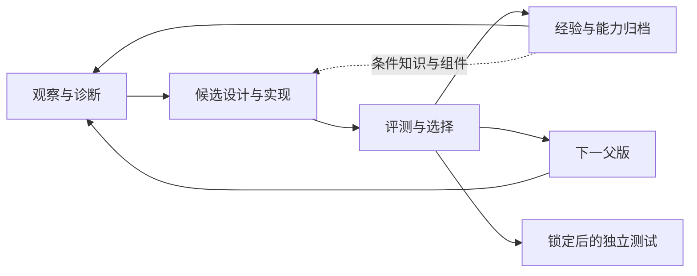

# DSH Loop：四个模块、八条宏观改进路线

我们把架构固定为**观察与诊断 → 候选设计与实现 → 评测与选择 → 经验与能力归档**。任务分布、Harness起点、允许修改面和预算是四类全局控制，不再额外堆成一串服务。

**English summary:** Four modules share one execution/evaluation core. Task distribution, initialization, editable program space and budget define the experiment. The eight proposals below change one primary architectural variable at a time; none has been run.

[结构化内容](../results/architecture-methodology.json) · [全部方法](METHODS.zh-CN.md) · [实际运行边界](REPRODUCING.zh-CN.md)

## 四个模块与真实代码

| 模块 | 交给下游什么 | 当前主要缺口 |
|---|---|---|
| 观察与诊断 | 代表性证据包；当前能力与状态职责；可检验的修复假设与优先目标 | 日志索引偏向末尾症状；样例覆盖和首次偏差尚未充分组织。 |
| 候选设计与实现 | 机制提案：改什么、何时生效、何时不生效；冻结候选：插件、状态、组合与父版关系 | 没有独立可替换的propose/implement接口，难定位候选失败的来源。 |
| 评测与选择 | 整体收益与回退；机制支持／反驳／未知；冠军决定和最终冻结选择 | 重复查询训练或验证都会产生选择偏差；一次涨分不保证泛化。 |
| 经验与能力归档 | 有条件、可被反驳的经验；重复无效方向的记录；可选的组件／互补父版 | 采用不能自动转写为原因成立的成功经验。 |

观察与诊断：已实现、缺口与代码

**已实现：**完整可见消息、失败索引和运行作用记录已保存。 L4生成源码登记与钩子清单；L6/L7要求证据定位和修复映射。 反馈分支按最多8失败＋4成功抽样，提供摘要或机制诊断。

**需要改进：**日志索引偏向末尾症状；样例覆盖和首次偏差尚未充分组织。 插件清单不等于状态依赖、真实覆盖或能力边界。 分类与引用正确，不代表原因假设成立。

**代码：**[records.py](../evolution/src/astra_evolve/records.py) `materials / runtime_evidence` · [l45.py](../evolution/src/dsh_evolve/loops/l45.py) `Campaign.inspect` · [l6.py](../evolution/src/dsh_evolve/loops/l6.py) `Campaign.plan` · [online_feedback.py](../evolution/extensions/feedback/online_feedback.py) `boundary`

候选设计与实现：已实现、缺口与代码

**已实现：**Project.prepare复制父版、准备工作区，不负责生成代码。 持续优化会话承担诊断、机制选择和实现；M1/M2改变修改约束。 L9可导入旧组件；DSH提供状态、动作前后处理和恢复干预。

**需要改进：**没有独立可替换的propose/implement接口，难定位候选失败的来源。 表述不同不等于机制多样；完整Harness空间也可能搜索不到有效区域。 强起点带来能力，也带来依赖和局部搜索偏好。

**代码：**[project.py](../evolution/src/astra_evolve/project.py) `Project.prepare` · [keeper.py](../evolution/src/dsh_evolve/keeper.py) `prompt / run` · [l789.py](../evolution/src/dsh_evolve/loops/l789.py) `Campaign.component`

评测与选择：已实现、缺口与代码

**已实现：**运行、完整有效结果、冻结和采用已程序化。 L1/L5/L7有不同验证门槛；L3区分分支保留与冠军改变。 当前L4-simple按固定训练严格成功提高采用，缺少独立开发验证。

**需要改进：**重复查询训练或验证都会产生选择偏差；一次涨分不保证泛化。 总分上涨可与原目标零修复同时发生。 普通同任务配对不等于共享前缀的受控因果干预。

**代码：**[project.py](../evolution/src/astra_evolve/project.py) `Project.evaluate / report / decide` · [loop_policy.py](../evolution/src/dsh_evolve/loops/loop_policy.py) `select / parent` · [l45.py](../evolution/src/dsh_evolve/loops/l45.py) `Campaign.report` · [l6.py](../evolution/src/dsh_evolve/loops/l6.py) `Campaign.report`

经验与能力归档：已实现、缺口与代码

**已实现：**L8已生成并传递轮内或外部经验。 L3保存三个按验证分排序的分支，L9复用训练选定组件。 事前预测已冻结并配对核对，但预测误差仍主要用于事后分析。

**需要改进：**采用不能自动转写为原因成立的成功经验。 文本经验送达不等于改变了后续行为。 分数前几名、组件库、行为互补Archive是三件事。

**代码：**[l789.py](../evolution/src/dsh_evolve/loops/l789.py) `Campaign.learn / initialize` · [learning.py](../evolution/src/dsh_evolve/loops/learning.py) `campaign_packet / run_job` · [loop_policy.py](../evolution/src/dsh_evolve/loops/loop_policy.py) `select` · [prediction_outcomes.py](../evolution/extensions/feedback/prediction_outcomes.py) `main`

## 四类控制怎样影响结果

| 控制 | 机器学习视角 | 应该怎样记录 |
|---|---|---|
| 数据分布与划分 | 比例只是表面；覆盖、难度、近重复和反复选版次数共同决定泛化。 | 固定训练集可以保留；验证任务身份与额外预算显式记录。已观察的测试只用于诊断，不回传新方案的选版。 |
| Harness起点 | 已有Harness是能力先验，也改变可到达的后续修改路径。 | 分别报告起点成绩、增量和先前搜索成本；同父版配对比较后续方法。 |
| 允许修改的空间 | 提示、状态、动作、恢复和组件组合，是不同的程序搜索空间。 | 允许空间与实际探索空间分别统计。先对同一知识和观察比较不同实现机制，保持评测基础固定。 |
| 优化与评测预算 | 轮数、候选数、读取轨迹、模型调用、重复评测和先验成本共同约束搜索。 | 同时报告有效候选、实测场次与可获得的调用成本；按相同总预算比较。 |

## 日志、经验与“梯度”的准确类比

**日志是梯度吗？** 这是有用的类比，但原始日志不是梯度。 日志经证据筛选和归因，提供“可能该往哪里改”的方向信号；配对评测提供局部改动的效果反馈。

Harness是离散程序与组合；现有代码没有可微目标、统一参数坐标或反向传播。应称方向建议或代理更新信号，不声称算出了梯度。 优化的不只是模型能力，也包括信号质量：覆盖偏、误归因或只看末尾症状，会让候选沿错误方向搜索。

**经验是二阶梯度吗？** 若经验学会“哪种更新在什么条件下有效”，更接近学习更新规则或预条件；不自动等于Hessian。 一阶类比：本题哪里错。更高阶类比：这种错应采用什么修改、步子多大、哪些组合会误伤。经验可以调节提案分布、修改范围和选择信心。

只有显式估计不同编辑方向的效果敏感性或交互，并用它控制更新，才有更强的二阶解释。当前L8是文本学习与传递，没有计算曲率。 经验条目要保留条件、动作、结果、反例与失效条件；评价标准是它是否改变下一轮决策并减少无效尝试。

**数据比例为何改变结果？** 训练决定看见哪些问题；验证决定保留哪些更新；测试估计未参与选择的效果。 改配比既改变有效训练信息，也改变选择噪声与泛化估计的方差。相同100题若包含大量近重复，其有效多样性可能远小于100。

训练和测试同分布也不保证有限样本分数相同；训练被用于自适应选择时，本来就会偏乐观。固定验证反复使用同样会被选择过程拟合。 先对齐任务家族、模板和难度，再比较划分；不要只调数字比例，更不要按测试反选比例。

**已有Harness改变的是初始能力和搜索先验** 起点决定已经具备的机制、后续修改成本和局部依赖。 它类似初始化与迁移先验：减少从零学基本机制的成本，也可能把候选锁在旧结构附近。

强起点实验和H0实验的信息与累计预算不同；不能只用最终分数解释更新算法优劣。 比较同父版下的新增收益、跨题覆盖与干扰；必要时允许删减或重新组合，不只追加。

**修改面就是参数空间，但参数是程序** 提示文本、持久状态、动作规则、恢复路径、插件图具有不同表达能力。 小空间更易搜索但可能表达不了所需修复；大空间更有表达力但候选效率和选择难度更高。

文件数、插件数和代码行数不是有效容量或机制多样性的可靠替代。相同代码长度可以有完全不同的作用范围。 记录本轮编辑算子、触发范围和行为差异，而不只记录改了哪些文件。

**为什么会出现平台期？** 固定任务有限、选择门槛、重复方向、噪声和可改空间都可能造成平台期。 冠军单调曲线本身是选择规则构造的结果；候选可能在周围振荡。没有采用，不等于没有新能力。

只能说在当前证据、算子、预算和评测精度下未发现可靠增益；不能由40轮曲线平坦推出全局收敛、模型能力上限或环境不可解。 先识别平台期类型，再决定补证据、换机制、改选择还是停止；停止应针对当前搜索条件。

选择过程本身可能拟合选择准则，见 [Cawley与Talbot](https://www.jmlr.org/papers/v11/cawley10a.html)。学习更新规则可以成为研究对象，见 [Learning to learn](https://arxiv.org/abs/1606.04474)。这两项是概念依据，不代替本项目的受控证据。

## 如何判断平台期，而不是武断宣布收敛

没有一个通用的“连续N轮不涨＝收敛”阈值。先声明预算和观察窗口，再结合下列信号；中断、额度耗尽或评测失败属于执行停滞。

| 辅助信号 | 怎样测 | 可能意味着什么 |
|---|---|---|
| 独立开发收益的边际变化 | 按预先声明的窗口记录开发验证净增益、重复波动和单位评测预算收益；训练与验证分开。 | 收益持续小于可分辨波动，说明当前搜索的新增价值下降。 |
| 目标修复与回归抵消 | 同任务父子比较：目标失败→成功、成功→失败、净变化；计划内与意外收益分列。 | 目标仍能修复但总分不涨，可能卡在副作用或选择；目标也修不好，可能卡在诊断或可改空间。 |
| 候选机制和行为新颖性 | 记录修改算子、适用条件和动作序列变化；比较是否反复提出相同无效机制。 | 新颖性下降且旧问题持续，提示搜索同质化或记忆未生效。 |
| 有效干预覆盖 | 新插件在目标任务上加载、进入实际请求／控制、改变后续动作的比例；三层分别计。 | 大量目标未触发，优先改输入、触发条件或可观察状态；触发充分仍失败，再查修复机制。 |
| 早期失败的剩余比例与反复出现 | 冻结早期失败任务集合F0，按检查点跟踪未修复、暂时修复后复发、稳定修复；另记新回归任务。 | 区分旧问题真正被解决、失败换到另一阶段、以及总体分数抵消。 |
| 阶段到达率与条件失败率 | 按实际动作/回执记录到达某阶段的比例，及到达后失败比例；同步看同任务迁移。 | 前段修好后更多任务暴露后段问题，后段失败数上升未必是退化。 |
| 诊断和事前预测是否更准确 | 对执行前封存的预测核对后果、置信度和反例；无匹配结果记缺失。 | 预测持续失准提示错误机制理解；校准提高但得分不涨则可能是表达/搜索/选择瓶颈。 |
| 资源或服务阻塞 | 检查真实有效场次、最后决定、错误原因和耗时，而不仅是进程/服务状态。 | 没有有效新评测时是执行停滞，不能称研究收敛。 |

**早期失败必须固定分母。** 把初始失败集合记为F0，逐版区分未修复、暂时修复后复发、稳定修复，同时另列新回归。失败类别后移不必然变坏：前段成功会让更多任务暴露后段问题，因此阶段到达率与条件失败率必须一起看。

**平台期诊断要落到模块。** 没看见问题先改观察；知道问题但方案雷同先改提案；目标能修但总收益被误伤抵消先改适用边界和选择；预测与结果反复冲突先改经验。只有证据支持修改面表达不了目标机制，才扩大搜索空间。

## 八条宏观路线：先选变量，再选实验

四个大模块不变。A/B/C保留，D—H扩展数据、起点、预算、修改空间和证据结构。它们是**待选方案，全部未运行**，不需要八条同时开启。

| 方案 | 宏观变量 | 对照方式 | 想回答什么 | 优先级 |
|---|---|---|---|---|
| A · 泛化选择 | 选版规则 | 同一候选池：训练最佳 vs 独立开发验证选择 | 候选池里是否已经有更好的产物，只是选错了？ | 诊断先行 |
| B · 机制对照生成 | 同一问题的修复机制 | 同一证据与知识：提示修复 vs 状态／动作／恢复修复 | 已知同一问题时，哪种修复表示更有效？ | 关键主对照 |
| C · 校准经验 | 跨轮经验的更新规则 | 同长度、同学习预算：普通总结 vs 带反例和失效条件的经验 | 经验是否真的改变下一轮，而不是重复讲故事？ | 后续扩展 |
| D · 数据分配 | 训练／验证配比 | 固定100个开发任务：60/40、80/20、90/10训练／验证；测试集保持独立 | 有限任务应该用于发现更多修法，还是用于更稳地选择？ | 关键主对照 |
| E · 起点与阶段 | Harness初始化与预训练／后训练 | H0空增强 vs 训练／开发选定高点 vs 跨任务通用Harness；各自追加同样40轮 | 高起点能节省搜索，还是把后续改动锁在旧结构里？ | 关键主对照 |
| F · 平台期策略 | 搜索预算与平台期响应 | 固定调度 vs 在同一40轮预算内依据平台迹象切换已允许的编辑算子 | 没有涨分时，是继续同类修改，还是改变本次搜索方向？ | 后续扩展 |
| G · 修改空间 | 可搜索的程序参数结构 | 提示限定 → 提示＋状态 → 动作／恢复 → 工具封装与编排；分别固定空间运行 | 效果受限，是生成器不会搜，还是允许的空间表达不了修复？ | 关键主对照 |
| H · 证据输入 | 日志到诊断的输入结构 | 自由挑样例／末尾摘要 vs 失败机制覆盖＋匹配成功＋新增退步的证据包 | 生成器没有提出好改动，是能力不足，还是看错了材料？ | 诊断先行 |

**选择顺序：**先用A/H分清选版和证据是否有问题；再从D/E/G中选择最相关的一条主对照。B用于同一问题的机制研究；C/F在基础稳定后研究跨轮学习与搜索策略。这个顺序是成本与可解释性的建议，不是预言哪条一定涨分。

<strong>A · 泛化选择：先校准保留什么</strong> · 选版规则 · 诊断先行

**对应模块：**评测与选择。**核心问题：**候选池里是否已经有更好的产物，只是选错了？

**怎么比：**同一候选池：训练最佳 vs 独立开发验证选择。

**改变：**保留当前固定训练集与候选生成方式，增加身份明确的独立开发验证；冠军由开发收益与必要回归检查决定。

**保持：**父版起点、做题模型、优化器与修改空间；固定训练任务，不增加为轮换大池；同一候选池的离线选版比较作为第一步。

**实施步骤：**

1. 先冻结相同候选池，比较训练最佳与开发验证选择；这一步不让选择反馈改变后续候选。
2. 若离线诊断有价值，再做两条完整搜索；在线父版分化是方法效果的一部分，不能继续叫同候选池。
3. 预先明确验证来源、总评测预算、停止原则，最终测试仅在选定后使用。

**预期：**降低训练增益很大但开发能力不升的采用；可能牺牲一部分训练最高分，换取更稳的保留。

**支持它的观察：**相同候选池中，开发选择更少选中回归版本；新确认任务上的H0相对增益更稳定；相同预算下训练—确认差距不再随轮数扩大。

**什么会否定它：**开发选择并未改善确认结果，或验证误差太大使选择不稳定；说明问题可能主要在覆盖/候选，而非仅选版。

**成本与边界：**新增验证场次必须单列并计入总预算；验证集也会因反复查询过拟合，必要时采用预先规定的分层或轮换验证机制，不能用test调它。

**下一步限制：**不与经验、Archive或生成器改动同时开启。

**代码落点：**[l123.py](../evolution/src/dsh_evolve/loops/l123.py) · [l45.py](../evolution/src/dsh_evolve/loops/l45.py)

<strong>B · 机制对照生成：让同一问题有不同修法</strong> · 同一问题的修复机制 · 关键主对照

**对应模块：**候选设计与实现。**核心问题：**已知同一问题时，哪种修复表示更有效？

**怎么比：**同一证据与知识：提示修复 vs 状态／动作／恢复修复。

**改变：**把同一证据上的提案与实现分开；在固定总预算内比较提示/知识修复与状态/动作/恢复修复。

**保持：**同一父版、证据包和可见信息；相同目标任务、模型权限与选择器；两种修法的总优化与评测预算对齐。

**实施步骤：**

1. 先写短机制提案：触发条件、预期动作、成功路径保护及不适用范围。
2. 同一知识分别实现两种可区分机制；不能给代码臂额外答案或隐藏状态。
3. 按实际行为差异确认候选确实不同；比较目标修复、跨表述覆盖与误伤。

**预期：**减少只改措辞的重复候选，识别哪些失败需要运行时状态/控制；不假设代码一律优于提示。

**支持它的观察：**相同证据下产生实际不同的行为机制；目标修复能迁移到同机制的新任务表述；单位总预算的开发净收益高于自由单候选。

**什么会否定它：**不同表示行为相同，或控制候选误伤抵消收益；说明机械化不适用或证据/机制仍错。

**成本与边界：**两候选不自动获得两倍预算；可在相同总候选预算内分配候选方向，额外比较成本透明。

**下一步限制：**证据包先冻结；若同时更换证据采样，将无法区分上游和生成器收益。

**代码落点：**[keeper.py](../evolution/src/dsh_evolve/keeper.py) · [l6.py](../evolution/src/dsh_evolve/loops/l6.py)

<strong>C · 校准经验：让结果真正改变下一轮</strong> · 跨轮经验的更新规则 · 后续扩展

**对应模块：**经验与归档。**核心问题：**经验是否真的改变下一轮，而不是重复讲故事？

**怎么比：**同长度、同学习预算：普通总结 vs 带反例和失效条件的经验。

**改变：**保留现有生成与选择规则，将经验从“采用后的成功叙述”改为带条件、反例和失效状态的短更新记录。

**保持：**相同起始父版、任务、生成器和选择规则；在线后续父版可随结果自然分化；同样的经验长度及学习调用预算；主对照仍是单链，不同时加入Archive。

**实施步骤：**

1. 从实际配对结果写清：预期是否发生、目标是否修复、是否误伤、哪些仍未知。
2. 后续提案明确继承/拒绝哪条经验及其条件；反例可撤销或收缩经验。
3. 比较普通总结与校准经验的下一轮行为、无效重复和开发收益。

**预期：**减少把偶然总分上涨当成正确原因，降低重复无效修复；经验更短但更可用。

**支持它的观察：**经验确实改变后续机制选择或适用范围；重复无效提案减少，目标修复或回归控制改善；在相同学习成本下提高开发净收益。

**什么会否定它：**经验虽然被引用，却没有改变候选或效果；或者条件记录过细，只记住个别任务。

**成本与边界：**复用已有轨迹与配对统计；新增学习调用按同预算比较，不把归因正确性委托给更多未经验证的模型。

**下一步限制：**只有先发现“总分未胜但能力互补”的候选，才另开C2试验有限能力Archive；固定容量与预算，分开评估。

**代码落点：**[l789.py](../evolution/src/dsh_evolve/loops/l789.py) · [prediction_outcomes.py](../evolution/extensions/feedback/prediction_outcomes.py)

<strong>D · 数据分配：生成与验证各看多少</strong> · 训练／验证配比 · 关键主对照

**对应模块：**观察与诊断。**核心问题：**有限任务应该用于发现更多修法，还是用于更稳地选择？

**怎么比：**固定100个开发任务：60/40、80/20、90/10训练／验证；测试集保持独立。

**改变：**固定总开发任务池，只改变用于候选生成和验证选择的配比；先测比例效应，再单独研究分层与去近重复。

**保持：**同一总开发任务池、独立测试身份及评测环境；同一起点、优化模型、修改空间和选择器定义；候选及模型总预算；额外验证费用单列。

**实施步骤：**

1. 将开发任务预先分组并冻结身份；60/40、80/20、90/10只是可比较示例，不预设最佳比例。
2. 候选只读训练证据；验证采用同一规则，报告各组有效样本和评测开销。
3. 比较配比后，再用另一项单变量试验改变机制分层或近重复分组，避免把比例和样本质量混为一件事。

**预期：**识别“训练覆盖不足”和“验证噪声过大”之间的权衡；可能用较少训练题得到更稳的选择，也可能因覆盖下降变差。

**支持它的观察：**新确认任务上增益更稳定，而不是只缩小训练分差；不同开发划分重复下，结论方向一致；相同总预算下找到有效产物的概率提高。

**什么会否定它：**配比差异小于划分波动，或更多验证仅减少探索机会而未改善确认结果；应转查任务覆盖、候选质量或选择规则。

**成本与边界：**比例会改变训练和验证场次，需对齐总评测预算；独立划分重复也需单列。把当前100训练改成80训练＋20验证是新协议，不能称原实验续跑或无改动复现。

**下一步限制：**测试比例不通过观察test成绩调优。可另做“固定100训练、增加验证规模”的试验，但它回答预算扩张问题，不与固定总池对照混排。

**代码落点：**[project.py](../evolution/src/astra_evolve/project.py) · [l123.py](../evolution/src/dsh_evolve/loops/l123.py)

<strong>E · 起点与阶段：从零学，还是接着改</strong> · Harness初始化与预训练／后训练 · 关键主对照

**对应模块：**候选设计与实现。**核心问题：**高起点能节省搜索，还是把后续改动锁在旧结构里？

**怎么比：**H0空增强 vs 训练／开发选定高点 vs 跨任务通用Harness；各自追加同样40轮。

**改变：**先只改变起点：比较空增强、已有高点、广覆盖任务上形成的通用Harness；后续循环完全一致。

**保持：**相同后训练任务、验证与测试身份；相同优化模型、修改空间、采用规则和40轮后训练预算；相同做题模型、工具权限和运行环境。

**实施步骤：**

1. 预先锁定三类起点，记录其原有能力、初始成绩、训练来源和历史成本；高点只能由训练／开发选择，不能由test挑选。
2. 各起点追加同样40轮，允许同样的新增、修改、删除和组合操作；比较起点之上的净增益与回归。
3. 若通用起点有价值，再单独比较“广覆盖预训练→领域后训练”与同总预算的一阶段搜索，避免起点和后训练算法同时变。

**预期：**通用起点可能减少基础接口修复，释放预算给困难机制；高分起点也可能更难修改、组合冲突更多。

**支持它的观察：**同样后训练预算下达到目标所需轮次更少；净增益、未见任务覆盖和回归控制优于直接追加旧规则；计入起点构建成本后，复用多个任务时仍有收益。

**什么会否定它：**最终优势完全来自更高初始分，后训练净增益很小；或强起点更早停滞、误伤更多，说明继承结构限制了可达更新。

**成本与边界：**同时报告新增40轮成本和累计成本；先前搜索、组件与经验不是免费资源。多个起点不能只按最终分数解释更新算法。

**下一步限制：**这里“预训练”指跨训练任务形成Harness代码／Skill先验，不更新做题模型权重。任务内在线状态适应是另一条轴，暂不同时改变。

**代码落点：**[cli.py](../evolution/src/dsh_evolve/cli.py) · [project.py](../evolution/src/astra_evolve/project.py) · [l789.py](../evolution/src/dsh_evolve/loops/l789.py)

<strong>F · 平台期策略：何时换方向，何时停</strong> · 搜索预算与平台期响应 · 后续扩展

**对应模块：**评测与选择。**核心问题：**没有涨分时，是继续同类修改，还是改变本次搜索方向？

**怎么比：**固定调度 vs 在同一40轮预算内依据平台迹象切换已允许的编辑算子。

**改变：**把平台诊断接到预算与算子选择：总候选预算仍为40轮，遇到重复低效方向时把剩余预算转给预先允许的另一类改动。

**保持：**训练／验证／测试身份、起点和模型；允许的总修改空间与采用规则；40轮候选上限及总优化／评测预算。

**实施步骤：**

1. 预先规定观察窗口与需记录的信号：有效评测、开发增益、修复回退、干预覆盖和候选行为差异。
2. 先排除额度与服务故障；再判断重复提案、覆盖不足、修复误伤抵消或分数分辨率限制。
3. 按预先定义的响应表在已有算子间切换；只调整剩余40轮如何使用，不自动加轮数或开放新工具。

**预期：**减少平台期反复进行同类无效改动；可能让相同预算覆盖更多有价值方向，不承诺最终上限更高。

**支持它的观察：**单位有效评测成本的开发净收益提高；重复无效提案减少，而目标修复或有效覆盖增加；诊断出的平台类型能预测切换方向后是否改善。

**什么会否定它：**信号不稳定、频繁误切换，或新方向没有比固定调度更好；说明平台检测不可靠或瓶颈不在预算分配。

**成本与边界：**诊断和额外分析计入预算。100题单遍的严格成功率以1个百分点变化；零分数增益不等于中间行为没有改善。

**下一步限制：**不定义通用“连续N轮不涨＝收敛”。若研究提前停止，应另做预先声明的停止策略对照，按实际消耗和剩余机会比较，而非声称与固定40轮等预算。

**代码落点：**[keeper.py](../evolution/src/dsh_evolve/keeper.py) · [records.py](../evolution/src/astra_evolve/records.py) · [prediction_outcomes.py](../evolution/extensions/feedback/prediction_outcomes.py)

<strong>G · 修改空间：提示、状态、工具还是整套流程</strong> · 可搜索的程序参数结构 · 关键主对照

**对应模块：**候选设计与实现。**核心问题：**效果受限，是生成器不会搜，还是允许的空间表达不了修复？

**怎么比：**提示限定 → 提示＋状态 → 动作／恢复 → 工具封装与编排；分别固定空间运行。

**改变：**显式约束候选可编辑的结构，比较逐级扩大的程序搜索空间；记录允许空间与实际探索到的机制。

**保持：**相同训练证据、父版和可见信息；相同做题模型、原生工具权限、任务步数及评分；同一总生成与评测预算、同一选择规则。

**实施步骤：**

1. 冻结四种编辑权限：只改提示；增加运行状态；增加动作前后控制和恢复；允许既有工具的封装与流程编排。
2. 将同一任务证据交给各空间，记录提出及实际生效的编辑类型、作用范围和复杂度。
3. 比较目标修复、未见任务收益与副作用；区分表达不了、没有搜到、实现失败和选择错误。

**预期：**找出各场景的最小有效空间：部分问题文字足够，部分需要状态或控制；完整Harness空间可能因难搜而表现更差。

**支持它的观察：**扩展空间带来原小空间难以表达的实际行为变化；相同总预算下的开发／确认收益提升；收益能与特定能力扩展对应，而非只是更多知识或调用次数。

**什么会否定它：**大空间只增加代码量、错误或误伤，行为覆盖与确认收益不升；应保留较小空间或改善搜索组织。

**成本与边界：**大空间会增加实现、验证和组合成本，需统一预算。工具封装中的每次原生调用仍计入原任务预算，不能通过宏工具隐藏额外动作。

**下一步限制：**若新增工具提供新的观察、数据库访问或外部能力，那是新协议，应另列工具增强实验，不能当作纯“参数空间扩大”的公平对照。B比较同一问题的具体修法，G比较整个搜索过程允许的空间，二者不要混为一个实验。

**代码落点：**[keeper.py](../evolution/src/dsh_evolve/keeper.py) · [project.py](../evolution/src/astra_evolve/project.py) · [l6.py](../evolution/src/dsh_evolve/loops/l6.py)

<strong>H · 证据输入：先把正确问题交给生成器</strong> · 日志到诊断的输入结构 · 诊断先行

**对应模块：**观察与诊断。**核心问题：**生成器没有提出好改动，是能力不足，还是看错了材料？

**怎么比：**自由挑样例／末尾摘要 vs 失败机制覆盖＋匹配成功＋新增退步的证据包。

**改变：**只改变证据包的构造方式：在相同输入预算内，增加机制覆盖、成功对照和近期回退，保留定位原轨迹的入口。

**保持：**同一父版、训练任务和完整可访问日志；相同优化器、输入Token预算、候选数及编辑空间；相同评测、采用规则和经验更新方式。

**实施步骤：**

1. 从同一父版冻结两种证据输入；把失败机制分组视为可修订索引，不预设分组就是原因。
2. 新证据包优先展示主要失败条件、相近成功对照、首次偏差和最近新增退步；不要以更多日志获得额外输入预算。
3. 让相同生成器提出候选，核对选题、目标修复、跨题覆盖和重复无效建议。

**预期：**减少对末尾症状和少数易读样例的偏好，使候选针对可复用机制；也可能因分类或压缩错误而漏掉关键细节。

**支持它的观察：**同预算下目标修复和跨题覆盖更好；反复提出已失败修法的比例降低；诊断与实现能定位到具体运行状态和行为。

**什么会否定它：**证据包更整齐但候选、行为和效果没有改善；或摘要丢失必要上下文。说明需要改诊断能力或候选空间，而不是继续扩文档。

**成本与边界：**采样、归类及摘要的额外模型调用计入输入与总预算；原始日志仍可按需读取，不能把“读得更多”误写成“组织得更好”。

**下一步限制：**H只改上游证据，B只改下游机制生成。先分开比较，确认各自有效后再研究两者是否互补。

**代码落点：**[records.py](../evolution/src/astra_evolve/records.py) · [online_feedback.py](../evolution/extensions/feedback/online_feedback.py) · [l45.py](../evolution/src/dsh_evolve/loops/l45.py)

## 与已有改进对齐

| 方法族 | 主要模块 | 已做过什么 | 不能混淆什么 |
|---|---|---|---|
| 3skill → Workflow | observe | 把监控、归因、优化职责及程序阶段明确化。 | 角色分工与可恢复执行成立，不证明需要多个常驻模型。 |
| Astra / Luna20 / M1 / M2 | propose | 自由修改、协同修改、起点与持续会话约束。 | 历史起点、模型、预算不同，不能按最终分数直接归因。 |
| L1 / L2 / L3 | select | 验证、固定子集回放、三个按验证分保留的分支。 | L2不是动态只回放成功题；L3不是能力互补归档。 |
| L4 / L5 | observe | 当前能力说明；场景化成功目标和验证。 | 旧L4/L5较强，但训练/验证划分也变了，不能当作单变量升级。 |
| L6 / L7 | observe | 计划先于编码、证据定位、目标修复统计和失败覆盖。 | 计划完整不等于原因正确；整体涨分可与原目标未修复并存。 |
| L8 / L9 | learn | 轮内/外部经验和训练选定组件复用。 | 传递与导入已发生，但稳定收益与互补组合仍需验证。 |
| summary / mechanism / prediction | observe | 独立反馈与执行前预测，之后配对核对。 | 预测误差主要用于分析，没有完整反向控制候选或采用。 |
| L4-simple fixed40 | select | 单链单候选，固定整集训练涨分采用，缩短诊断流程。 | 同时改变数据、选择和诊断，不是旧L4原样复现；已测DB/Web有H0相对收益，OS收益迁移不足。 |

**每版只回答一个主要问题。** A冻结候选池定位选版，H固定生成器定位证据；D调整数据用途，E调整起点，G调整允许的搜索空间。F不能把额度停滞当收敛，C不能把采用当原因成立。既有测试已被观察，适合探索诊断；正式确认需要未用于方案设计的确认任务。Archive仍作为单独后续变量。

云效与GitHub使用同一份结构化方法数据和模块编号；代码分别映射到内部`dsh/`与公开`evolution/`。两仓库公开范围不同，不把映射等同于所有历史流程均已一键迁移。

## 实测平台期与早期目标的去向

[交互架构工作台](../site/architecture.html)和[数值快照](../results/architecture-evidence.json)保留40组已发生的进化记录、27组同Harness三遍训练/测试对照。未完成实验不作收敛判断。

OS Sol6.1 medium前五轮登记7个目标题，最终6题从H0三遍失败变为三遍成功，只有train/0024仍三遍失败；对应18/21个原失败场次修复。但是最终测试30.56%，同协议H0为31.02%。这支持“早期目标被修好不等于泛化收益”，不支持声称全部语义问题已解决。

最近10轮该组只采用1次，冠军训练提高2个百分点，但候选成功任务集合仍出现10种。集合变化可能含模型输出波动，不等于10种新机制。平台期需要结合候选差异、干预覆盖、修复/回退及独立开发表现；不能从平坦曲线证明全局最优。

当前固定集控制器源码参考见[源码快照](../evolution/reference/simple-fixed40/README.md)。代码仅作为原实现证据，依赖各场景历史宿主，尚未变成统一CLI的一键新配方。A—H均未执行。
