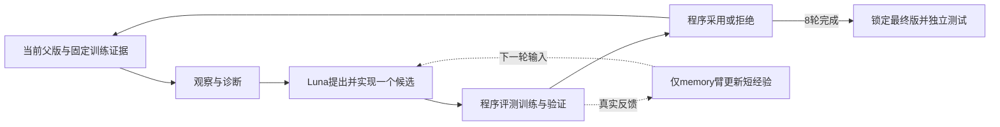

# 四场景 × 五条架构路线 × 八轮

[English](ARCHITECTURE-PILOT.md) · [交互架构工作台](../site/architecture.html) · [八条宏观方案](ARCHITECTURE-LAB.zh-CN.md)

**目的：用小规模对照，筛选值得继续投入的架构改动。** 本轮只改变循环中的一个主要模块；共同基线加四条改进路线，共20组、160个候选决定。协议准备完成；实际启动、进度与结果以运行记录为准。

## 共同流程

阶段由程序驱动，Luna负责诊断与候选代码。所有路线使用相同执行器、评分、工具权限和起点。每轮只实现、评测一个候选，保留拒绝记录；没有互补Archive，也不扩展工具权限。

## 五条路线，只改一处

| 运行标识 | 对应方案／模块 | 相对共同基线的唯一主要改动 | 想验证什么 |
|---|---|---|---|
| `base` | 共同基线 | 单链、单候选；训练严格成功提高且改动实际生效才采用 | 八轮下的基本进化能力 |
| `evidence` | H／观察与诊断 | 相同材料预算下，从随机失败／成功样例改为按可观测失败特征组织证据 | 问题交得更清楚，能否提高目标修复与跨题覆盖 |
| `mechanism` | B／候选设计与实现 | 同一证据先提出两个简短、不同的修复机制，再选一个实现 | 明确机制选择，能否减少同类无效改动 |
| `validation` | A／评测与选择 | 在基线采用条件上，增加独立验证严格成功率不退步 | 是否能减少训练涨分但开发表现退化的采用 |
| `memory` | C／经验与归档 | 同一优化器根据上一轮真实反馈维护短条件经验，再生成下一候选 | 经验能否改变后续决策，减少重复失败 |

`evidence` 的分组依据是可观测特征，不是已知真实原因。`mechanism` 的两份提案不会变成每轮两次评测。`memory`不增加教师模型；基线也获得简短实际反馈，区别在于是否显式维护有条件的经验。最后一轮结束仅保存反馈，不冒称它已影响下一轮。

## 固定配置

| 项目 | 本轮设置 |
|---|---|
| 场景 | ALFWorld、DBBench、WebShop、OSBench；不含Telecom |
| 优化器 | `gpt-6-luna`，`high`推理强度 |
| 做题模型 | `Qwen3-4B-Instruct-2507`；沿用各场景原生采样与任务预算 |
| 起点 | H0空增强插件；同协议基线共用，保留来源 |
| 训练 | 每场景固定100题，每轮完整评测，不轮换 |
| 验证 | 每场景固定60题，来自既有训练池剩余任务；与本轮100题训练及测试不重叠 |
| 候选预算 | 每组8个新候选；20组共160个采用／拒绝决定 |
| 证据预算 | 最多8条失败＋4条成功对照，证据包统一24,000字符上限；样例不足时按实际数量记录 |
| 最终测试 | ALFWorld 109题、DBBench 300题、WebShop 200题、OSBench 144题；各3遍 |

所有路线都评测相同验证集，保证候选评测工作量可比；只有`validation`路线用验证聚合分决定采用。验证轨迹不提供给优化器，其余路线的验证结果仅供后续分析。最终测试在8轮结束、检查点锁定之后进行，不测中间版本，也不据测试成绩重新选版。

本轮五条路线的数据完全相同，但不是旧固定100题实验的原样续跑：本轮统一增加了60题验证观测。数据配比、强起点、工具扩展和平台期自适应预算，留给其他架构对照，不在这次同时改变。

## 看哪些结果

首先看每场景的最终测试相对H0增益，并同时查看训练／验证曲线、采用率、目标修复与新增退步。其次看提案是否产生不同机制、经验是否改变下一轮动作，以及额外分析是否值得其成本。只统计实际发生的阶段，计划文件、进程存活或插件加载都不能代替有效执行。

**完成标准：160个候选决定＋20份完整最终测试。** 基础设施失败不计作任务零分；保留有效场次，只补缺失或无效评测。已有正常任务失败不通过反复重测挑高分。

各路线候选数和规定评测场次一致，但模型Token、工具调用、耗时不保证相等，记录实际用量。每组只有一次独立搜索，最终检查点的三遍测试不是三次搜索。已有测试任务曾用于历史结果观察，因此这轮是探索性架构筛选，不作为全新盲测或SOTA确认。

当前启动状态：共享验证基线已派发；新的20组优化器因最新实际请求出现routing/network错误，等待模型连接恢复。原生启动门每30分钟最多检查一次；明确额度错误熔断，不连续重试。恢复后仍只执行本协议20组、每组8轮。

[实际控制器源码](../evolution/reference/luna8-architecture/runtime.py)已公开；原生场景依赖和部署配置仍需对应实验环境，尚未完成正式模型端到端验证。
