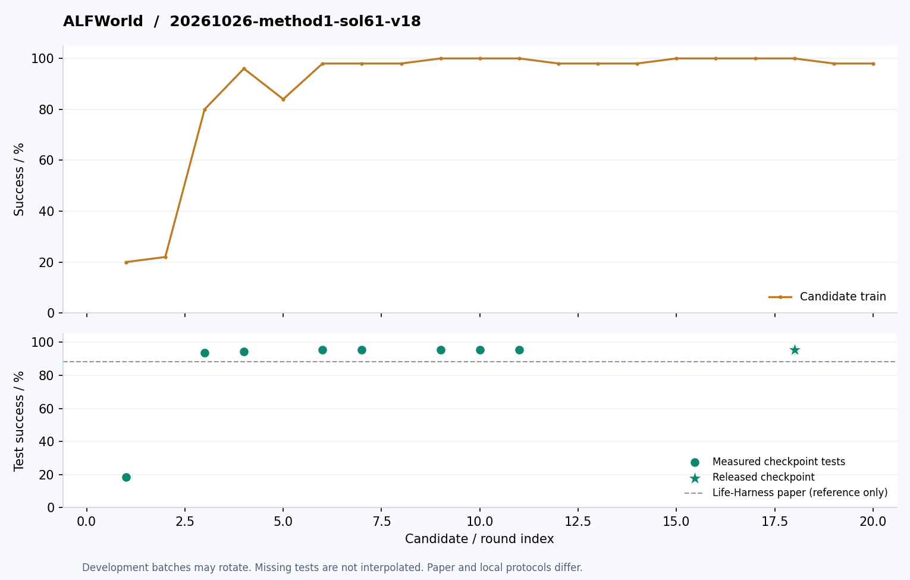
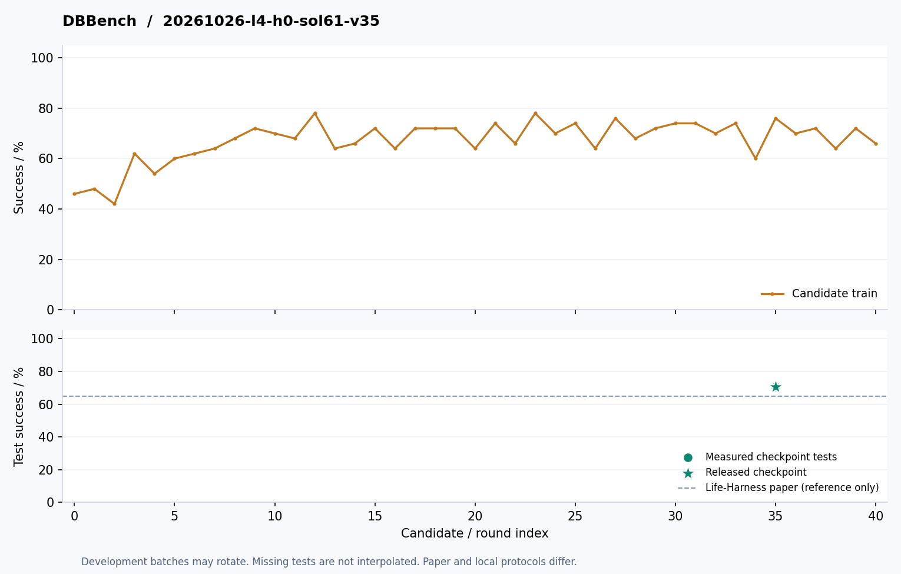

# Evolution curves

Recorded development scores and measured test checkpoints for the current published artifacts. Unmeasured test points are left empty.

## ALFWorld

[20261026-method1-sol61-v18 — architecture and plugins](../harnesses/alfworld/20261026-method1-sol61-v18)

## DBBench

[20261026-l4-h0-sol61-v35 — architecture and plugins](../harnesses/dbbench/20261026-l4-h0-sol61-v35)

## WebShop

[20261026-l5-h0-sol61-v28 — architecture and plugins](../harnesses/webshop/20261026-l5-h0-sol61-v28)

## OSBench

[20261026-l4-h0-sol61-v17 — architecture and plugins](../harnesses/osbench/20261026-l4-h0-sol61-v17)

## τ²-Telecom

[20261026-start-luna-repaired-v06 — architecture and plugins](../harnesses/telecom/20261026-start-luna-repaired-v06)

