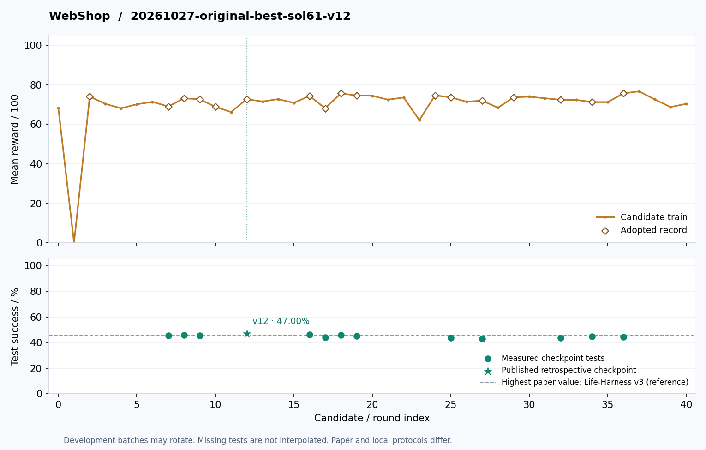
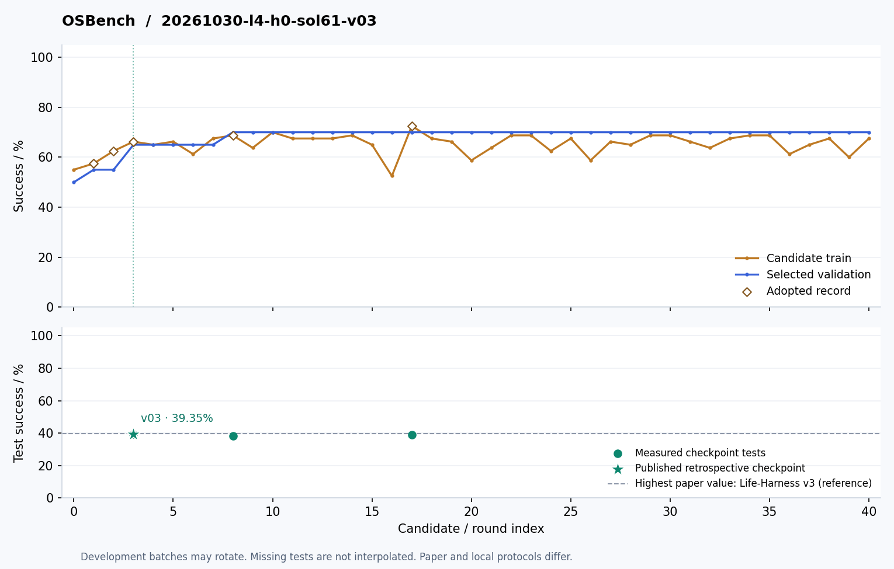

# 进化曲线

[**按方法、模型和场景查看全部进化曲线**](https://huangshengzebluesky.github.io/dsh-harness-evolution/)。开发分数、原最终测试与回溯补测单独显示；可导出当前曲线。

[English](CURVES.md) | **简体中文**

只展示真实记录的开发成绩与测试点；未测检查点不补画测试分数。

## ALFWorld

[检查点 v18：源码与框图](../harnesses/alfworld/20261026-method1-sol61-v18/README.zh-CN.md)

## DBBench

[检查点 v35：源码与框图](../harnesses/dbbench/20261026-l4-h0-sol61-v35/README.zh-CN.md)

## WebShop

[检查点 v12：源码与框图](../harnesses/webshop/20261027-original-best-sol61-v12/README.zh-CN.md)

## OSBench

[检查点 v03：源码与框图](../harnesses/osbench/20261030-l4-h0-sol61-v03/README.zh-CN.md)

## τ²-Telecom

[检查点 v06：源码与框图](../harnesses/telecom/20261026-start-luna-repaired-v06/README.zh-CN.md)

