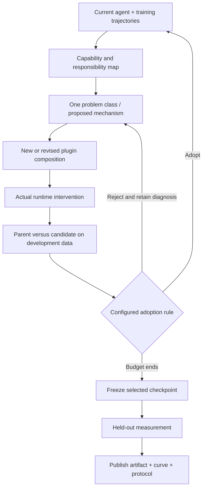

# Method overview

We evolve the runtime harness around a frozen actor using DSH's native plugin system. A plugin can provide a procedure, maintain episode state, clarify tool descriptions, check a proposed action, annotate real receipts, or guide recovery. The intervention should have an explicit responsibility and a reason grounded in observed failures.

**One problem class, one explicit responsibility.** This is a design principle, not a requirement to create exactly one source file per failure or to forbid cooperation. Several plugins may cooperate; redundant or conflicting guidance can be removed. More plugins is not itself progress.

## Evolution loop

1. Inspect training failures and the current agent's structure.
2. Maintain a concise map of enabled plugins, responsibilities, supported capabilities, overlaps, and gaps.
3. Propose a mechanism for a recurring problem class before implementing it.
4. Implement the change as native DSH hooks; keep the actor and benchmark scoring fixed.
5. Evaluate the candidate against its parent under the configured development protocol. A loaded module alone does not establish a behavioral improvement.
6. Adopt or reject, preserve the decision, and repeat. At the budget boundary, freeze the selected checkpoint and evaluate it on the final test protocol.

These steps describe the public workflow, not a disclosure or formal definition of an unpublished paper method.

## What is represented by the first release

| Artifact | Evolution route | Development criterion |
|---|---|---|
| ALFWorld | Free plugin evolution, 20 rounds | Same-batch training improvement; final checkpoint selection is separate from the later standardized test measurement |
| DBBench | L4, capability map and plugin responsibilities, 40 rounds | Same-batch training improvement and actual behavioral change; no separate validation gate in this arm |
| WebShop | L5, benchmark-specific objective, 40 rounds | Strict training success improves, validation strict success does not decline, and the change takes effect |
| OSBench | L4, capability map and plugin responsibilities, 40 rounds | Training improvement, validation non-decrease, and actual behavioral change |
| τ²-Telecom | Original-method continuation from a repaired Luna-derived starting artifact | Training-selected final checkpoint; historical intermediate test measurements exist |

**L4** emphasizes the current-agent map and distinct plugin responsibilities. **L5** changes development objectives and selection procedures for the benchmark; it is a combined scheme comparison, not proof that one isolated change caused the gain. The current public release includes the WebShop L5 artifact; it does not imply L5 wins every benchmark.

The public evidence supports measured released combinations. Per-plugin benefit, transfer to new actors, and broad causal claims require separate experiments.
