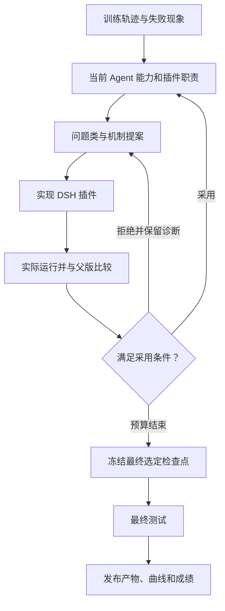

# 方法概览

[English](METHOD.md) | **简体中文**

我们固定做题模型，基于 DSH 原生插件机制进化模型与环境之间的 harness。插件可以维护单场状态、提供流程指导、澄清工具语义、检查动作、解释真实回执或引导恢复。

**一类问题对应明确的插件职责。**这不要求一个问题必须只有一个文件，也不禁止多个插件合作。先维护当前 Agent 的结构、现有插件能力、重叠和缺口，再决定新增、修改或删除什么。

## 公开的迭代流程

L4 重点是能力结构与插件职责管理；L5 结合场景改变目标和采用规则。例如 WebShop 优化严格购买成功，而不是只提高部分奖励。具体门槛按实验记录保留，不能因为某个插件加载了，就认为它已经改变行为或提高成绩。

当前发布的是各实验最终选定版本中的优质产物。选择某个组合发布，不等于已经证明组合内每个插件的独立收益。本仓库仅公开方法概览和产物，不展开未公开的论文细节。

## 和其他方法怎么对照

| 方法 | 主要思路 |
|---|---|
| 裸模型 | 不添加进化后的 harness |
| ALIGN | 生成环境交互接口 |
| AgentSquare | 搜索模块化智能体架构 |
| Meta-Harness | 根据历史代码、分数与轨迹搜索 harness 程序 |
| AHE | 修改 harness 组件文件，评测实际效果是否符合预期 |
| Life-Harness | 围绕交互生命周期的四层结构进化干预 |
| 我们 | 先维护能力与职责，再按问题类进化 DSH 原生插件 |

对照方法的描述和分数来源见 [Life-Harness 论文](https://arxiv.org/html/2605.22166v3)。[完整中英文榜单](../LEADERBOARD.zh-CN.md) 将论文报告与本地实测分列，不把协议不同的数字当成严格公平排名。
