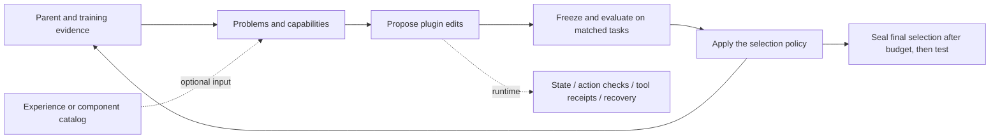

# DSH methods: common foundation, actual changes and findings

[简体中文](METHODS.zh-CN.md) · [Configuration and reproduction](REPRODUCING.md) · [Machine-readable recipes](../results/research-methods.json) · [Research data](../results/research/)

**We evolve executable harnesses between a model and its environment.** The outer optimizer reads training evidence, edits plugins, evaluates and selects. Inside an episode, plugins maintain state, check actions, process real tool receipts and guide recovery. Skills organize responsibilities, Workflows organize experiments, and DSH provides runtime extension points; these are not mutually exclusive actor architectures.

## Findings worth retaining

1. **The useful DSH capability is executable intervention, beyond additional prompting.** State, action checks and bounded recovery expose inspectable intervention points. One Telecom V4 paired test measured 95/120 with the intervention versus 80/120 without it: 15 improvements and no regressions. This supports that plugin under that protocol, not all plugins or the whole search method.
2. **More complex loops are not automatically better.** L4/L5 are strong in the three-benchmark campaigns. L9 leads L7–L9 but does not consistently beat earlier methods. L8 delivered experience across rounds without consistent test gains.
3. **Generation and checkpoint selection both need improvement.** OS L4’s final selection tested at 38.89%, while accepted v03 later tested at 39.35%. The continued Web method selected 44.33%, while retrospective v12 scored 47.00%. This shows selection mismatch; it does not justify selecting final models on test results.
4. **Total gains and explanation accuracy are separate metrics.** Eleven of 40 L6 acceptances repaired none of their planned targets while gaining on other tasks. Such gains may remain useful without supporting the original explanation. The current native records contain another four zero-target-repair acceptances among 75 acceptances across L7–L9, including both L8 variants.
5. **Mechanism feedback shows local promise, not a new best result.** It beat summary feedback on DB, Web and OS in these single searches, but trailed on ALF. Neither raised the previous best levels; Telecom has no final test yet. The next comparison needs matched resources and independent search repetitions.

| New-feedback final tests | DBBench | WebShop strict success | OSBench | ALFWorld |
|---|---:|---:|---:|---:|
| Summary |55.44%|39.00%|29.40%|95.41%|
| Mechanism |55.78%|42.33%|32.87%|94.50%|

These are one adaptive search per arm per benchmark. ALF uses 109 test episodes; the others use their configured three repeats. Repeating a selected artifact’s test three times is not three independent searches.

**New OS finding: broader coverage did not imply greater repeat consistency.** Mechanism feedback has higher mean strict success but slightly fewer tasks that succeed in all three observed trials. Mean score alone does not establish stability.

| OS feedback | Mean strict success | At least one success in 3 | All 3 successful |
|---|---:|---:|---:|
| Summary |127/432 (29.40%)|47/144 (32.64%)|38/144 (26.39%)|
| Mechanism |142/432 (32.87%)|58/144 (40.28%)|36/144 (25.00%)|

The any/all values are empirical proportions from these three tests, with one search per arm. Source: [native per-run statistics](../results/research/runs.json), run IDs `failure-frontier-fivebench-20261029/experiments/osbench/dsh-summary` and `failure-frontier-fivebench-20261029/experiments/osbench/dsh-mechanism`.

**New code-audit finding: the method name does not define the experiment.** L4 H0 DB/Web use 300 training tasks with no independent validation; corresponding L1-L3/L5 instances use 240 training plus 60 validation; L6 uses 300 training without validation; L7-L9 use 300+60. Publish task identities and partitions alongside method names, rather than presenting successive labels as one-feature ablations.

## One foundation, explicit optional changes

Problem types organize diagnosis; capability maps describe existing responsibilities; experience supplies conditional suggestions; runtime memory retains episode facts; component catalogs supply executable code. Keep these concepts separate. The six-layer review covers reading, attribution, repair mapping, implementation, actual input/control/behavior, and complete outcomes; it is not six mandatory model calls.

**Not every historical method has been unified.** The public entry point provides L1–L9 strategies and profiles for DBBench, WebShop and OSBench. Historical Astra/Luna, cross-domain M1/M2, two-role Telecom and new feedback recipes retain explicit release boundaries. Running the current package is distinct from exactly reproducing a historical campaign.

## Method index

| Method | Change to the foundation | Reproduction status |
|---|---|---|
| M1: coordinated plugin edits | One persistent optimizer edits at least two active plugins per round. | Historical recipe; incomplete port |
| M2: free plugin edits | One persistent optimizer freely adds, edits, removes or combines plugins. | Historical recipe; incomplete port |
| Original Astra: seeded plugin evolution | A persistent session continues from existing V1/V2 capabilities. | Historical recipe; incomplete port |
| Luna: 20 rounds from empty plugins | Evolve 20 candidates from empty plugins in one persistent session. | Historical recipe; incomplete port |
| DSH Playbook: 30 rounds | Give the optimizer explicit hook, state and implementation guidance. | Historical recipe; incomplete port |
| L1: validation gate | Training must improve without development-validation regression. | Public strategy + profiles |
| L2: fixed-subset replay | Protect a preselected subset of training tasks on top of L1. | Public strategy + profiles |
| L3: three retained branches | Manage exploration branches separately from the current champion. | Public strategy + profiles |
| L4: plugin capability map | Explain existing plugin responsibilities before proposing an edit. | Public strategy + profiles |
| L4: seeded continuation | Continue L4 from an earlier training-selected artifact. | Prior artifact required |
| Continue the original method | Extend the search budget while retaining the original method and training-selected start. | Prior artifact required |
| L5: benchmark-specific objectives | Check another DB batch, optimize strict shopping success and validate OS categories. | Public strategy + profiles |
| L6: plan before code | Record trace-backed failure clusters, repair locations and expected behavior before coding. | Public strategy + profiles |
| L7: failure coverage and benchmark validation | Cover all failed-task IDs, inspect representative traces and add benchmark validation. | Public strategy + profiles |
| L8: within-campaign experience | Learn separately after each decision; provide concise experience to the next round. | Public strategy + profiles |
| L8: prior-campaign experience | Summarize prior training campaigns and hold that guidance fixed during a new search. | Prior training material required |
| L9: component selection and assembly | Select prior plugins from current failures and check their interactions. | Prior parts + training required |
| Summary feedback | Guide the next candidate with a concise ordinary summary. | Historical recipe; incomplete port |
| Mechanism feedback | Guide candidates with problem classes, state gaps, alternative explanations and testable repairs. | Historical recipe; incomplete port |
| Historical three-role Skills | Monitoring, attribution and optimization as three outer-loop responsibilities. | Historical context; executor not fully released |
| Historical programmatic Workflow | Program the budgets, stages, freezing, scheduling and promotion. | Historical context; executor not fully released |
| Historical experience and problem types | Organize optimizer knowledge by problem type or conditions. | Historical context; executor not fully released |
| Complementary archive: proposal | Retain executable combinations with complementary capabilities, not only high scores. | Proposal; not implemented |
| Prior-plugin fusion | Start with empty plugins and adapt prior capabilities into combinations. | Historical recipe; incomplete port |
| Startpoint and session variants | Compare empty or seeded plugins and persistent or restarted sessions. | Historical recipe; incomplete port |

[44 final artifacts and runtime diagrams](../research-artifacts/README.md) join to configuration, curves and tests through the same run IDs.

## Reproduction recipes: expand a method

<strong>M1: coordinated plugin edits</strong> · <code>M1_cooperative</code>

**Inputs：** Parent, current-batch training traces, fixed interfaces and progress.

**Editable surface：** Candidate plugins and composition; keep data, scoring, actor and episode budgets fixed.

**Change：** Require at least two substantive changes and a six-layer round review.

**One round:** Evaluate the parent on the current batch; read failures and successful controls → Generate and freeze a candidate; run paired-batch training and configured validation → Check input/control evidence and scores; record acceptance or rejection

**Acceptance rule：** Require a strict same-batch training mean gain and observed input/control use of changed plugins.

**Final selection：** Seal the training/development-selected final checkpoint; use test only for reporting.

**Observations and limits：** Historical method2 / luna_multi maps here. Coordination means plugin coordination, not multiple optimizers. The common runner alone does not reproduce original prompts, starts or environments.

**Code:** [project.py](../evolution/src/astra_evolve/project.py)

<strong>M2: free plugin edits</strong> · <code>M2_free</code>

**Inputs：** The same task batches and baseline as M1, with per-arm training materials isolated.

**Editable surface：** Candidate plugins and composition; keep data, scoring, actor and episode budgets fixed.

**Change：** Remove a plugin-count quota while retaining paired-batch evaluation and use evidence.

**One round:** Evaluate the parent on the current batch; read failures and successful controls → Generate and freeze a candidate; run paired-batch training and configured validation → Check input/control evidence and scores; record acceptance or rejection

**Acceptance rule：** Require a strict same-batch training mean gain and observed use of changed plugins.

**Final selection：** Seal the training/development-selected final checkpoint; use test only for reporting.

**Observations and limits：** Historical method1 / astra_autonomous maps here. Selected Sol artifacts from both routes reached 95.41% on ALFWorld; this does not establish universal superiority.

**Code:** [project.py](../evolution/src/astra_evolve/project.py)

<strong>Original Astra: seeded plugin evolution</strong> · <code>astra_original</code>

**Inputs：** V1/V2 code and training evidence under the Telecom two-role protocol.

**Editable surface：** Candidate plugins and composition; keep data, scoring, actor and episode budgets fixed.

**Change：** Use actual business receipts for bounded action checks and recovery; no fixed plugin quota.

**One round:** Read the current parent and failures → Implement a concrete mechanism → Keep the better parent after full training

**Acceptance rule：** Select the next parent using complete training scores; historical test measurements do not define selection.

**Final selection：** Training selects V4: 174/222; original test 96/120 (80.00%).

**Observations and limits：** This is not an empty-plugin start. A later paired intervention measured 95/120; it is separate from the original 96/120. The public unified entry point does not reconstruct this historical controller.

**Code:** The full historical controller is not released here; no generic command is presented as an exact reproduction.

<strong>Luna: 20 rounds from empty plugins</strong> · <code>luna20</code>

**Inputs：** Empty-plugin start, training traces and the same optimizer session.

**Editable surface：** Candidate plugins and composition; keep data, scoring, actor and episode budgets fixed.

**Change：** Require two substantive active-plugin edits per round and retain the six-layer review.

**One round:** Diagnose and propose coordinated changes → Implement and review the six layers → Run full training, decide and continue the current best

**Acceptance rule：** Continue only after a strict full 74-task × 3 training gain; test does not guide the next round.

**Final selection：** Training selects v14: 115/222 (51.80%); test 56/120 (46.67%).

**Observations and limits：** Model, startpoint and editing constraints all differ from Astra; this is not an isolated model comparison. The historical recipe is not fully ported to the unified entry point.

**Code:** The full historical controller is not released here; no generic command is presented as an exact reproduction.

<strong>DSH Playbook: 30 rounds</strong> · <code>playbook</code>

**Inputs：** Current code, training evidence and DSH guidance; starts include H0 and existing plugins.

**Editable surface：** Candidate plugins and composition; keep data, scoring, actor and episode budgets fixed.

**Change：** Change proposal guidance; the Playbook itself is not a runtime plugin.

**One round:** Evaluate the parent on the current batch; read failures and successful controls → Generate and freeze a candidate; run paired-batch training and configured validation → Check input/control evidence and scores; record acceptance or rejection

**Acceptance rule：** Retain each native campaign’s training adoption rule and configured budget.

**Final selection：** Seal the training/development-selected final checkpoint; use test only for reporting.

**Observations and limits：** Telecom H0 Sol reached 77.50%; an OS branch with large training gains tested at 30.79%. More detailed guidance did not yield consistent cross-benchmark gains; historical prompts are not fully ported.

**Code:** The full historical controller is not released here; no generic command is presented as an exact reproduction.

<strong>L1: validation gate</strong> · <code>L1</code>

**Inputs：** Current champion, training batch and fixed development-validation set.

**Editable surface：** Candidate plugins and composition; keep data, scoring, actor and episode budgets fixed.

**Change：** Add validation non-regression to the paired-batch training gate.

**One round:** Evaluate the parent on the current batch; read failures and successful controls → Generate and freeze a candidate; run paired-batch training and configured validation → Check input/control evidence and scores; record acceptance or rejection

**Acceptance rule：** Parent must be the champion; require training mean gain, non-decreasing validation mean and changed-plugin use.

**Final selection：** Seal the training/development-selected final checkpoint; use test only for reporting.

**Observations and limits：** Repeated use of a small validation set can still overfit; the three-benchmark 40-round campaigns are separate from historical 20-round Telecom runs.

**Selected final tests:** DB 54.33% / Web strict 37.17% / OS 32.64%.

**Code:** [l123.py](../evolution/src/dsh_evolve/loops/l123.py) · [loop_policy.py](../evolution/src/dsh_evolve/loops/loop_policy.py)

<strong>L2: fixed-subset replay</strong> · <code>L2</code>

**Inputs：** L1 inputs plus the tasks selected by replay-ids.json.

**Editable surface：** Candidate plugins and composition; keep data, scoring, actor and episode budgets fixed.

**Change：** Add a mechanism hypothesis and fixed task-subset replay.

**One round:** Evaluate the parent on the current batch; read failures and successful controls → Generate and freeze a candidate; run paired-batch training and configured validation → Check input/control evidence and scores; record acceptance or rejection

**Acceptance rule：** All L1 conditions, plus non-decreasing replay-subset score sum.

**Final selection：** Seal the training/development-selected final checkpoint; use test only for reporting.

**Observations and limits：** The implementation does not dynamically choose only parent-success tasks. Aggregate non-regression can conceal regressions offset by repairs.

**Selected final tests:** DB 61.22% / Web strict 34.17% / OS 28.94%.

**Code:** [l123.py](../evolution/src/dsh_evolve/loops/l123.py) · [loop_policy.py](../evolution/src/dsh_evolve/loops/loop_policy.py)

<strong>L3: three retained branches</strong> · <code>L3</code>

**Inputs：** Branch archive, visit counts, current batch and fixed validation.

**Editable surface：** Candidate plugins and composition; keep data, scoring, actor and episode budgets fixed.

**Change：** Retain up to three high-validation candidates and continue the least-visited branch.

**One round:** Choose the least-visited parent; break ties by higher validation → Execute the common candidate loop → Record archive retention and champion changes separately

**Acceptance rule：** Require observed changed-plugin use and validation at least the archive minimum (or a free slot). Replace the champion only on strict validation improvement.

**Final selection：** Seal the training/development-selected final checkpoint; use test only for reporting.

**Observations and limits：** Archive admission need not improve training. This score-based archive is not the proposed mechanism-complementary archive.

**Selected final tests:** DB 58.56% / Web strict 39.83% / OS 35.88%.

**Code:** [l123.py](../evolution/src/dsh_evolve/loops/l123.py) · [loop_policy.py](../evolution/src/dsh_evolve/loops/loop_policy.py)

<strong>L4: plugin capability map</strong> · <code>L4</code>

**Inputs：** Current source, active plugins and training batch; whether an independent validation set exists is instance-specific.

**Editable surface：** Candidate plugins and composition; keep data, scoring, actor and episode budgets fixed.

**Change：** Maintain capabilities, state, overlap, conflicts and gaps before proposal.

**One round:** Update agent-state.md and proposal.md → Implement the necessary plugin edits → Decide after paired-batch training and validation

**Acceptance rule：** Use the current champion; require training mean gain and observed changed-plugin use. Require validation non-regression only when independent validation is configured.

**Final selection：** Seal the training/development-selected final checkpoint; use test only for reporting.

**Observations and limits：** The strong DB result is not an isolated capability-map ablation. L4 H0 DB/Web use 300 training tasks (6x50) without independent validation; L4 is not universally validation-gated.

**Selected final tests:** DB 70.56% / Web strict 40.83% / OS 38.89%.

**Code:** [l45.py](../evolution/src/dsh_evolve/loops/l45.py)

<strong>L4: seeded continuation</strong> · <code>L4_seeded</code>

**Inputs：** L4 inputs plus the complete specified seed artifact.

**Editable surface：** Candidate plugins and composition; keep data, scoring, actor and episode budgets fixed.

**Change：** Change the startpoint while retaining L4.

**One round:** Update agent-state.md and proposal.md → Implement the necessary plugin edits → Decide after paired-batch training and validation

**Acceptance rule：** Use the L4 gate and the specified prior artifact as baseline.

**Final selection：** Seal the training/development-selected final checkpoint; use test only for reporting.

**Observations and limits：** A stronger start did not consistently improve final tests; initialization must not substitute empty plugins for the required seed.

**Selected final tests:** DB 62.44% / Web strict 42.00% / OS 37.27%.

**Code:** [l45.py](../evolution/src/dsh_evolve/loops/l45.py)

<strong>Continue the original method</strong> · <code>resume</code>

**Inputs：** Prior training-selected artifact, original method definition and subsequent training materials.

**Editable surface：** Candidate plugins and composition; keep data, scoring, actor and episode budgets fixed.

**Change：** Separate seed and extra-budget effects without adding a capability-map requirement.

**One round:** Evaluate the parent on the current batch; read failures and successful controls → Generate and freeze a candidate; run paired-batch training and configured validation → Check input/control evidence and scores; record acceptance or rejection

**Acceptance rule：** Use the corresponding Resume instance’s training/validation gate; do not relabel it L4.

**Final selection：** Seal the training/development-selected final checkpoint; use test only for reporting.

**Observations and limits：** Web final v36 tested at 44.33%; retrospective v12 tested at 47.00%. Keep both measurements and selection roles distinct.

**Selected final tests:** DB 62.22% / Web strict 44.33% / OS 35.65%.

**Code:** [l45.py](../evolution/src/dsh_evolve/loops/l45.py)

<strong>L5: benchmark-specific objectives</strong> · <code>L5</code>

**Inputs：** Capability map, training and validation; an extra DB batch and OS task-family map.

**Editable surface：** Candidate plugins and composition; keep data, scoring, actor and episode budgets fixed.

**Change：** Retain L4 capability review while changing benchmark objectives and gates.

**One round:** Maintain capabilities and the benchmark-specific proposal → Evaluate with the benchmark’s objective and validation logic → Accept only when gates hold; test the final selection after the budget

**Acceptance rule：** DB: L4 plus next-batch non-regression. Web: strict training-success gain and strict-validation non-regression. OS: L4 plus category-macro non-regression.

**Final selection：** Seal the training/development-selected final checkpoint; use test only for reporting.

**Observations and limits：** Relative to L4, L5 DB/Web use 240 training tasks (6x40) plus 60 validation tasks, changing both partitions and gates. A Web candidate may be accepted when mean reward falls but strict success improves.

**Selected final tests:** DB 66.56% / Web strict 44.50% / OS 38.19%.

**Code:** [l45.py](../evolution/src/dsh_evolve/loops/l45.py)

<strong>L6: plan before code</strong> · <code>L6</code>

**Inputs：** Parent training traces, plugin state, failure clusters and successful controls.

**Editable surface：** Candidate plugins and composition; keep data, scoring, actor and episode budgets fixed.

**Change：** Record the proposal before implementation and report paired repairs/regressions.

**One round:** Prepare the candidate and write analysis.json → Record the repair hypothesis with plan, then edit plugins → Evaluate target repairs, global regressions and adoption eligibility

**Acceptance rule：** Require paired-batch strict-success gain, planned edits and observed use/removal evidence; no rule requires a repaired task in the original target cluster.

**Final selection：** Seal the training/development-selected final checkpoint; use test only for reporting.

**Observations and limits：** L6 uses 300 training tasks without independent validation and does not fully inherit L5. Eleven of 40 acceptances repaired none of their planned targets; total gains and explanation accuracy are separate.

**Selected final tests:** DB 56.22% / Web strict 39.83% / OS 29.40%.

**Code:** [l6.py](../evolution/src/dsh_evolve/loops/l6.py)

<strong>L7: failure coverage and benchmark validation</strong> · <code>L7</code>

**Inputs：** L6 inputs plus the full failure index, validation set and benchmark mappings.

**Editable surface：** Candidate plugins and composition; keep data, scoring, actor and episode budgets fixed.

**Change：** Add failure-ID coverage and validation/next-batch/category gates to L6.

**One round:** Assign every failed-task ID to a cluster, allowing unresolved clusters → Execute L6 planning, implementation and evaluation → Apply validation and benchmark-specific gates before deciding

**Acceptance rule：** L6 gates plus strict-validation non-regression; DB next-batch strict success and OS category macro must not regress.

**Final selection：** Seal the training/development-selected final checkpoint; use test only for reporting.

**Observations and limits：** The three benchmarks use 300 training plus 60 validation tasks, unlike the 240+60 L1-L3/L5 setup. ID coverage is not full-trajectory reading, and this is not a one-variable change.

**Selected final tests:** DB 49.67% / Web strict 36.50% / OS 31.71%.

**Code:** [l789.py](../evolution/src/dsh_evolve/loops/l789.py) · [l6.py](../evolution/src/dsh_evolve/loops/l6.py)

<strong>L8: within-campaign experience</strong> · <code>L8_internal</code>

**Inputs：** Prior experience, plan, decision, outcomes and training repair/regression/failure examples.

**Editable surface：** Candidate plugins and composition; keep data, scoring, actor and episode budgets fixed.

**Change：** Add within-campaign experience updates to L7, retaining, revising or deleting prior lessons.

**One round:** Complete the L7 candidate and decision → Use a separate learning call to update at most eight short lessons → Explain applicable, inapplicable or revisable lessons in the next proposal

**Acceptance rule：** Use L7 adoption rules; writing or delivering experience does not make a candidate eligible.

**Final selection：** Seal the training/development-selected final checkpoint; use test only for reporting.

**Observations and limits：** Experience was generated and passed forward for 120 rounds, without consistent test gains. Learning calls add resource cost beyond candidate counts.

**Selected final tests:** DB 43.67% / Web strict 35.50% / OS 30.09%.

**Code:** [l789.py](../evolution/src/dsh_evolve/loops/l789.py) · [learning.py](../evolution/src/dsh_evolve/loops/learning.py) · [INNER_PROMPT.txt](../evolution/prompts/INNER_PROMPT.txt)

<strong>L8: prior-campaign experience</strong> · <code>L8_external</code>

**Inputs：** Prior L4/L5 training material and a fresh empty-plugin start; do not supply test scores to the learner.

**Editable surface：** Candidate plugins and composition; keep data, scoring, actor and episode budgets fixed.

**Change：** Separate prior-campaign knowledge from the current plugin startpoint.

**One round:** Extract and freeze prior-campaign experience → Reuse it through 40 rounds with L7 selection → Summarize the completed campaign for a future run

**Acceptance rule：** Use L7 gates; experience written after completion is for a future campaign and does not alter this result.

**Final selection：** Seal the training/development-selected final checkpoint; use test only for reporting.

**Observations and limits：** Empty plugins do not imply no prior knowledge. Prior campaigns and summarization belong in the resource budget; test results are inconsistent.

**Selected final tests:** DB 60.33% / Web strict 34.33% / OS 32.41%.

**Code:** [l789.py](../evolution/src/dsh_evolve/loops/l789.py) · [learning.py](../evolution/src/dsh_evolve/loops/learning.py) · [OUTER_PROMPT.txt](../evolution/prompts/OUTER_PROMPT.txt)

<strong>L9: component selection and assembly</strong> · <code>L9</code>

**Inputs：** Prior training-selected artifacts and training evidence, plus current failures; do not rank parts by test scores.

**Editable surface：** Candidate plugins and composition; keep data, scoring, actor and episode budgets fixed.

**Change：** Add a catalog of training-selected components, import and compatibility/conflict analysis to L7.

**One round:** Catalog capabilities, shared state and conflicts → Select parts in the repair plan and import them with component → Adapt and evaluate the assembly, then use L7 selection

**Acceptance rule：** Use L7 gates; plan component imports before assembly and evaluate the assembled candidate.

**Final selection：** Seal the training/development-selected final checkpoint; use test only for reporting.

**Observations and limits：** Strongest among L7–L9 but not consistently beyond L4/L5. Components come from prior search, not a resource-free cold start. Inherited import logs are not counts of new unique parts.

**Selected final tests:** DB 67.44% / Web strict 43.33% / OS 38.19%.

**Code:** [l789.py](../evolution/src/dsh_evolve/loops/l789.py) · [learning.py](../evolution/src/dsh_evolve/loops/learning.py)

<strong>Summary feedback</strong> · <code>dsh_summary</code>

**Inputs：** Sample parent training failures and successful controls; both arms share a feedback-length cap and analysis-model settings.

**Editable surface：** Candidate plugins and composition; keep data, scoring, actor and episode budgets fixed.

**Change：** Add training-evidence feedback at the native candidate boundary; record a prediction before candidate execution.

**One round:** Sample training evidence and generate the assigned feedback → Write a candidate and a prospective prediction; run native evaluation → Select under the native rule and compare prediction with outcomes

**Acceptance rule：** Retain the benchmark’s native adoption rule; feedback does not implicitly add L7 validation. Test only the final selection.

**Final selection：** Seal the training/development-selected final checkpoint; use test only for reporting.

**Observations and limits：** Four benchmarks have final tests; Telecom does not yet. Each arm is one adaptive search with diverging parents, not repeated same-parent causal interventions.

**Code:** The full historical controller is not released here; no generic command is presented as an exact reproduction.

<strong>Mechanism feedback</strong> · <code>dsh_mechanism</code>

**Inputs：** Sample parent training failures and successful controls; both arms share a feedback-length cap and analysis-model settings.

**Editable surface：** Candidate plugins and composition; keep data, scoring, actor and episode budgets fixed.

**Change：** Add training-evidence feedback at the native candidate boundary; record a prediction before candidate execution.

**One round:** Sample training evidence and generate the assigned feedback → Write a candidate and a prospective prediction; run native evaluation → Select under the native rule and compare prediction with outcomes

**Acceptance rule：** Retain the benchmark’s native adoption rule; feedback does not implicitly add L7 validation. Test only the final selection.

**Final selection：** Seal the training/development-selected final checkpoint; use test only for reporting.

**Observations and limits：** Four benchmarks have final tests; Telecom does not yet. Each arm is one adaptive search with diverging parents, not repeated same-parent causal interventions.

**Code:** The full historical controller is not released here; no generic command is presented as an exact reproduction.

<strong>Historical three-role Skills</strong> · <code>legacy_skill</code>

**Inputs：** The campaign’s frozen parent, visible training traces and role/experience instructions.

**Editable surface：** The historical instance’s allowed YAML, prompt, tool, memory or harness surfaces; not a unified native-DSH plugin space.

**Change：** Use sessions and Skills to guide evaluation, cluster choice, design and promotion.

**One round:** Read the instance protocol → Execute the assigned roles or programmatic stages → Select under the original rule and report tests separately

**Acceptance rule：** Use the specific campaign’s Target/Full and round-end promotion rules.

**Final selection：** Seal the training/development-selected final checkpoint; use test only for reporting.

**Observations and limits：** Three responsibilities are not three runtime plugins; multiple persistent models are not established as necessary.

**Code:** The full historical controller is not released here; no generic command is presented as an exact reproduction.

<strong>Historical programmatic Workflow</strong> · <code>legacy_workflow</code>

**Inputs：** The campaign’s frozen parent, visible training traces and role/experience instructions.

**Editable surface：** The historical instance’s allowed YAML, prompt, tool, memory or harness surfaces; not a unified native-DSH plugin space.

**Change：** Retain model diagnosis/design while reducing session-level orchestration inconsistencies.

**One round:** Read the instance protocol → Execute the assigned roles or programmatic stages → Select under the original rule and report tests separately

**Acceptance rule：** Keep the original five-round, ten-round and later fifteen-round templates distinct.

**Final selection：** Seal the training/development-selected final checkpoint; use test only for reporting.

**Observations and limits：** The original five-round campaign had no final test; later testing must not be retroactively labeled its final evaluation. YAML authority is an engineering change.

**Code:** The full historical controller is not released here; no generic command is presented as an exact reproduction.

<strong>Historical experience and problem types</strong> · <code>legacy_experience</code>

**Inputs：** The campaign’s frozen parent, visible training traces and role/experience instructions.

**Editable surface：** The historical instance’s allowed YAML, prompt, tool, memory or harness surfaces; not a unified native-DSH plugin space.

**Change：** Includes type-based, six-axis and conditional guidance, plus experience-on/off diagnostics.

**One round:** Read the instance protocol → Execute the assigned roles or programmatic stages → Select under the original rule and report tests separately

**Acceptance rule：** Provide experience only to the specified design/repair stages; distinguish probes, two-task evaluations and full search.

**Final selection：** Seal the training/development-selected final checkpoint; use test only for reporting.

**Observations and limits：** Changed edit preferences and input delivery are not stable behavior gains. Existing comparisons had differing initial evidence; the matched four-arm design was not run.

**Code:** The full historical controller is not released here; no generic command is presented as an exact reproduction.

<strong>Complementary archive: proposal</strong> · <code>archive_proposal</code>

**Inputs：** Proposed inputs: current failures, behavior differences, component combinations and budgets.

**Editable surface：** Candidate plugins and composition; keep data, scoring, actor and episode budgets fixed.

**Change：** Separate champion selection, mechanism explanation and diversity retention.

**One round:** Define complementarity and resource constraints → Compare against matched L3 branch and L9 component baselines

**Acceptance rule：** No new selection algorithm has been implemented and established yet.

**Final selection：** Not run; no final tests.

**Observations and limits：** Renaming the L3 archive does not constitute a new mechanism.

**Code:** The full historical controller is not released here; no generic command is presented as an exact reproduction.

<strong>Prior-plugin fusion</strong> · <code>fusion</code>

**Inputs：** Empty-plugin baseline, prior plugins and visible training evidence.

**Editable surface：** Candidate plugins and composition; keep data, scoring, actor and episode budgets fixed.

**Change：** Provide prior plugins explicitly and test whether reuse improves a new combination.

**Acceptance rule：** Retain the historical full-training adoption rule and record the combination outcome.

**Final selection：** The training-selected ten-round artifact tested at 59.17%; this is not an independent component ablation.

**Observations and limits：** Adding available components does not automatically improve a combination; reuse has prior-information cost.

**One round:** Evaluate the parent on the current batch; read failures and successful controls → Generate and freeze a candidate; run paired-batch training and configured validation → Check input/control evidence and scores; record acceptance or rejection

**Code:** The historical recipe is not fully ported.

<strong>Startpoint and session variants</strong> · <code>startpoint_ablation</code>

**Inputs：** Specified initial artifact, training evidence, model and session protocol.

**Editable surface：** Candidate plugins and composition; keep data, scoring, actor and episode budgets fixed.

**Change：** Vary startpoint or session persistence while retaining the recorded model roles and budgets.

**Acceptance rule：** Use each arm’s original training selection rule; different starts do not form one monotonic evolution curve.

**Final selection：** Keep each training-selected endpoint; mark stopped arms and later tests separately.

**Observations and limits：** Restarted sessions still inherit files and code, so they are not history-free; effects depend on the startpoint.

**One round:** Evaluate the parent on the current batch; read failures and successful controls → Generate and freeze a candidate; run paired-batch training and configured validation → Check input/control evidence and scores; record acceptance or rejection

**Code:** The historical recipe is not fully ported.

## A minimal next direction

Retain L4 responsibility mapping and concrete state/action control; allow reuse of implemented L9 components, with experience optional. Record champion selection, explanation accuracy and complementary capabilities separately, then compare under matched resources. The new archive remains a proposal, not an established algorithm made by combining these parts.

Every curve should resolve to method, startpoint, actor and optimizer, task IDs and seeds, parent candidate, actual selection rule, train/validation scores, test role and missing resource fields. See [statistics and curves](../results/research/) and [reproduction](REPRODUCING.md).
