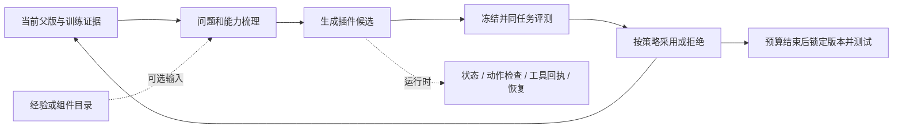

# DSH 方法：共同基础、真实增量与当前判断

[English](METHODS.md) · [配置与复现](REPRODUCING.zh-CN.md) · [结构化方法目录](../results/research-methods.json) · [研究数据](../results/research/)

**我们进化的是模型与环境之间的可执行 Harness。** 外层优化器读训练证据、改插件、评测与选版；内层做题 Agent 通过插件维护状态、检查动作、处理真实工具回执。Skill 管职责，Workflow 管编排，DSH 管运行时扩展；三者不是互相排斥的模型架构。

## 检查后最值得保留的结论

1. **DSH的价值在可执行干预，而不只是增加提示。** 状态、动作检查和有界恢复提供可检查的作用位置。Telecom V4一次配对干预测试为开启95/120、关闭80/120，15项改善、0项退步；这是特定插件、特定协议的证据，没有证明所有插件或整套搜索更强。
2. **更复杂的循环不自动更好。** 三场景主线中L4/L5较强，L9是L7–L9中较好的方案，但没有全面超过旧方法；L8完成经验写入与传递，测试收益仍不稳定。
3. **候选生成与选版都需要改。** OS L4最终版38.89%，已采用的v03补测39.35%；Web原方法续跑最终44.33%，v12补测47.00%。这表明已有产物与当前选择规则存在失配，不代表允许按测试结果重新选最终版。
4. **总收益与解释命中是两个指标。** L6的40次采用中，11次没有修好计划目标，却因其他任务涨分而采用。可保留实际收益，但不能把它写成原假设得到支持。最新原生记录中，L7–L9（包括两种L8）75次采用还有4次目标零修复。
5. **机制反馈有局部积极结果，尚未形成新高点。** 本次单次搜索中，它相对摘要反馈在DB、Web、OS较好，ALF略低；都未抬高旧水位，Telecom还没有最终测试。接下来应比较匹配资源下的独立搜索重复。

| 新反馈最终测试 | DBBench | WebShop严格成功 | OSBench | ALFWorld |
|---|---:|---:|---:|---:|
| 普通摘要 | 55.44% | 39.00% | 29.40% | 95.41% |
| 问题机制 | 55.78% | 42.33% | 32.87% | 94.50% |

这是四个场景各一次自适应搜索；ALF测试109场，其余为原配置的三次重复。不能把同一最终产物的三次测试当成三次独立搜索。

**OS 的新结论：覆盖提高，稳定性未同步提高。** 机制反馈的平均严格成功率更高，但在144道题的三次观测中，“三次全过”反而略低。不能只凭一列平均分说方法更稳定。

| OS 反馈 | 平均严格成功 | 三次中至少成功一次 | 三次全部成功 |
|---|---:|---:|---:|
| 摘要 | 127/432（29.40%） | 47/144（32.64%） | 38/144（26.39%） |
| 问题机制 | 142/432（32.87%） | 58/144（40.28%） | 36/144（25.00%） |

这里的至少一次/全部成功是本批三次测试的观测比例；每臂仅一次搜索。来源为[逐组原生统计](../results/research/runs.json)，run ID分别为`failure-frontier-fivebench-20261029/experiments/osbench/dsh-summary`与`failure-frontier-fivebench-20261029/experiments/osbench/dsh-mechanism`。

**本次代码审查补充：方法名不足以定义实验。** L4 H0的DB/Web为300训练且无独立验证；L1-L3/L5的对应实例为240训练加60验证；L6为300训练无独立验证；L7-L9为300训练加60验证。因此需要同时公开训练任务与验证身份，不能把编号顺序写成仅增加一个功能的严格消融。

## 一个基础，几类增量

问题类型组织诊断，能力图描述现有职责，经验提出有条件的建议，运行时记忆保存本场事实，组件目录提供可执行代码。它们分别记录，避免把“有经验”“有状态”“有插件”混为同一种方法。六层漏斗仅检查阅读覆盖、归因依据、修复对应、代码装配、实际输入/控制/行为与完整结果，不是固定调用六个模型。

**代码并非已经统一所有历史方法。** 本次公共入口提供DBBench、WebShop、OSBench的L1–L9策略与配置；历史Astra/Luna、跨场景M1/M2、Telecom双角色和新反馈方法仍按实际发布范围标记。运行当前包与精确重跑旧实验是两件事。

## 方法速览

| 方法 | 在基础上改什么 | 复现状态 |
|---|---|---|
| 方法一：协同插件修改 | 同一优化会话，每轮协调修改至少两个启用插件。 | 历史配方；未完整移植 |
| 方法二：自由插件修改 | 单一持续会话自由选择新增、修改、删除或组合插件。 | 历史配方；未完整移植 |
| 原始 Astra：已有插件起点 | 持续会话接续已有 V1／V2 能力，自由改插件。 | 历史配方；未完整移植 |
| Luna：空插件二十轮 | 从空插件起点出发，持续会话进化二十个候选。 | 历史配方；未完整移植 |
| DSH Playbook 三十轮 | 给优化器更具体的钩子能力、状态和实现指导。 | 历史配方；未完整移植 |
| L1：验证门槛 | 训练变好，开发验证也不能变差。 | 公共策略与配置 |
| L2：固定子集回放 | 在L1上保护一小组预先选定的训练任务。 | 公共策略与配置 |
| L3：三个分支 | 分开管理可探索分支与当前冠军。 | 公共策略与配置 |
| L4：插件能力结构 | 先说明已有插件各管什么，再提出改动。 | 公共策略与配置 |
| L4：已有最佳起点 | 从旧训练选定产物继续L4。 | 需指定旧产物 |
| 旧方法续跑 | 增加搜索预算，保留旧方法与训练选定起点。 | 需指定旧产物 |
| L5：场景化目标与验证 | 数据库跨批检查、购物严格成功、操作系统按类别验证。 | 公共策略与配置 |
| L6：先计划后编码 | 先写可核对的失败簇、修复位置和预期行为。 | 公共策略与配置 |
| L7：失败覆盖与场景验证 | 检查全部失败索引，深读代表轨迹，恢复场景验证。 | 公共策略与配置 |
| L8：轮内经验 | 每轮决定后独立学习，下一轮读取简短经验。 | 公共策略与配置 |
| L8：外部经验 | 先总结旧训练活动，再固定指导一整次新搜索。 | 需旧训练材料 |
| L9：组件选择与组装 | 从当前失败出发，选择旧插件并检查组合关系。 | 需旧组件和训练材料 |
| 摘要反馈 | 用普通简明摘要指导下一候选。 | 历史配方；未完整移植 |
| 问题机制反馈 | 用问题分类、状态缺口、替代解释和可检验修复指导候选。 | 历史配方；未完整移植 |
| 历史三角色Skill | 监控、归因、优化三个外层职责。 | 历史背景，未完整公开执行器 |
| 历史程序化Workflow | 把预算、阶段、冻结、调度与晋升交给程序。 | 历史背景，未完整公开执行器 |
| 历史经验与问题类型 | 按问题类别或条件组织优化器知识。 | 历史背景，未完整公开执行器 |
| 能力互补Archive：提案 | 保留有互补能力的可执行组合，不只保留高分。 | 提案，未实现 |
| 旧插件融合 | 从空插件起点出发，读取旧能力并改装组合。 | 历史配方；未完整移植 |
| 起点与会话分支 | 比较空插件或已有插件，以及持续或重开会话。 | 历史配方；未完整移植 |

[44个方法最终产物与运行框图](../research-artifacts/README.md)可通过相同run ID对上配置、曲线和测试。

## 可复现配方：按方法展开

<strong>方法一：协同插件修改</strong> · <code>M1_cooperative</code>

**输入：** 父版、同批训练轨迹、既定接口与当前进度。

**可改空间：** 本轮候选的插件与组合；数据、评分、做题模型、任务预算固定。

**增量：** 限制每轮至少两个实质变更，并逐轮记录六层复盘。

**一轮流程：** 在当前批次重新评测父版，读取失败及成功对照 → 生成并冻结候选，运行同批训练与配置要求的验证 → 比较实际输入／控制记录与成绩，记录采用或拒绝

**采用规则：** 同批训练均值严格提高，且修改插件有实际输入或控制记录，才有采用资格。

**最终选择：** 按训练／验证规则锁定最终版，测试仅报告。

**实测与限制：** 磁盘早期 method2／luna_multi 对应本方法；协同指插件协同，不是多个优化器。通用运行器并不自动恢复原二十轮提示、起点和全部环境。

**代码：** [project.py](../evolution/src/astra_evolve/project.py)

<strong>方法二：自由插件修改</strong> · <code>M2_free</code>

**输入：** 与方法一相同的任务批次与基线，逐组隔离训练材料。

**可改空间：** 本轮候选的插件与组合；数据、评分、做题模型、任务预算固定。

**增量：** 不设插件数量配额，保留同批比较及真实使用条件。

**一轮流程：** 在当前批次重新评测父版，读取失败及成功对照 → 生成并冻结候选，运行同批训练与配置要求的验证 → 比较实际输入／控制记录与成绩，记录采用或拒绝

**采用规则：** 同批训练均值严格提高，且变更插件实际进入输入或控制路径。

**最终选择：** 按训练／验证规则锁定最终版，测试仅报告。

**实测与限制：** 磁盘早期 method1／astra_autonomous 对应本方法。两路线ALFWorld的Sol已选版均为95.41%；不能由此推广到所有场景。

**代码：** [project.py](../evolution/src/astra_evolve/project.py)

<strong>原始 Astra：已有插件起点</strong> · <code>astra_original</code>

**输入：** 已有V1／V2代码与训练证据；Telecom双角色运行协议。

**可改空间：** 本轮候选的插件与组合；数据、评分、做题模型、任务预算固定。

**增量：** 真实业务回执驱动有界动作检查与恢复；没有固定插件配额。

**一轮流程：** 读取当前父版与失败 → 选择一个具体机制并实现 → 完整训练后保留更好父版

**采用规则：** 按完整训练成绩选择下一父版；历史测试测量不作为选版规则。

**最终选择：** 训练最终选V4：174/222；原测试96/120（80.00%）。

**实测与限制：** 不是从空插件出发。后来的配对干预测量95/120与原96/120是不同测量；公开统一入口未复刻这套历史控制器。

**代码：** 本次未完整发布该历史控制器；不提供冒充精确复现的通用命令。

<strong>Luna：空插件二十轮</strong> · <code>luna20</code>

**输入：** 空插件起点、训练轨迹、同一优化会话。

**可改空间：** 本轮候选的插件与组合；数据、评分、做题模型、任务预算固定。

**增量：** 每轮至少两个启用插件发生实质变化，并保留六层复盘。

**一轮流程：** 归因及提出协调修改 → 实现并核对六层记录 → 完整训练、采用决定、继续当前最佳

**采用规则：** 完整74题×3训练严格提高才接续；测试不指导下一轮。

**最终选择：** 训练选v14：115/222（51.80%）；测试56/120（46.67%）。

**实测与限制：** 与Astra同时不同模型、起点和编辑约束，不能解释成单独的模型能力差。历史配方尚未完整接入统一入口。

**代码：** 本次未完整发布该历史控制器；不提供冒充精确复现的通用命令。

<strong>DSH Playbook 三十轮</strong> · <code>playbook</code>

**输入：** 当前代码、训练证据、DSH能力指导；起点分H0与已有插件。

**可改空间：** 本轮候选的插件与组合；数据、评分、做题模型、任务预算固定。

**增量：** 改变提案前的指导，不把Playbook当执行时插件。

**一轮流程：** 在当前批次重新评测父版，读取失败及成功对照 → 生成并冻结候选，运行同批训练与配置要求的验证 → 比较实际输入／控制记录与成绩，记录采用或拒绝

**采用规则：** 保留各原生实例训练采用规则，按本实例预算结束。

**最终选择：** 按训练／验证规则锁定最终版，测试仅报告。

**实测与限制：** Telecom H0 Sol为77.50%；OS一个训练大幅上升的分支测试30.79%。指导更详细未带来跨场景一致收益；历史提示尚未全部移植。

**代码：** 本次未完整发布该历史控制器；不提供冒充精确复现的通用命令。

<strong>L1：验证门槛</strong> · <code>L1</code>

**输入：** 当前冠军、训练批次、固定开发验证集。

**可改空间：** 本轮候选的插件与组合；数据、评分、做题模型、任务预算固定。

**增量：** 在同批训练晋升上增加固定验证集非退步条件。

**一轮流程：** 在当前批次重新评测父版，读取失败及成功对照 → 生成并冻结候选，运行同批训练与配置要求的验证 → 比较实际输入／控制记录与成绩，记录采用或拒绝

**采用规则：** 当前冠军为父版；训练均值严格提高、验证均值不降、变更插件实际使用。

**最终选择：** 按训练／验证规则锁定最终版，测试仅报告。

**实测与限制：** 反复使用同一小验证集仍可能过拟合；三场景四十轮，历史Telecom二十轮另列。

**最终测试：** DB 54.33% / Web strict 37.17% / OS 32.64%.

**代码：** [l123.py](../evolution/src/dsh_evolve/loops/l123.py) · [loop_policy.py](../evolution/src/dsh_evolve/loops/loop_policy.py)

<strong>L2：固定子集回放</strong> · <code>L2</code>

**输入：** L1输入，加replay-ids.json所选任务。

**可改空间：** 本轮候选的插件与组合；数据、评分、做题模型、任务预算固定。

**增量：** 增加机制假设及固定任务子集回放。

**一轮流程：** 在当前批次重新评测父版，读取失败及成功对照 → 生成并冻结候选，运行同批训练与配置要求的验证 → 比较实际输入／控制记录与成绩，记录采用或拒绝

**采用规则：** L1全部条件，加回放子集分数总和不下降。

**最终选择：** 按训练／验证规则锁定最终版，测试仅报告。

**实测与限制：** 实际代码并非动态只回放父版成功题；总分非退步仍可由新修复抵消旧退步。

**最终测试：** DB 61.22% / Web strict 34.17% / OS 28.94%.

**代码：** [l123.py](../evolution/src/dsh_evolve/loops/l123.py) · [loop_policy.py](../evolution/src/dsh_evolve/loops/loop_policy.py)

<strong>L3：三个分支</strong> · <code>L3</code>

**输入：** 分支归档、使用次数、当前批次与固定验证。

**可改空间：** 本轮候选的插件与组合；数据、评分、做题模型、任务预算固定。

**增量：** 保留最多三个验证较好的候选，从最少访问分支继续。

**一轮流程：** 选最少访问父版，同次数优先更高验证 → 执行共同候选流程 → 分别记录分支保留和冠军变化

**采用规则：** 变更实际使用且验证不低于归档最低值（未满三项则可入档）；仅验证严格超过冠军才换冠军。

**最终选择：** 按训练／验证规则锁定最终版，测试仅报告。

**实测与限制：** 不要求每次入档都训练提升；已有分支归档不等于按机制互补保留的Archive方案。

**最终测试：** DB 58.56% / Web strict 39.83% / OS 35.88%.

**代码：** [l123.py](../evolution/src/dsh_evolve/loops/l123.py) · [loop_policy.py](../evolution/src/dsh_evolve/loops/loop_policy.py)

<strong>L4：插件能力结构</strong> · <code>L4</code>

**输入：** 当前源码、启用插件、当前训练批次；独立验证是否存在以实例配置为准。

**可改空间：** 本轮候选的插件与组合；数据、评分、做题模型、任务预算固定。

**增量：** 候选生成前维护能力、状态、重叠、冲突和缺口。

**一轮流程：** 维护agent-state.md和proposal.md → 实施最小必要插件改动 → 同批训练和验证后决定

**采用规则：** 当前冠军为父版；训练均值严格提高且变更实际使用。仅在配置了独立验证时才要求其均值不降。

**最终选择：** 按训练／验证规则锁定最终版，测试仅报告。

**实测与限制：** DB结果较强，但不是能力图的独立消融。L4 H0的DB/Web为300训练（6×50），无独立验证；不能概括成L4统一带验证门槛。

**最终测试：** DB 70.56% / Web strict 40.83% / OS 38.89%.

**代码：** [l45.py](../evolution/src/dsh_evolve/loops/l45.py)

<strong>L4：已有最佳起点</strong> · <code>L4_seeded</code>

**输入：** L4输入，加指定起点的完整插件与组合。

**可改空间：** 本轮候选的插件与组合；数据、评分、做题模型、任务预算固定。

**增量：** 改变起点，L4机制不变。

**一轮流程：** 维护agent-state.md和proposal.md → 实施最小必要插件改动 → 同批训练和验证后决定

**采用规则：** 沿用L4门槛；基线必须是指定旧产物。

**最终选择：** 按训练／验证规则锁定最终版，测试仅报告。

**实测与限制：** 高起点未稳定提高最终测试；初始化时不能用空插件偷偷代替旧起点。

**最终测试：** DB 62.44% / Web strict 42.00% / OS 37.27%.

**代码：** [l45.py](../evolution/src/dsh_evolve/loops/l45.py)

<strong>旧方法续跑</strong> · <code>resume</code>

**输入：** 旧训练选定产物、原方法定义与后续训练材料。

**可改空间：** 本轮候选的插件与组合；数据、评分、做题模型、任务预算固定。

**增量：** 区分起点与额外搜索预算，不新增能力图要求。

**一轮流程：** 在当前批次重新评测父版，读取失败及成功对照 → 生成并冻结候选，运行同批训练与配置要求的验证 → 比较实际输入／控制记录与成绩，记录采用或拒绝

**采用规则：** 以对应Resume实例的训练/验证门槛为准；不能自动视作L4。

**最终选择：** 按训练／验证规则锁定最终版，测试仅报告。

**实测与限制：** Web最终v36为44.33%；事后测试v12为47.00%，两者必须分开。

**最终测试：** DB 62.22% / Web strict 44.33% / OS 35.65%.

**代码：** [l45.py](../evolution/src/dsh_evolve/loops/l45.py)

<strong>L5：场景化目标与验证</strong> · <code>L5</code>

**输入：** 当前能力图、训练与验证；DB另读下一批，OS包含任务类别映射。

**可改空间：** 本轮候选的插件与组合；数据、评分、做题模型、任务预算固定。

**增量：** 继承L4能力梳理；调整各场景目标和门槛。

**一轮流程：** 维护能力和场景问题提案 → 按场景评分与验证逻辑评测 → 门槛满足才采用，预算结束后最终测试

**采用规则：** DB：L4加下一批不退步；Web：同批严格成功提高且验证严格成功不降；OS：L4加类别宏平均不降。

**最终选择：** 按训练／验证规则锁定最终版，测试仅报告。

**实测与限制：** 相较L4，L5的DB/Web采用240训练（6×40）加60验证，同时改变了数据划分和门槛。Web平均奖励下降但严格成功提高可以合法采用。

**最终测试：** DB 66.56% / Web strict 44.50% / OS 38.19%.

**代码：** [l45.py](../evolution/src/dsh_evolve/loops/l45.py)

<strong>L6：先计划后编码</strong> · <code>L6</code>

**输入：** 父版训练轨迹、插件状态、失败簇、成功对照。

**可改空间：** 本轮候选的插件与组合；数据、评分、做题模型、任务预算固定。

**增量：** 把提案固定在实现之前，并统计成对修复/回退。

**一轮流程：** 准备候选并写analysis.json → plan冻结修复假设，再改插件 → 评测并核对目标修复、全体回退与采用门槛

**采用规则：** 同批严格成功提高；变更必须在计划内且有实际使用/移除证据；不要求原目标簇至少修好一题。

**最终选择：** 按训练／验证规则锁定最终版，测试仅报告。

**实测与限制：** 没有独立验证，使用300训练；没有完整继承L5。40次采用中11次未修好计划目标，总收益与解释命中必须分开。

**最终测试：** DB 56.22% / Web strict 39.83% / OS 29.40%.

**代码：** [l6.py](../evolution/src/dsh_evolve/loops/l6.py)

<strong>L7：失败覆盖与场景验证</strong> · <code>L7</code>

**输入：** L6输入，加完整失败索引、验证集与场景映射。

**可改空间：** 本轮候选的插件与组合；数据、评分、做题模型、任务预算固定。

**增量：** 在L6上约束失败覆盖，并加验证/下一批/类别宏平均门槛。

**一轮流程：** 所有失败编号归簇，允许未解决簇 → 执行L6计划、实现、评测 → 核对验证和场景门槛后决定

**采用规则：** L6条件加验证严格成功不降；DB下一批严格成功不降；OS类别宏平均不降。

**最终选择：** 按训练／验证规则锁定最终版，测试仅报告。

**实测与限制：** 三场景为300训练加60验证，区别于L1-L3/L5的240加60。编号全覆盖不等于读完每条完整轨迹，也不是单变量变化。

**最终测试：** DB 49.67% / Web strict 36.50% / OS 31.71%.

**代码：** [l789.py](../evolution/src/dsh_evolve/loops/l789.py) · [l6.py](../evolution/src/dsh_evolve/loops/l6.py)

<strong>L8：轮内经验</strong> · <code>L8_internal</code>

**输入：** 上一版经验、计划、决定、实际结果、修复/退步/仍失败的训练例子。

**可改空间：** 本轮候选的插件与组合；数据、评分、做题模型、任务预算固定。

**增量：** 在L7上增加循环内经验更新，可保留、修订或删除旧经验。

**一轮流程：** 按L7完成候选与决定 → 独立学习调用更新至多八条简短经验 → 下一候选说明哪些适用、不适用或需修订

**采用规则：** 采用规则同L7；经验写出或送达不自动赋予采用资格。

**最终选择：** 按训练／验证规则锁定最终版，测试仅报告。

**实测与限制：** 120轮均生成并送入经验，但未稳定提高测试。经验调用增加资源成本，不能只统计候选次数。

**最终测试：** DB 43.67% / Web strict 35.50% / OS 30.09%.

**代码：** [l789.py](../evolution/src/dsh_evolve/loops/l789.py) · [learning.py](../evolution/src/dsh_evolve/loops/learning.py) · [INNER_PROMPT.txt](../evolution/prompts/INNER_PROMPT.txt)

<strong>L8：外部经验</strong> · <code>L8_external</code>

**输入：** 旧L4/L5训练材料与新的空插件起点；不向学习器提供测试分数。

**可改空间：** 本轮候选的插件与组合；数据、评分、做题模型、任务预算固定。

**增量：** 把跨活动经验与本次插件起点分开。

**一轮流程：** 先独立提炼并固定外部经验 → 四十轮候选沿用该经验，按L7选择 → 结束后总结供下次活动的经验

**采用规则：** 采用规则同L7；本次结束后生成的经验只供下次活动，不回改本次结果。

**最终选择：** 按训练／验证规则锁定最终版，测试仅报告。

**实测与限制：** 空插件不等于无先验；旧活动和总结成本必须计入资源比较，测试结果不稳定。

**最终测试：** DB 60.33% / Web strict 34.33% / OS 32.41%.

**代码：** [l789.py](../evolution/src/dsh_evolve/loops/l789.py) · [learning.py](../evolution/src/dsh_evolve/loops/learning.py) · [OUTER_PROMPT.txt](../evolution/prompts/OUTER_PROMPT.txt)

<strong>L9：组件选择与组装</strong> · <code>L9</code>

**输入：** 旧训练选定产物和训练证据、当前失败；不使用组件测试分数排序。

**可改空间：** 本轮候选的插件与组合；数据、评分、做题模型、任务预算固定。

**增量：** 在L7上加入训练选定组件目录、导入、兼容与冲突分析。

**一轮流程：** 建立能力、共享状态与冲突目录 → 在修复计划中选组件并调用component导入 → 适配组合后评测，按L7决定

**采用规则：** 采用规则同L7；组件导入前先列入修复计划，组装仍需实际评测。

**最终选择：** 按训练／验证规则锁定最终版，测试仅报告。

**实测与限制：** L7—L9中较强但未全面超过L4/L5；组件来自旧搜索，资源不等于冷启动。继承的导入记录不等于新增独立组件数。

**最终测试：** DB 67.44% / Web strict 43.33% / OS 38.19%.

**代码：** [l789.py](../evolution/src/dsh_evolve/loops/l789.py) · [learning.py](../evolution/src/dsh_evolve/loops/learning.py)

<strong>摘要反馈</strong> · <code>dsh_summary</code>

**输入：** 父版训练中抽取失败与成功对照；两臂共用反馈长度上限和分析模型设置。

**可改空间：** 本轮候选的插件与组合；数据、评分、做题模型、任务预算固定。

**增量：** 在原生候选边界增加训练证据反馈；候选执行前记录预测。

**一轮流程：** 抽取训练证据并产生指定反馈 → 写候选与事前预测，运行原生评测 → 按原生规则选择，再核对预测

**采用规则：** 继承本场景原生采用规则，不把新反馈自动视为L7验证门槛；测试仅最终报告。

**最终选择：** 按训练／验证规则锁定最终版，测试仅报告。

**实测与限制：** 四场景已终测；Telecom仍无最终测试。每臂一次自适应搜索，后续父版自然分化，不是每轮固定同父版因果干预。

**代码：** 本次未完整发布该历史控制器；不提供冒充精确复现的通用命令。

<strong>问题机制反馈</strong> · <code>dsh_mechanism</code>

**输入：** 父版训练中抽取失败与成功对照；两臂共用反馈长度上限和分析模型设置。

**可改空间：** 本轮候选的插件与组合；数据、评分、做题模型、任务预算固定。

**增量：** 在原生候选边界增加训练证据反馈；候选执行前记录预测。

**一轮流程：** 抽取训练证据并产生指定反馈 → 写候选与事前预测，运行原生评测 → 按原生规则选择，再核对预测

**采用规则：** 继承本场景原生采用规则，不把新反馈自动视为L7验证门槛；测试仅最终报告。

**最终选择：** 按训练／验证规则锁定最终版，测试仅报告。

**实测与限制：** 四场景已终测；Telecom仍无最终测试。每臂一次自适应搜索，后续父版自然分化，不是每轮固定同父版因果干预。

**代码：** 本次未完整发布该历史控制器；不提供冒充精确复现的通用命令。

<strong>历史三角色Skill</strong> · <code>legacy_skill</code>

**输入：** 对应活动的冻结父版、可见训练轨迹、角色/经验指令。

**可改空间：** 对应历史实例允许的YAML、提示、工具、记忆或Harness修改面；并非原生DSH插件统一空间。

**增量：** 由会话与Skill指导训练、选簇、候选设计和晋升。

**一轮流程：** 读取本实例协议 → 执行指定角色或程序化阶段 → 按原规则选择并单独报告测试

**采用规则：** 按具体活动Target／Full及轮末晋升规则。

**最终选择：** 按训练／验证规则锁定最终版，测试仅报告。

**实测与限制：** 三职责不等于三个执行插件；不预设多个常驻模型必然更好。

**代码：** 本次未完整发布该历史控制器；不提供冒充精确复现的通用命令。

<strong>历史程序化Workflow</strong> · <code>legacy_workflow</code>

**输入：** 对应活动的冻结父版、可见训练轨迹、角色/经验指令。

**可改空间：** 对应历史实例允许的YAML、提示、工具、记忆或Harness修改面；并非原生DSH插件统一空间。

**增量：** 保留模型诊断/设计，减少会话自行编排的不一致。

**一轮流程：** 读取本实例协议 → 执行指定角色或程序化阶段 → 按原规则选择并单独报告测试

**采用规则：** 原五轮、十轮、后续十五轮模板分别保留；不能混成同一选择规则。

**最终选择：** 按训练／验证规则锁定最终版，测试仅报告。

**实测与限制：** 原五轮未终测，后来补测不能倒写为原活动终测；权威YAML是工程改进。

**代码：** 本次未完整发布该历史控制器；不提供冒充精确复现的通用命令。

<strong>历史经验与问题类型</strong> · <code>legacy_experience</code>

**输入：** 对应活动的冻结父版、可见训练轨迹、角色/经验指令。

**可改空间：** 对应历史实例允许的YAML、提示、工具、记忆或Harness修改面；并非原生DSH插件统一空间。

**增量：** 经历按类型、六维标签、条件式指导及经验开关诊断。

**一轮流程：** 读取本实例协议 → 执行指定角色或程序化阶段 → 按原规则选择并单独报告测试

**采用规则：** 经验只进入指定设计/修复阶段；探针、两题评测与完整搜索分别计量。

**最终选择：** 按训练／验证规则锁定最终版，测试仅报告。

**实测与限制：** 修改偏好变化和输入送达不是稳定行为收益；既有经验对照起点不同，四组严格匹配方案未运行。

**代码：** 本次未完整发布该历史控制器；不提供冒充精确复现的通用命令。

<strong>能力互补Archive：提案</strong> · <code>archive_proposal</code>

**输入：** 拟使用当前失败、行为差异、组件组合与资源预算。

**可改空间：** 本轮候选的插件与组合；数据、评分、做题模型、任务预算固定。

**增量：** 将冠军选择、机制解释与多样性保留分开。

**一轮流程：** 先定义互补性与资源约束 → 再与L3分支和L9组件作匹配比较

**采用规则：** 尚未确定并实现新采用规则；不能报告为已验证算法。

**最终选择：** 未运行，没有最终测试。

**实测与限制：** 不能把L3归档改名就算新增机制。

**代码：** 本次未完整发布该历史控制器；不提供冒充精确复现的通用命令。

<strong>旧插件融合</strong> · <code>fusion</code>

**输入：** 空插件基线、历史插件和可见训练证据。

**可改空间：** 本轮候选的插件与组合；数据、评分、做题模型、任务预算固定。

**增量：** 显式提供历史插件来源，检验复用能否改善新组合。

**采用规则：** 保留该历史活动完整训练晋升规则，记录组合的共同效果。

**最终选择：** 十轮训练选定版测试59.17%；不是独立组件消融。

**实测与限制：** 可用组件相加不自动产生更强组合；复用具有历史信息成本。

**一轮流程：** 在当前批次重新评测父版，读取失败及成功对照 → 生成并冻结候选，运行同批训练与配置要求的验证 → 比较实际输入／控制记录与成绩，记录采用或拒绝

**代码：** 历史配方未完整移植。

<strong>起点与会话分支</strong> · <code>startpoint_ablation</code>

**输入：** 指定初始产物、训练证据、模型与会话协议。

**可改空间：** 本轮候选的插件与组合；数据、评分、做题模型、任务预算固定。

**增量：** 分别变化起点或会话保留方式，保留原角色模型及预算。

**采用规则：** 使用每个分支原有训练选择规则；不同起点不共享同一纵向单调曲线。

**最终选择：** 保留各分支按训练选择的终点，单列中途停止与后补测试。

**实测与限制：** 会话重开仍继承文件和代码，不等于没有历史知识；效应随起点变化。

**一轮流程：** 在当前批次重新评测父版，读取失败及成功对照 → 生成并冻结候选，运行同批训练与配置要求的验证 → 比较实际输入／控制记录与成绩，记录采用或拒绝

**代码：** 历史配方未完整移植。

## 下一步的最小方法方向

保留L4能力职责与具体的状态/动作控制，允许从L9组件中复用已经实现的能力；经验保持可开关。把冠军选择、解释命中和互补能力保留分开记录，再做同资源对照。新Archive仍是方案，不把上述组合直接称为已验证的新算法。

每条曲线应能定位：方法编号、起点、做题与优化模型、任务编号与种子、候选父版、实际采用规则、训练/验证成绩、测试角色及资源缺失项。见[统计与曲线数据](../results/research/)与[复现说明](REPRODUCING.zh-CN.md)。
