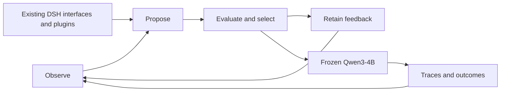

# Core method: expand editable scope and reuse DSH

[中文](SCALING-METHOD.zh-CN.md) · [Curves and leaderboard](https://huangshengzebluesky.github.io/dsh-harness-evolution/?lang=en)

## Motivation
Prompts, skills, tools and full harnesses define different editable spaces. Can more capable optimizers discover more complex reusable mechanisms and improve unseen tasks? DSH supplies existing runtime/plugin interfaces to reduce infrastructure reinvention.

## Method
Freeze the Qwen3-4B executor. L4 first describes current capabilities, plugin responsibilities, state and unresolved problems. An external improver reads training traces, proposes a mechanism and implements a candidate through DSH. Coherent multi-plugin changes are allowed; unrelated edits should not be bundled. Freeze, evaluate and select according to the campaign’s recorded protocol, then retain training feedback.

This is not a forced prompt-to-code curriculum. Editable scope, mechanism complexity and behavioral reach are distinct; a complex conditional mechanism can have narrower effects than a global prompt.

## Findings
Historical L4/L5 artifacts remain strong. The shared fixed-set study includes Luna, Sol 5.6, Terra 6.1 and Sol 6.1 at high/medium effort. Outcomes vary by task rather than yield a universal monotonic ranking. Capability-enabled use of larger spaces is a central hypothesis, not emergence proven by model names, score peaks or code size.

## Bottlenecks
Coverage, selection bias, regression and dependencies on the startpoint/conversation can limit progress. Independent benefits from DSH reuse and capability descriptions need corresponding controls. Life-Harness, AHE and HarnessOpt already edit broad harness mechanisms; editing code alone is not a first-of-its-kind claim.

## Data and reproduction
The five-benchmark historical portfolio combines different methods/protocols. Decisions, configurations, task IDs, measured tests and token records remain identifiable. Missing is not zero. Input includes cached input; output includes reasoning. Experience calls and inherited search costs are separate. See [metrics](METRICS.md), [reproduction](REPRODUCING.md).
