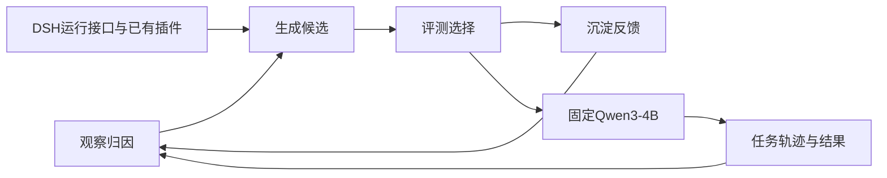

# 核心方法：扩展Harness修改空间，复用DSH底座

**English:** [Method](SCALING-METHOD.md) · [交互曲线与榜单](https://huangshengzebluesky.github.io/dsh-harness-evolution/)

## Motivation
提示、Skill与工具到完整Harness，是不同的可修改空间。优化模型变强后，能否生成更复杂、可复用的机制，并获得未参与选版任务上的收益？DSH提供成熟运行与插件接口，目的是减少重造框架的负担。

## Method
固定Qwen3-4B做题权重。L4先梳理当前Agent能力、插件职责、已有状态与问题，再让外部improver读取训练轨迹，提出机制假设，复用DSH接口实现候选。允许一个机制跨多个插件协同，但不混入无关优化。候选冻结后按原协议评测、选择，训练反馈进入下一轮。

这不是每轮强制按“提示→Skill→工具→代码”升级的课程。可修改范围、机制复杂度与行为影响范围要分开。一个复杂但条件明确的机制，可能比一条全局提示影响更窄。

## 结论
历史L4／L5产物仍较强。共同固定集实验已覆盖Luna、Sol 5.6、Terra 6.1、Sol 6.1的high／medium；模型差异随场景变化，不支持所有场景单调排名。能力提升后利用更大修改空间，是核心待验证解释，不能仅凭高分、代码量或模型名称宣布涌现。

## Bottleneck
训练覆盖与选择偏差、修改误伤、起点与优化器会话的依赖，都可能限制进化。DSH复用和能力梳理的独立收益，需要相应对照；完整Harness修改已有Life-Harness、AHE与HarnessOpt等相关工作，不把“改代码”本身当成首次提出的贡献。

## 数据与复现
历史五场景成绩是不同方法与协议的产物合集。公开逐轮决定、配置、任务编号、已测测试点和Token，缺失不填零。优化成本区分输入、缓存输入、输出及独立经验调用，保留继承成本边界。参见[指标](METRICS.zh-CN.md)、[逐方法复现](REPRODUCING.zh-CN.md)。
