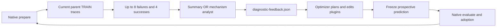

# Summary versus mechanism feedback — native integration reference

**This is source from the later feedback study, not a new `dsh-evolve` strategy.** It has not been validated as a portable end-to-end installation. The core advice/prediction logic, prompts and native host entrypoints are included so the method is inspectable; no original private filesystem or model endpoint is required by the source.

Both arms keep the native start/model/tasks/scorer/adoption rule and 40 candidate rounds. The analyst is `gpt-6-luna`, high; the optimizer is `gpt-6.1-sol`, high. The complete feedback response has the same 16,000-character cap in both conditions. The mechanism arm asks for evidence, a state/capability gap, alternatives and a testable repair; the summary arm asks for ordinary concise observations. Subsequent parents may diverge, so this is not a fixed-parent paired intervention for every later round. Analyst cost is additional, not included in the candidate count.

| Source | What it does |
|---|---|
| `online_feedback.py` | Samples only the current parent training batch, writes feedback after prepare, freezes predictions before native evaluation |
| `semantic_worker.py` | Exact analyst prompts, response accounting and the original Linux filesystem isolation scheme |
| `analysis_protocol.json` | Sampling seed, taxonomy, evidence fields, response cap and prediction interpretation |
| `adapters.py` | Normalizes native and two-role Telecom observations |
| `hosts/native_experiment.py` | The actual common four-scene native repair-plan host; it differs from later L7 gates |
| `hosts/telecom_native_experiment.py`, `telecom_campaign.py` | Telecom-specific prepare, evidence, plan and selection; requires its original Tau2 bridge/baseline resources |
| `prompts/` | Ten recorded optimizer instructions; machine-specific Python paths replaced by `python` |
| `observe.py`, `prediction_outcomes.py` | Native observations and prediction/outcome accounting; observation phases are proxies, not causal labels |

The historical host library is not automatically interchangeable with the packaged common runtime. To reconstruct the original study, match the published run configuration/task identity and supply the corresponding native host, environment, baseline and scorer. The public results distinguish final tests from ongoing groups. See [research records](../../../results/research/) and [reproduction scope](../../../docs/REPRODUCING.md).

## Explicit local configuration

Work in a **new** directory. Set `DSH_FEEDBACK_ROOT` to that study directory; copy `analysis_protocol.json` and an adapted `manifest.example.json` there as `manifest.json`. Its paths are relative to the study root, and only the listed two feedback methods are dispatched. `frontier.feedback` in each experiment YAML is `summary` or `mechanism`.

The analyst reference requires Linux `unshare`, mount namespaces, `chroot`, and a compatible standalone Codex binary with its adjacent `codex-code-mode-host`. Set `DSH_ANALYST_CODEX_BIN` to the executable and `DSH_ANALYST_HOME` to your own authenticated CLI home; **credentials are runtime resources and are not included in this repository**. Copy `runtime/isolated_cli.sh` into the study runtime directory. Proxy settings, if needed, are inherited explicitly from the invoking environment. Do not use this Linux isolation reference unchanged on macOS.

A group wrapper imports `online_feedback.main`; its separate `native_experiment.py` owns the original scoring/adoption behavior. For Telecom, the host files are installed as `native_experiment.py` and `campaign.py`; the original per-candidate Tau2 bridge and baseline train results are additional required inputs. `DSH_NODE` selects Node; the old optional H0 test summary reference is `DSH_TELECOM_H0_TEST`, which is reporting-only and must never be given to the optimizer.

This release changes deployment paths and removes unused historical inventory scans; it does not claim to have rerun the analyst sandbox, full native hosts or the new study. Missing setup inputs must stay explicit rather than silently falling back to a different model, task set or gate.
