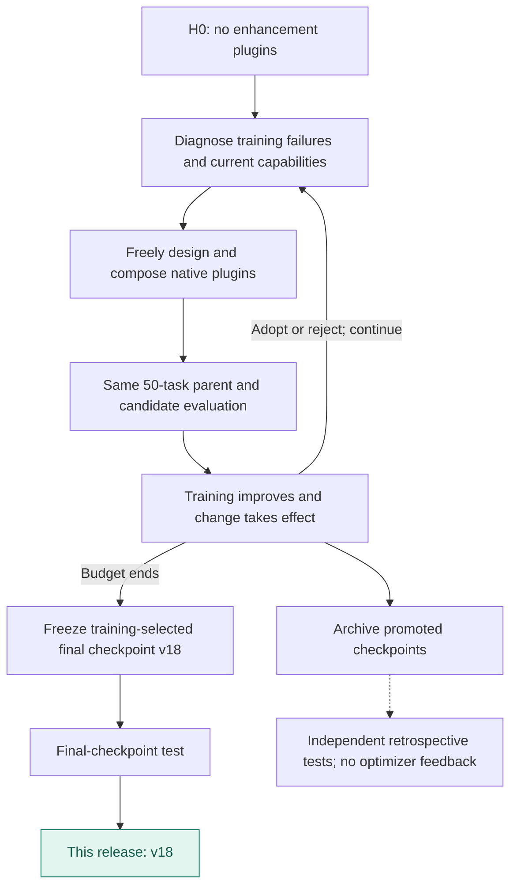
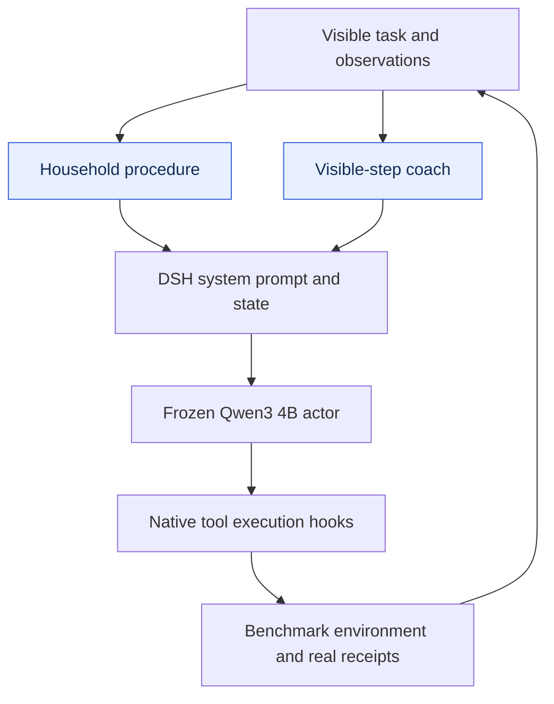

# ALFWorld · v18

**English** | [简体中文](README.zh-CN.md)

Two native plugins combine household procedures with a coach driven by visible observations. The released final checkpoint was re-evaluated on 109 tasks × 3 repeats.

**Release basis: Training-selected final checkpoint**.

| Test success | Published checkpoint | Plugin registrations | Test coverage |
|---:|---|---:|---|
| **95.41%** | **v18** / 20 rounds | 2 | 109 tasks × 3 repeats |

[**Plugin source**](plugins) · [**Method flow**](#method-flow) · [**Architecture**](#architecture) · [**Evolution curve**](#evolution) · [**Run**](#load-this-artifact) · [**All harnesses**](../../../README.md#choose-a-harness)

Actor: **Qwen3-4B-Instruct-2507** · Optimizer: **Sol 6.1 high** · Method: **Method 2 · Free plugin evolution**.

## Method flow



## Architecture



Arrows show runtime responsibilities, not independent causal gains.

## Evolution


[Machine-readable curve](curve.json) · [Evaluation protocol](protocol.json) · [Composition](composition.json)

Diamonds mark adoption records; the vertical line marks the released checkpoint. Training batches can rotate. Test dots represent actual measurements only.

## Plugin inventory

| Module | Responsibility |
|---|---|
| [household-procedure.mjs](plugins/household-procedure.mjs) | Household task procedure guidance: inspect, retrieve, transform, and place. |
| [visible-step-coach.mjs](plugins/visible-step-coach.mjs) | Step guidance grounded in currently visible scene and action feedback. |

## Load this artifact

```bash
MODEL_BASE_URL=http://localhost:8000/v1 node tools/serve.mjs harnesses/alfworld/20261026-method1-sol61-v18
```

Run from the repository root after `npm install`. This starts the native DSH bridge. Supply the benchmark environment/executor separately; see [integration instructions](../../../docs/RUNNING.md).

## Evaluation notes

- Paper AgentBench scores use one trial; these results average three trials.
- Equal-score final artifact also exists for the cooperative method; this release uses the free method.

Export changes are limited to portable module paths, selectable listener ports, runtime configuration, and removal of local-path metadata. Reported scores come from the original completed evaluations; the packaged copy has not been scored again.
