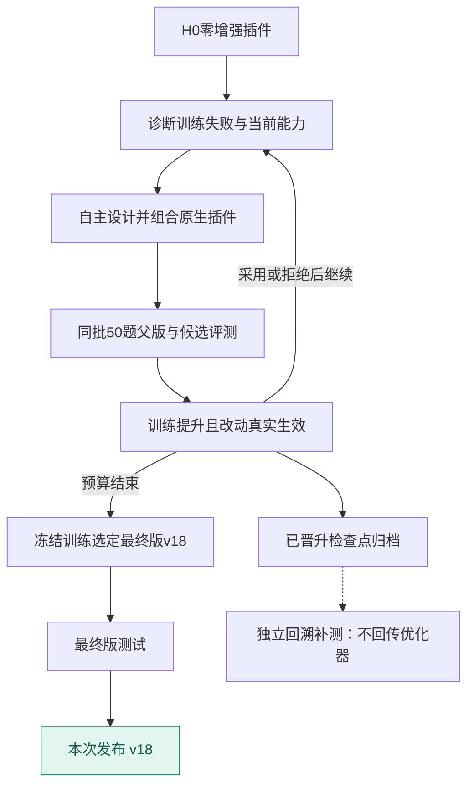
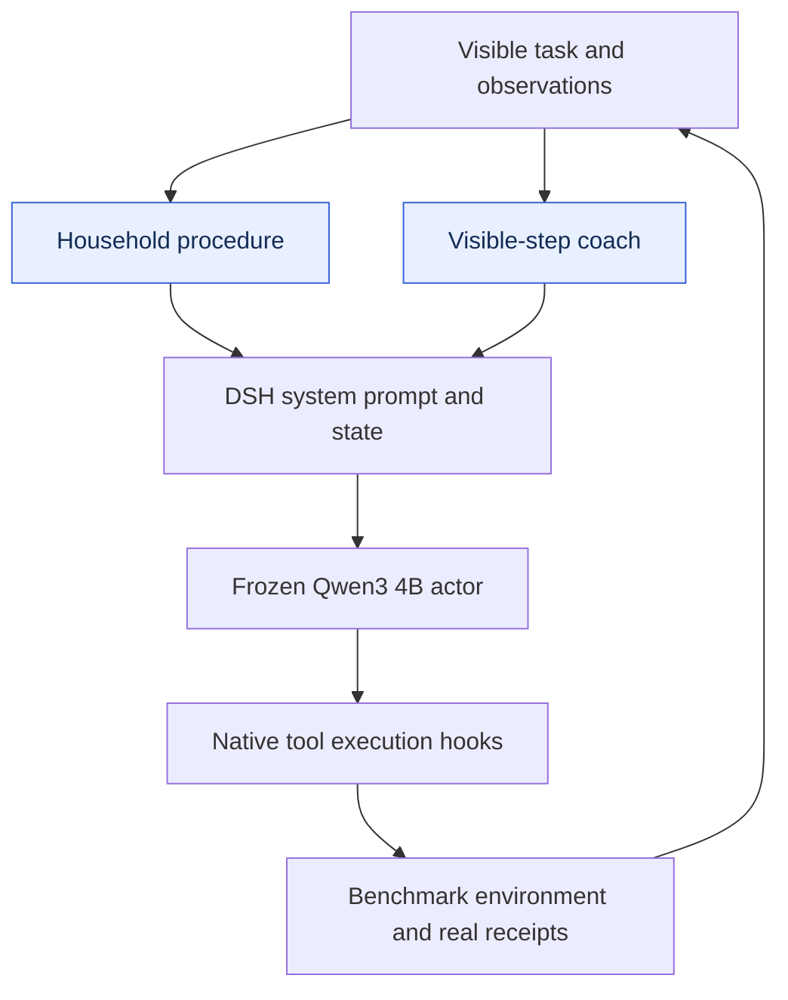

# ALFWorld · v18

[English](README.md) | **简体中文**

**产物说明：**家务任务流程与可见状态指导

**发布依据：**训练选定的最终检查点。

| 测试成功率 | 本次发布检查点 | 插件注册项 | 测试覆盖 |
|---:|---|---:|---|
| **95.41%** | v18 / 20 轮预算 | 2 | 109 题 × 3 遍 |

做题模型：**Qwen3-4B-Instruct-2507**；优化模型：**Sol 6.1 high**；方法：**方法2 · Astra自由方案**。

[**插件源码**](plugins) · [**运行配置**](protocol.json) · [**插件装配**](composition.json) · [**全部产物**](../../../README.zh-CN.md)

## 方法流程图



## 结构框图

下图展示运行时结构和插件职责；模块名保留源码英文名称，便于对应实现。



## 进化曲线


上图为候选训练成绩和已采用版本的验证成绩；下图仅显示实际测过的测试点。训练批次可能轮换，曲线上下波动不等于固定测试集能力下降。WebShop L5 展示严格成功率；原方法协同续跑按平均奖励晋升，开发曲线保留平均奖励。测试排名统一看严格成功率。菱形标记采用记录，竖线标记发布检查点。灰线是论文各方法在该场景报告的最高数值，只作参考。

[曲线数据](curve.json) · [完整插件职责表](README.md#plugin-inventory) · [多方法榜单](../../../LEADERBOARD.zh-CN.md)

## 使用产物

在仓库根目录安装依赖后启动：

```bash
npm install
MODEL_BASE_URL=http://localhost:8000/v1 node tools/serve.mjs harnesses/alfworld/20261026-method1-sol61-v18
```

该命令启动 harness 运行时。基准环境、任务数据和做题模型服务另行提供。[运行说明](../../../docs/RUNNING.zh-CN.md)

## 评测口径

成绩来自原实验的完整有效测试，不是发布后重新评测。发布依据已在页首明确标注；回溯补测发现的候选不会改写原实验最终选择，也不是新的独立盲测。插件数量是实现登记数，不代表每个插件都已单独证明有收益。
