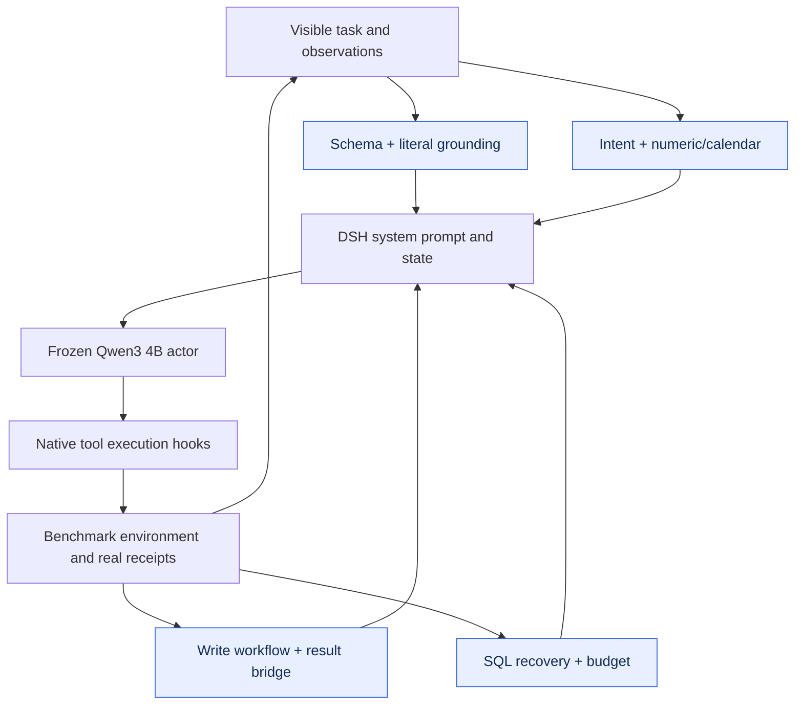

# DBBench · v35

**English** | [简体中文](README.zh-CN.md)

Eight responsibilities coordinate SQL schema/literal grounding, write completion, result submission, recovery, and budget use. L4 maintains the agent capability map before proposing changes.

| Test success | Selected checkpoint | Plugin registrations | Test coverage |
|---:|---|---:|---|
| **70.56%** | **v35** / 40 rounds | 8 | 300 tasks × 3 repeats |

[**Plugin source**](plugins) · [**Architecture**](#architecture) · [**Evolution curve**](#evolution) · [**Run**](#load-this-artifact) · [**All harnesses**](../../../README.md#choose-a-harness)

Actor: **Qwen3-4B-Instruct-2507** · Optimizer: **Sol 6.1 high** · Method: **L4 · Agent capability map**.

## Architecture



Arrows show runtime responsibilities, not independent causal gains.

## Evolution


[Machine-readable curve](curve.json) · [Evaluation protocol](protocol.json) · [Composition](composition.json)

Diamonds mark adoption records; the vertical line marks the released checkpoint. Training batches can rotate. Test dots represent actual measurements only.

## Plugin inventory

| Module | Responsibility |
|---|---|
| [schema-contract.mjs](plugins/schema-contract.mjs) | Exact schema names and bounded SQL identifier checks. |
| [literal-contract.mjs](plugins/literal-contract.mjs) | Ground filter values in observed database literals. |
| [write-workflow.mjs](plugins/write-workflow.mjs) | Track mutation execution and actual completion receipts. |
| [result-bridge.mjs](plugins/result-bridge.mjs) | Align observed result shape with final submission. |
| [sql-recovery.mjs](plugins/sql-recovery.mjs) | Remember SQL errors and guide non-repeating recovery. |
| [budget-conductor.mjs](plugins/budget-conductor.mjs) | Use remaining model-call budget and finish deliberately. |
| [numeric-calendar.mjs](plugins/numeric-calendar.mjs) | Handle numeric/date formats and relevant profiling. |
| [intent-contract.mjs](plugins/intent-contract.mjs) | Translate task intent into operation and direction constraints. |

## Load this artifact

```bash
MODEL_BASE_URL=http://localhost:8000/v1 node tools/serve.mjs harnesses/dbbench/20261026-l4-h0-sol61-v35
```

Run from the repository root after `npm install`. This starts the native DSH bridge. Supply the benchmark environment/executor separately; see [integration instructions](../../../docs/RUNNING.md).

## Evaluation notes

- Paper AgentBench scores use one trial; these results average three trials.

Export changes are limited to portable module paths, selectable listener ports, runtime configuration, and removal of local-path metadata. Reported scores come from the original completed evaluations; the packaged copy has not been scored again.
