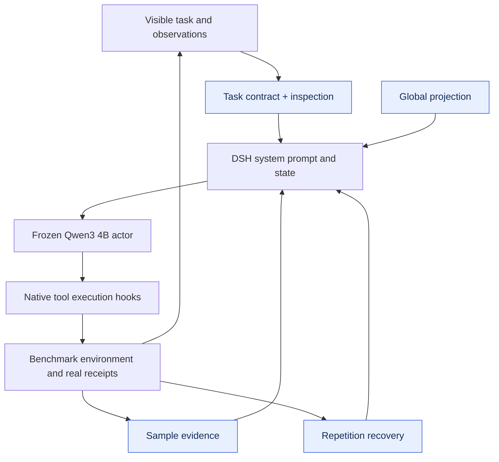

# OSBench · v17

Five plugins structure shell-task interpretation, file inspection, sample evidence, global aggregation, and recovery from repeated commands. The actor and OS task evaluator remain frozen.

| Test success | Selected checkpoint | Plugin registrations | Test coverage |
|---:|---|---:|---|
| **38.89%** | **v17** / 40 rounds | 5 | 144 tasks × 3 repeats |

[**Plugin source**](plugins) · [**Architecture**](#architecture) · [**Evolution curve**](#evolution) · [**Run**](#load-this-artifact) · [**All harnesses**](../../../README.md#choose-a-harness)

Actor: **Qwen3-4B-Instruct-2507** · Optimizer: **Sol 6.1 high** · Method: **L4 · Agent结构与多插件职责**.

## Architecture



Arrows show runtime responsibilities, not independent causal gains.

## Evolution


[Machine-readable curve](curve.json) · [Evaluation protocol](protocol.json) · [Composition](composition.json)

Development curves show recorded candidate scores; rotating batches can cause rises and falls. Test dots represent actual measurements only. WebShop development scores here are mean reward; its published ranking uses strict success.

## Plugin inventory

| Module | Responsibility |
|---|---|
| [inspection-contract.mjs](plugins/inspection-contract.mjs) | Inspect relevant files and schema before committing to a command. |
| [global-projection.mjs](plugins/global-projection.mjs) | Preserve task-wide aggregation and projection semantics. |
| [sample-evidence.mjs](plugins/sample-evidence.mjs) | Use actual sampled contents instead of guessed fields or separators. |
| [task-contract.mjs](plugins/task-contract.mjs) | State target, scope, filtering, and answer requirements. |
| [repetition-recovery.mjs](plugins/repetition-recovery.mjs) | Detect repeated commands and prompt a changed strategy. |

## Load this artifact

```bash
MODEL_BASE_URL=http://localhost:8000/v1 node tools/serve.mjs harnesses/osbench/20261026-l4-h0-sol61-v17
```

Run from the repository root after `npm install`. This starts the native DSH bridge. Supply the benchmark environment/executor separately; see [integration instructions](../../../docs/RUNNING.md).

## Evaluation notes

- Paper AgentBench scores use one trial; these results average three trials.

Export changes are limited to portable module paths, selectable listener ports, runtime configuration, and removal of local-path metadata. Reported scores come from the original completed evaluations; the packaged copy has not been scored again.
