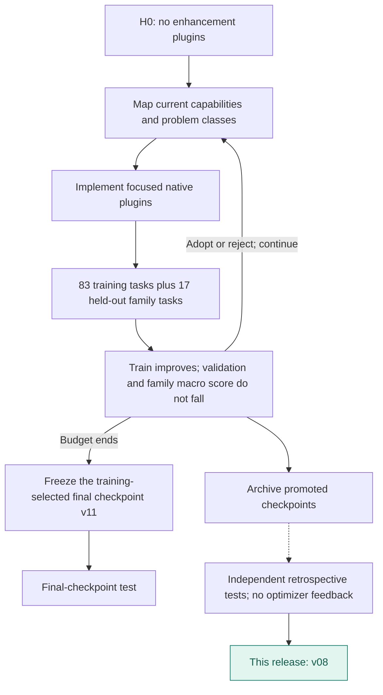
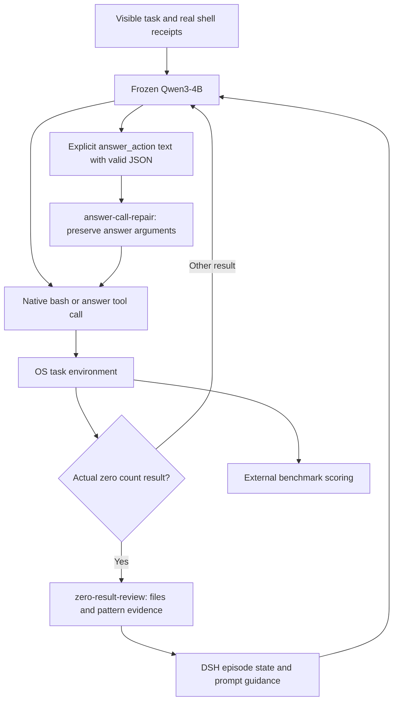
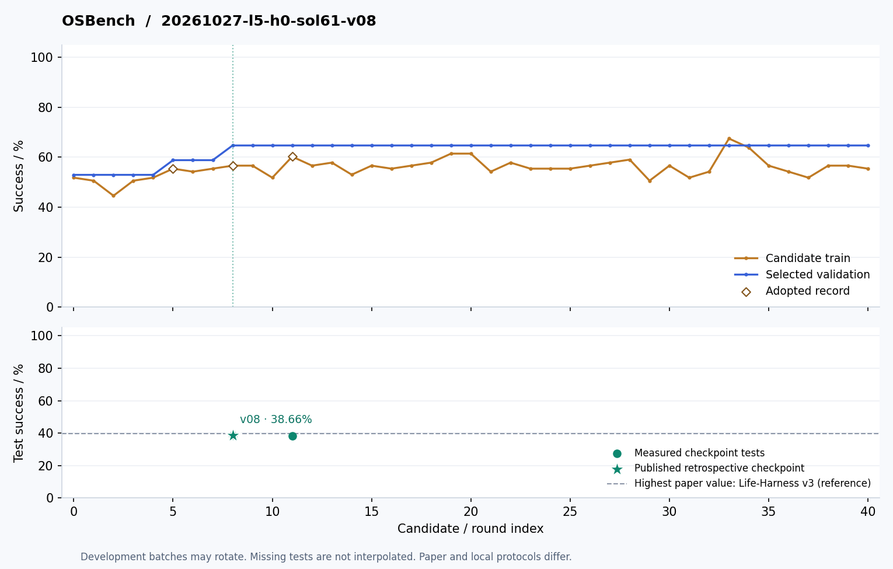

# OSBench · v08

**English** | [简体中文](README.zh-CN.md)

Two focused mechanisms: recover an explicit answer_action directive into a native call, and review zero-valued shell results against real files and patterns. L5 uses held-out task-family validation.

**Release basis: Retrospective test of a promoted checkpoint**. Original training-selected final: **v11**.

| Test success | Published checkpoint | Plugin registrations | Test coverage |
|---:|---|---:|---|
| **38.66%** | **v08** / 40 rounds | 2 | 144 tasks × 3 repeats |

[**Plugin source**](plugins) · [**Method flow**](#method-flow) · [**Architecture**](#architecture) · [**Evolution curve**](#evolution) · [**Run**](#load-this-artifact) · [**All harnesses**](../../../README.md#choose-a-harness)

Actor: **Qwen3-4B-Instruct-2507** · Optimizer: **Sol 6.1 high** · Method: **L5 · Task-family validation**.

## Method flow



## Architecture



Arrows show runtime responsibilities, not independent causal gains.

## Evolution



[Machine-readable curve](curve.json) · [Evaluation protocol](protocol.json) · [Composition](composition.json)

Diamonds mark adoption records; the vertical line marks the released checkpoint. Training batches can rotate. Test dots represent actual measurements only.

## Plugin inventory

| Module | Responsibility |
|---|---|
| [answer-call-repair.mjs](plugins/answer-call-repair.mjs) | Recover an explicit JSON answer_action directive, preserving the original answer arguments. |
| [zero-result-review.mjs](plugins/zero-result-review.mjs) | Trigger targeted file/pattern checks after a real zero result; zero can still be a valid answer. |

## Load this artifact

```bash
MODEL_BASE_URL=http://localhost:8000/v1 node tools/serve.mjs harnesses/osbench/20261027-l5-h0-sol61-v08
```

Run from the repository root after `npm install`. This starts the native DSH bridge. Supply the benchmark environment/executor separately; see [integration instructions](../../../docs/RUNNING.md).

## Evaluation notes

- Published from an adopted checkpoint with a complete retrospective test. Selected for publication using already observed test scores; not a fresh confirmatory evaluation.
- Original training-selected final checkpoint is v11. Its identity and original result are retained.
- Paper AgentBench uses one trial; this measurement averages three repeats.

Export changes are limited to portable module paths, selectable listener ports, runtime configuration, and removal of local-path metadata. Reported scores come from the original completed evaluations; the packaged copy has not been scored again.
