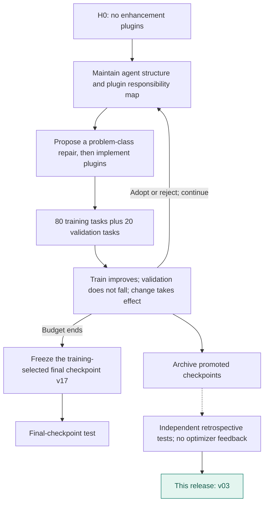
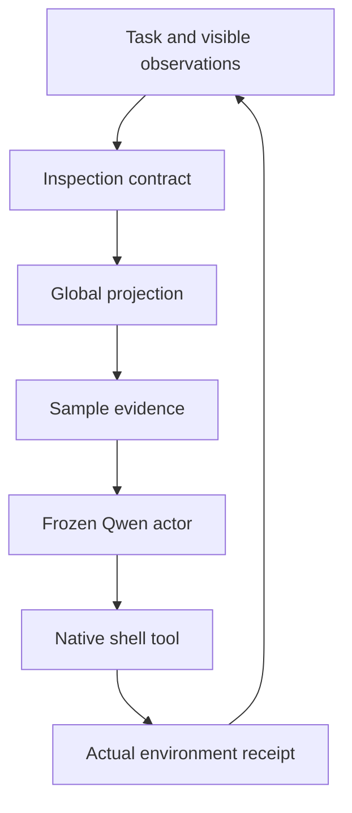

# OSBench · v03

**English** | [简体中文](README.zh-CN.md)

Three focused plugins guide file inspection, task-wide aggregation and evidence-based field selection. This earlier promoted checkpoint outscored the campaign final in retrospective tests.

**Release basis: Retrospective test of a promoted checkpoint**. Original training-selected final: **v17**.

| Test success | Published checkpoint | Plugin registrations | Test coverage |
|---:|---|---:|---|
| **39.35%** | **v03** / 40 rounds | 3 | 144 tasks × 3 repeats |

[**Plugin source**](plugins) · [**Method flow**](#method-flow) · [**Architecture**](#architecture) · [**Evolution curve**](#evolution) · [**Run**](#load-this-artifact) · [**All harnesses**](../../../README.md#choose-a-harness)

Actor: **Qwen3-4B-Instruct-2507** · Optimizer: **Sol 6.1 high** · Method: **L4 · Agent capability map**.

## Method flow



## Architecture



Arrows show runtime responsibilities, not independent causal gains.

## Evolution


[Machine-readable curve](curve.json) · [Evaluation protocol](protocol.json) · [Composition](composition.json)

Diamonds mark adoption records; the vertical line marks the released checkpoint. Training batches can rotate. Test dots represent actual measurements only.

## Plugin inventory

| Module | Responsibility |
|---|---|
| [inspection-contract.mjs](plugins/inspection-contract.mjs) | Inspect relevant files and schema before choosing a command. |
| [global-projection.mjs](plugins/global-projection.mjs) | Preserve task-wide aggregation and projection semantics. |
| [sample-evidence.mjs](plugins/sample-evidence.mjs) | Ground fields and delimiters in actual sampled contents. |

## Load this artifact

```bash
MODEL_BASE_URL=http://localhost:8000/v1 node tools/serve.mjs harnesses/osbench/20261030-l4-h0-sol61-v03
```

Run from the repository root after `npm install`. This starts the native DSH bridge. Supply the benchmark environment/executor separately; see [integration instructions](../../../docs/RUNNING.md).

## Evaluation notes

- Complete retrospective evaluation of a previously promoted checkpoint: 170 successes / 432 episodes. Original training-selected final v17 remains 168/432.
- Selected for publication after observing checkpoint tests; this is not a new confirmatory test.
- Three repeat accuracies: 38.89%, 37.50%, 41.67%; population standard deviation 1.73 percentage points.
- Paper AgentBench uses one trial; this measurement averages three.

Export changes are limited to portable module paths, selectable listener ports, runtime configuration, and removal of local-path metadata. Reported scores come from the original completed evaluations; the packaged copy has not been scored again.
