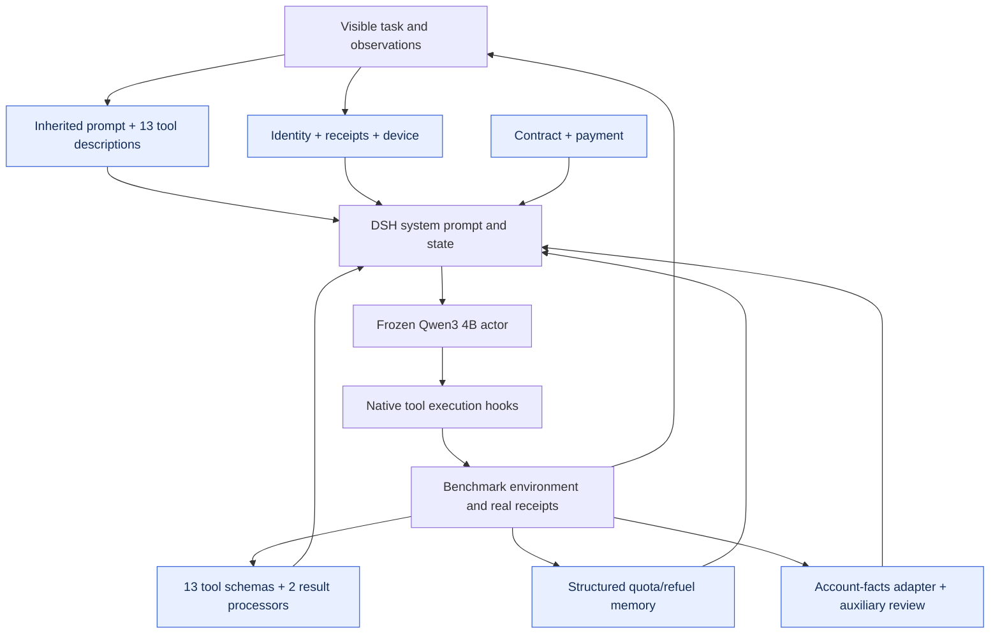

# τ²-Telecom · v06

**English** | [简体中文](README.zh-CN.md)

A repaired Luna-derived starting harness continued with the Sol optimizer. The release contains 30 migrated source surfaces plus five evolved custom plugins, with the measured Telecom review bridge and account-facts integration.

| Test success | Selected checkpoint | Plugin registrations | Test coverage |
|---:|---|---:|---|
| **84.17%** | **v06** / 8 rounds | 35 | 40 tasks × 3 repeats |

[**Plugin source**](plugins) · [**Architecture**](#architecture) · [**Evolution curve**](#evolution) · [**Run**](#load-this-artifact) · [**All harnesses**](../../../README.md#choose-a-harness)

Actor: **Qwen3-4B-Instruct-2507** · Optimizer: **Sol high** · Method: **Method 2 continuation · Repaired Luna-derived start**.

## Architecture



Functional grouping: 35 registrations are not 35 independently proven mechanisms. Account-facts access and auxiliary review are part of this measured integration; see the protocol caveat.

## Evolution


[Machine-readable curve](curve.json) · [Evaluation protocol](protocol.json) · [Composition](composition.json)

Diamonds mark adoption records; the vertical line marks the released checkpoint. Training batches can rotate. Test dots represent actual measurements only.

## Plugin inventory

<details>
<summary>Expand all native registrations and responsibilities</summary>

| Module | Responsibility |
|---|---|
| [001-prompt.mjs](plugins/001-prompt.mjs) | Inherited task/policy prompt surface. |
| [002-description.mjs](plugins/002-description.mjs) | Inherited business-tool description surface. |
| [003-schema.mjs](plugins/003-schema.mjs) | Inherited tool argument schema surface. |
| [004-description.mjs](plugins/004-description.mjs) | Inherited business-tool description surface. |
| [005-schema.mjs](plugins/005-schema.mjs) | Inherited tool argument schema surface. |
| [006-description.mjs](plugins/006-description.mjs) | Inherited business-tool description surface. |
| [007-schema.mjs](plugins/007-schema.mjs) | Inherited tool argument schema surface. |
| [008-description.mjs](plugins/008-description.mjs) | Inherited business-tool description surface. |
| [009-schema.mjs](plugins/009-schema.mjs) | Inherited tool argument schema surface. |
| [010-description.mjs](plugins/010-description.mjs) | Inherited business-tool description surface. |
| [011-schema.mjs](plugins/011-schema.mjs) | Inherited tool argument schema surface. |
| [012-description.mjs](plugins/012-description.mjs) | Inherited business-tool description surface. |
| [013-schema.mjs](plugins/013-schema.mjs) | Inherited tool argument schema surface. |
| [014-description.mjs](plugins/014-description.mjs) | Inherited business-tool description surface. |
| [015-schema.mjs](plugins/015-schema.mjs) | Inherited tool argument schema surface. |
| [016-description.mjs](plugins/016-description.mjs) | Inherited business-tool description surface. |
| [017-schema.mjs](plugins/017-schema.mjs) | Inherited tool argument schema surface. |
| [018-description.mjs](plugins/018-description.mjs) | Inherited business-tool description surface. |
| [019-schema.mjs](plugins/019-schema.mjs) | Inherited tool argument schema surface. |
| [020-description.mjs](plugins/020-description.mjs) | Inherited business-tool description surface. |
| [021-schema.mjs](plugins/021-schema.mjs) | Inherited tool argument schema surface. |
| [022-description.mjs](plugins/022-description.mjs) | Inherited business-tool description surface. |
| [023-schema.mjs](plugins/023-schema.mjs) | Inherited tool argument schema surface. |
| [024-description.mjs](plugins/024-description.mjs) | Inherited business-tool description surface. |
| [025-schema.mjs](plugins/025-schema.mjs) | Inherited tool argument schema surface. |
| [026-description.mjs](plugins/026-description.mjs) | Inherited business-tool description surface. |
| [027-schema.mjs](plugins/027-schema.mjs) | Inherited tool argument schema surface. |
| [028-result.mjs](plugins/028-result.mjs) | Inherited result processing surface. |
| [029-result.mjs](plugins/029-result.mjs) | Inherited result processing surface. |
| [030-memory.mjs](plugins/030-memory.mjs) | Structured quota/refuel evidence memory. |
| [receipts.mjs](plugins/receipts.mjs) | Interpret actual account and action receipts. |
| [identity.mjs](plugins/identity.mjs) | Maintain verified customer/line identity. |
| [device.mjs](plugins/device.mjs) | Guide customer-side device diagnosis and confirmation. |
| [contract.mjs](plugins/contract.mjs) | Check contract and service-state obligations. |
| [payment.mjs](plugins/payment.mjs) | Track billing and payment completion. |

</details>

**Why v06 rather than the highest historical test point?** v05 measured 87.50% on historical tests, but the training-selected final checkpoint is v06 (84.17%). We publish that final selection instead of retrospectively substituting a test-peak checkpoint. The eight new candidates were v03–v10, continuing from v02.


## Load this artifact

```bash
MODEL_BASE_URL=http://localhost:8000/v1 node tools/serve.mjs harnesses/telecom/20261026-start-luna-repaired-v06
```

Run from the repository root after `npm install`. This starts the native DSH bridge. Supply the benchmark environment/executor separately; see [integration instructions](../../../docs/RUNNING.md).

## Evaluation notes

- Historical tests were visible during the campaign; not a fresh blind test.
- User simulator differs from the Life-Harness paper; no direct ranking claim.
- Includes migrated source surfaces and evolved custom plugins; not 35 independently validated problem categories.
- Measured runtime includes a read-only business account-facts adapter and auxiliary review/model calls; it does not share the pure observation-only contract of the four AgentBench artifacts.

Export changes are limited to portable module paths, selectable listener ports, runtime configuration, and removal of local-path metadata. Reported scores come from the original completed evaluations; the packaged copy has not been scored again.
