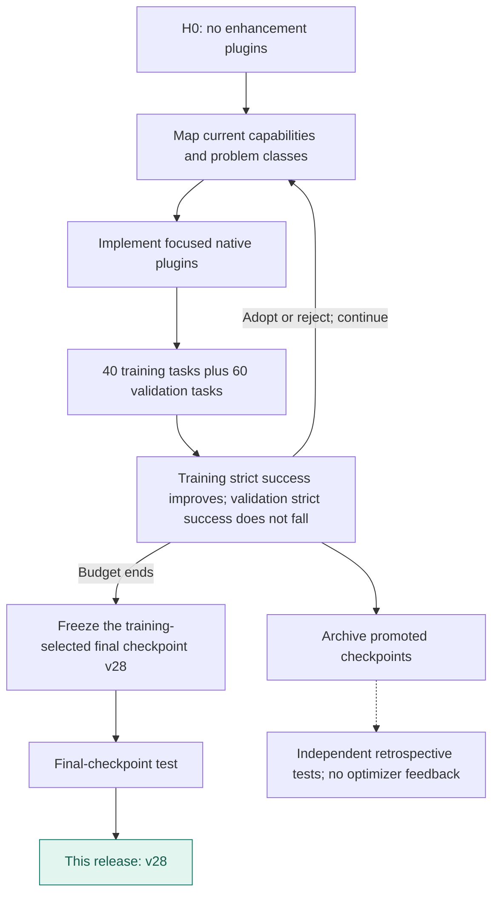
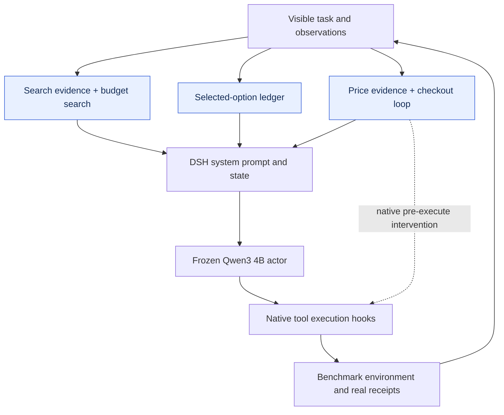
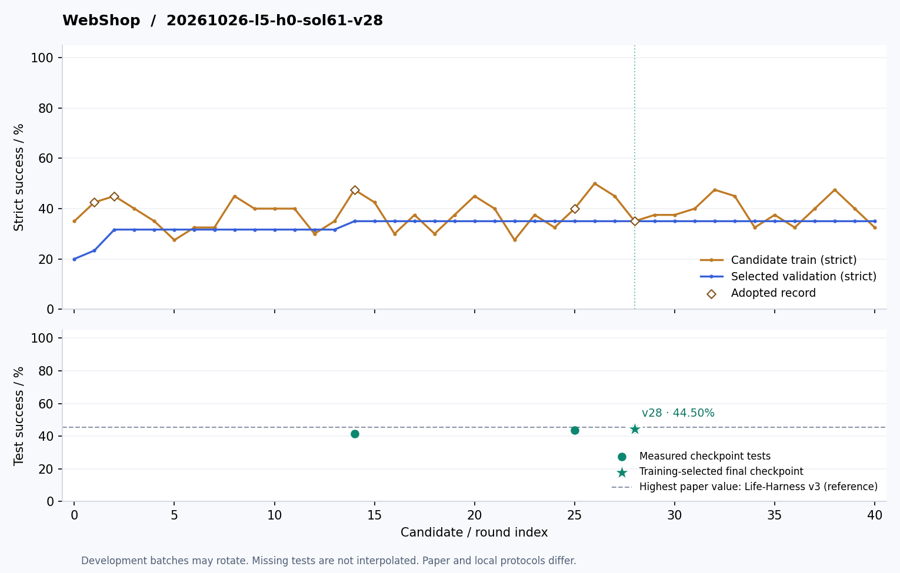

# WebShop · v28

**English** | [简体中文](README.zh-CN.md)

Five plugins track selected options, search evidence, purchase readiness, price evidence, and bounded budget-aware search recovery. L5 adoption targets strict success rather than partial shopping reward.

**Release basis: Training-selected final checkpoint**.

| Test success | Published checkpoint | Plugin registrations | Test coverage |
|---:|---|---:|---|
| **44.50%** | **v28** / 40 rounds | 5 | 200 tasks × 3 repeats |

[**Plugin source**](plugins) · [**Method flow**](#method-flow) · [**Architecture**](#architecture) · [**Evolution curve**](#evolution) · [**Run**](#load-this-artifact) · [**All harnesses**](../../../README.md#choose-a-harness)

Actor: **Qwen3-4B-Instruct-2507** · Optimizer: **Sol 6.1 high** · Method: **L5 · Benchmark-specific loop**.

## Method flow



## Architecture



Arrows show runtime responsibilities, not independent causal gains.

## Evolution



[Machine-readable curve](curve.json) · [Evaluation protocol](protocol.json) · [Composition](composition.json)

This WebShop L5 curve shows the strict-success adoption objective. Mean rewards remain in curve.json. Diamonds mark adoption records; the vertical line marks the released checkpoint. Training batches can rotate. Test dots represent actual measurements only.

## Plugin inventory

| Module | Responsibility |
|---|---|
| [option-ledger.mjs](plugins/option-ledger.mjs) | Track real option selections and outstanding requested specifications. |
| [search-evidence.mjs](plugins/search-evidence.mjs) | Use visible search/product evidence for candidate comparison. |
| [checkout-loop.mjs](plugins/checkout-loop.mjs) | Control premature or repeated checkout attempts. |
| [price-evidence.mjs](plugins/price-evidence.mjs) | Check visible price against the user budget. |
| [budget-search.mjs](plugins/budget-search.mjs) | At most one bounded alternative click after an explicitly over-budget choice. |

## Load this artifact

```bash
MODEL_BASE_URL=http://localhost:8000/v1 node tools/serve.mjs harnesses/webshop/20261026-l5-h0-sol61-v28
```

Run from the repository root after `npm install`. This starts the native DSH bridge. Supply the benchmark environment/executor separately; see [integration instructions](../../../docs/RUNNING.md).

## Evaluation notes

- Paper AgentBench scores use one trial; these results average three trials.

Export changes are limited to portable module paths, selectable listener ports, runtime configuration, and removal of local-path metadata. Reported scores come from the original completed evaluations; the packaged copy has not been scored again.
