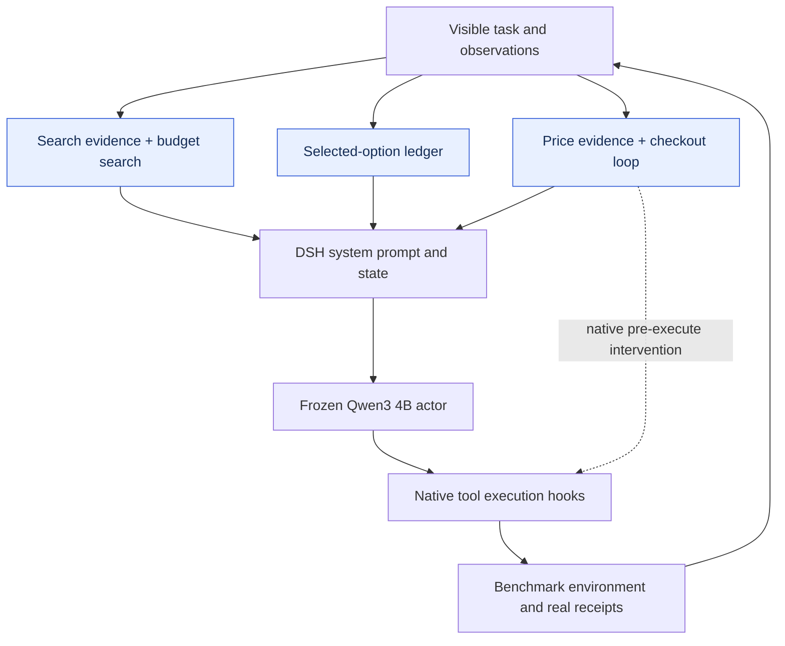

# WebShop · v28

[English](README.md) | **简体中文**

**解决的问题：**商品检索、规格选择、价格核验与购买。

| 测试成功率 | 最终选定检查点 | 插件注册项 | 测试覆盖 |
|---:|---|---:|---|
| **44.50%** | v28 / 40 轮预算 | 5 | 200 题 × 3 遍 |

做题模型：**Qwen3-4B-Instruct-2507**；优化模型：**Sol 6.1 high**；方法：**L5 · 场景专用循环**。

[**插件源码**](plugins) · [**运行配置**](protocol.json) · [**插件装配**](composition.json) · [**全部产物**](../../../README.zh-CN.md)

## 结构框图

下图展示运行时结构和插件职责；模块名保留源码英文名称，便于对应实现。



## 进化曲线


上图为候选训练成绩和已采用版本的验证成绩；下图仅显示实际测过的测试点。训练批次可能轮换，曲线上下波动不等于固定测试集能力下降。WebShop 开发曲线展示平均奖励，采用和主榜使用严格成功率。灰线是论文各方法在该场景报告的最高数值，只作参考。

[曲线数据](curve.json) · [完整插件职责表](README.md#plugin-inventory) · [多方法榜单](../../../LEADERBOARD.zh-CN.md)

## 使用产物

在仓库根目录安装依赖后启动：

```bash
npm install
MODEL_BASE_URL=http://localhost:8000/v1 node tools/serve.mjs harnesses/webshop/20261026-l5-h0-sol61-v28
```

该命令启动 harness 运行时。基准环境、任务数据和做题模型服务另行提供。[运行说明](../../../docs/RUNNING.md)

## 评测口径

成绩来自原实验的完整有效测试，不是发布后重新评测。当前产物是在各实验最终选定版本之间，依据已获得的测试成绩挑选发布的；不是新的独立盲测。插件数量是实现登记数，不代表每个插件都已单独证明有收益。
