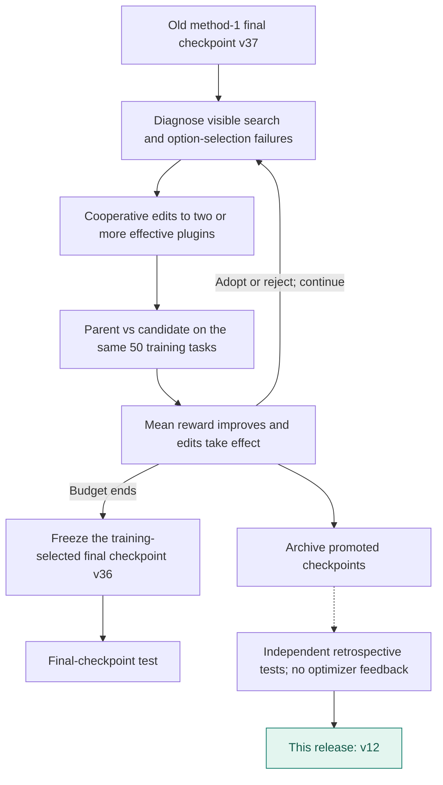
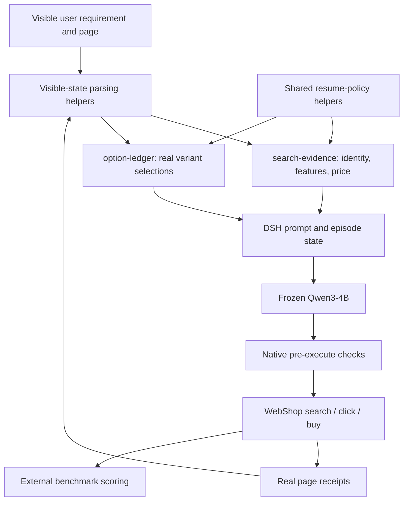

# WebShop · v12

**English** | [简体中文](README.zh-CN.md)

Two cooperative plugins combine visible search evidence with explicit option tracking. Starting from an earlier method-1 final harness, v12 reached 47.00% strict success in retrospective testing. Its original adoption objective was mean reward, not strict success.

**Release basis: Retrospective test of a promoted checkpoint**. Original training-selected final: **v36**.

| Test success | Published checkpoint | Plugin registrations | Test coverage |
|---:|---|---:|---|
| **47.00%** | **v12** / 40 rounds | 2 | 200 tasks × 3 repeats |

[**Plugin source**](plugins) · [**Method flow**](#method-flow) · [**Architecture**](#architecture) · [**Evolution curve**](#evolution) · [**Run**](#load-this-artifact) · [**All harnesses**](../../../README.md#choose-a-harness)

Actor: **Qwen3-4B-Instruct-2507** · Optimizer: **Sol 6.1 high** · Method: **Method 1 cooperative · Best-checkpoint continuation**.

## Method flow



## Architecture



Arrows show runtime responsibilities, not independent causal gains.

## Evolution


[Machine-readable curve](curve.json) · [Evaluation protocol](protocol.json) · [Composition](composition.json)

This cooperative WebShop method adopts by mean reward; the test panel ranks strict success. Diamonds mark adoption records; the vertical line marks the released checkpoint. Training batches can rotate. Test dots represent actual measurements only.

## Plugin inventory

| Module | Responsibility |
|---|---|
| [search-evidence.mjs](plugins/search-evidence.mjs) | Ground product search, price and feature evidence; check legal page actions. |
| [option-ledger.mjs](plugins/option-ledger.mjs) | Track actual variant choices and remaining requested specifications. |

## Load this artifact

```bash
MODEL_BASE_URL=http://localhost:8000/v1 node tools/serve.mjs harnesses/webshop/20261027-original-best-sol61-v12
```

Run from the repository root after `npm install`. This starts the native DSH bridge. Supply the benchmark environment/executor separately; see [integration instructions](../../../docs/RUNNING.md).

## Evaluation notes

- Published from an adopted checkpoint with a complete retrospective test. Selected for publication using already observed test scores; not a fresh confirmatory evaluation.
- Original training-selected final checkpoint is v36. Its identity and original result are retained.
- Paper AgentBench uses one trial; this measurement averages three repeats.
- The v01 training score of zero is a real 50/50-valid evaluation: a plugin scope error broke ledger receipts and the candidate was rejected. The failed candidate remains visible in the development curve.

Export changes are limited to portable module paths, selectable listener ports, runtime configuration, and removal of local-path metadata. Reported scores come from the original completed evaluations; the packaged copy has not been scored again.
