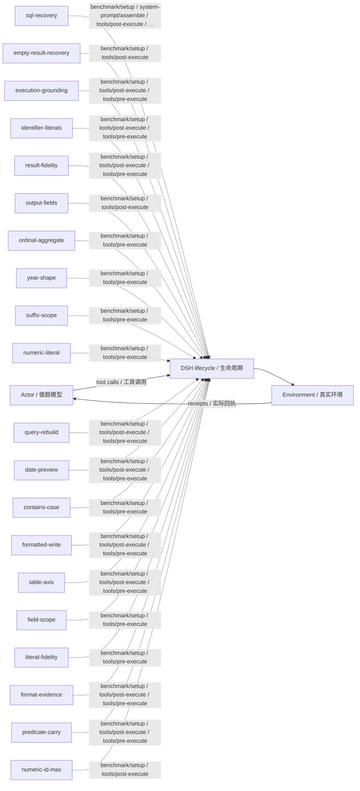

# dbbench · 问题机制反馈 · v37

Mechanism feedback · training/development-selected final checkpoint / 按训练或开发规则选定的最终版。

**测试 / Test:** 55.78% · 900 valid episodes / 有效场次。

Run ID: `failure-frontier-fivebench-20261029/experiments/dbbench/dsh-mechanism`。在[结构化结果](../../../../../results/research/runs.json)中按此编号查本组曲线、逐次测试与统计；[配置](../../../../../results/research/protocols/failure-frontier-fivebench-20261029--experiments--dbbench--dsh-mechanism.json) · [任务清单](../../../../../results/research/tasks/failure-frontier-fivebench-20261029--experiments--dbbench--dsh-mechanism.json)。

[组合与启用名单 / Composition](composition.json) · [Mermaid source](diagram.mmd) · [全部方法产物 / All artifacts](../../../../../research-artifacts/README.md)

**读图：** 实线是一般模型—工具运行路径；虚线只表示源码中登记的插件挂接，不表示这些插件按顺序执行、每场触发或各自带来独立增益。

**Diagram:** Solid edges show the general actor/tool path. Dashed edges show static source attachments, not ordering, activation in every episode, or independent causal gains.

启用插件与源码钩子 / Active plugins and source hooks

| Plugin source | Source hooks |
|---|---|
| [sql-recovery](plugins/sql-recovery.mjs) | `benchmark/setup` · `system-prompt/assemble` · `tools/post-execute` · `tools/pre-execute` |
| [empty-result-recovery](plugins/empty-result-recovery.mjs) | `benchmark/setup` · `tools/post-execute` |
| [execution-grounding](plugins/execution-grounding.mjs) | `benchmark/setup` · `tools/post-execute` · `tools/pre-execute` |
| [identifier-literals](plugins/identifier-literals.mjs) | `benchmark/setup` · `tools/post-execute` · `tools/pre-execute` |
| [result-fidelity](plugins/result-fidelity.mjs) | `benchmark/setup` · `tools/post-execute` · `tools/pre-execute` |
| [output-fields](plugins/output-fields.mjs) | `benchmark/setup` · `tools/post-execute` |
| [ordinal-aggregate](plugins/ordinal-aggregate.mjs) | `benchmark/setup` · `tools/pre-execute` |
| [year-shape](plugins/year-shape.mjs) | `benchmark/setup` · `tools/pre-execute` |
| [suffix-scope](plugins/suffix-scope.mjs) | `benchmark/setup` · `tools/pre-execute` |
| [numeric-literal](plugins/numeric-literal.mjs) | `benchmark/setup` · `tools/pre-execute` |
| [query-rebuild](plugins/query-rebuild.mjs) | `benchmark/setup` · `tools/post-execute` · `tools/pre-execute` |
| [date-preview](plugins/date-preview.mjs) | `benchmark/setup` · `tools/post-execute` · `tools/pre-execute` |
| [contains-case](plugins/contains-case.mjs) | `benchmark/setup` · `tools/pre-execute` |
| [formatted-write](plugins/formatted-write.mjs) | `benchmark/setup` · `tools/post-execute` · `tools/pre-execute` |
| [table-axis](plugins/table-axis.mjs) | `benchmark/setup` · `tools/post-execute` · `tools/pre-execute` |
| [field-scope](plugins/field-scope.mjs) | `benchmark/setup` · `tools/pre-execute` |
| [literal-fidelity](plugins/literal-fidelity.mjs) | `benchmark/setup` · `tools/pre-execute` |
| [format-evidence](plugins/format-evidence.mjs) | `benchmark/setup` · `tools/post-execute` · `tools/pre-execute` |
| [predicate-carry](plugins/predicate-carry.mjs) | `benchmark/setup` · `tools/post-execute` · `tools/pre-execute` |
| [numeric-id-max](plugins/numeric-id-max.mjs) | `benchmark/setup` · `tools/post-execute` |

本目录保留冻结插件及其本地依赖。完整运行仍需共同DSH基础与本场景环境，见[复现说明](../../../../../docs/REPRODUCING.zh-CN.md)。本次导出没有重跑正式测试，也没有修改插件算法。

This directory retains frozen plugins and local dependencies. It still needs the shared DSH runtime and benchmark environment; see [reproduction](../../../../../docs/REPRODUCING.md). Export did not rerun the benchmark or change the plugin algorithms.
