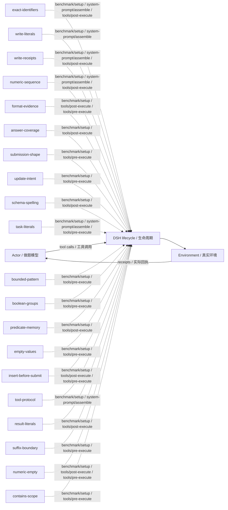

# dbbench · 摘要反馈 · v40

Summary feedback · training/development-selected final checkpoint / 按训练或开发规则选定的最终版。

**测试 / Test:** 55.44% · 900 valid episodes / 有效场次。

Run ID: `failure-frontier-fivebench-20261029/experiments/dbbench/dsh-summary`。在[结构化结果](../../../../../results/research/runs.json)中按此编号查本组曲线、逐次测试与统计；[配置](../../../../../results/research/protocols/failure-frontier-fivebench-20261029--experiments--dbbench--dsh-summary.json) · [任务清单](../../../../../results/research/tasks/failure-frontier-fivebench-20261029--experiments--dbbench--dsh-summary.json)。

[组合与启用名单 / Composition](composition.json) · [Mermaid source](diagram.mmd) · [全部方法产物 / All artifacts](../../../../../research-artifacts/README.md)

**读图：** 实线是一般模型—工具运行路径；虚线只表示源码中登记的插件挂接，不表示这些插件按顺序执行、每场触发或各自带来独立增益。

**Diagram:** Solid edges show the general actor/tool path. Dashed edges show static source attachments, not ordering, activation in every episode, or independent causal gains.

启用插件与源码钩子 / Active plugins and source hooks

| Plugin source | Source hooks |
|---|---|
| [exact-identifiers](plugins/exact-identifiers.mjs) | `benchmark/setup` · `system-prompt/assemble` · `tools/post-execute` |
| [write-literals](plugins/write-literals.mjs) | `benchmark/setup` · `system-prompt/assemble` |
| [write-receipts](plugins/write-receipts.mjs) | `benchmark/setup` · `system-prompt/assemble` · `tools/post-execute` |
| [numeric-sequence](plugins/numeric-sequence.mjs) | `benchmark/setup` · `system-prompt/assemble` · `tools/post-execute` |
| [format-evidence](plugins/format-evidence.mjs) | `benchmark/setup` · `tools/post-execute` · `tools/pre-execute` |
| [answer-coverage](plugins/answer-coverage.mjs) | `benchmark/setup` · `tools/post-execute` |
| [submission-shape](plugins/submission-shape.mjs) | `benchmark/setup` · `tools/pre-execute` |
| [update-intent](plugins/update-intent.mjs) | `benchmark/setup` · `tools/pre-execute` |
| [schema-spelling](plugins/schema-spelling.mjs) | `benchmark/setup` · `tools/post-execute` |
| [task-literals](plugins/task-literals.mjs) | `benchmark/setup` · `system-prompt/assemble` · `tools/pre-execute` |
| [bounded-pattern](plugins/bounded-pattern.mjs) | `benchmark/setup` · `tools/pre-execute` |
| [boolean-groups](plugins/boolean-groups.mjs) | `benchmark/setup` · `tools/pre-execute` |
| [predicate-memory](plugins/predicate-memory.mjs) | `benchmark/setup` · `tools/post-execute` |
| [empty-values](plugins/empty-values.mjs) | `benchmark/setup` · `tools/pre-execute` |
| [insert-before-submit](plugins/insert-before-submit.mjs) | `benchmark/setup` · `tools/post-execute` · `tools/pre-execute` |
| [tool-protocol](plugins/tool-protocol.mjs) | `benchmark/setup` · `system-prompt/assemble` |
| [result-literals](plugins/result-literals.mjs) | `benchmark/setup` · `tools/post-execute` |
| [suffix-boundary](plugins/suffix-boundary.mjs) | `benchmark/setup` · `tools/pre-execute` |
| [numeric-empty](plugins/numeric-empty.mjs) | `benchmark/setup` · `tools/post-execute` · `tools/pre-execute` |
| [contains-scope](plugins/contains-scope.mjs) | `benchmark/setup` · `tools/pre-execute` |

本目录保留冻结插件及其本地依赖。完整运行仍需共同DSH基础与本场景环境，见[复现说明](../../../../../docs/REPRODUCING.zh-CN.md)。本次导出没有重跑正式测试，也没有修改插件算法。

This directory retains frozen plugins and local dependencies. It still needs the shared DSH runtime and benchmark environment; see [reproduction](../../../../../docs/REPRODUCING.md). Export did not rerun the benchmark or change the plugin algorithms.
