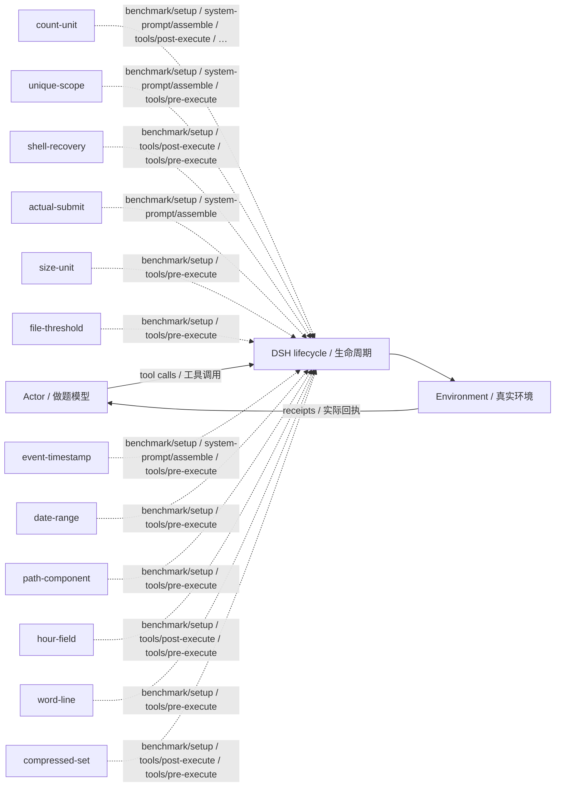

# osbench · 问题机制反馈 · v39

Mechanism feedback · training/development-selected final checkpoint / 按训练或开发规则选定的最终版。

**测试 / Test:** 32.87% · 432 valid episodes / 有效场次。

Run ID: `failure-frontier-fivebench-20261029/experiments/osbench/dsh-mechanism`。在[结构化结果](../../../../../results/research/runs.json)中按此编号查本组曲线、逐次测试与统计；[配置](../../../../../results/research/protocols/failure-frontier-fivebench-20261029--experiments--osbench--dsh-mechanism.json) · [任务清单](../../../../../results/research/tasks/failure-frontier-fivebench-20261029--experiments--osbench--dsh-mechanism.json)。

[组合与启用名单 / Composition](composition.json) · [Mermaid source](diagram.mmd) · [全部方法产物 / All artifacts](../../../../../research-artifacts/README.md)

**读图：** 实线是一般模型—工具运行路径；虚线只表示源码中登记的插件挂接，不表示这些插件按顺序执行、每场触发或各自带来独立增益。

**Diagram:** Solid edges show the general actor/tool path. Dashed edges show static source attachments, not ordering, activation in every episode, or independent causal gains.

启用插件与源码钩子 / Active plugins and source hooks

| Plugin source | Source hooks |
|---|---|
| [count-unit](plugins/count-unit.mjs) | `benchmark/setup` · `system-prompt/assemble` · `tools/post-execute` · `tools/pre-execute` |
| [unique-scope](plugins/unique-scope.mjs) | `benchmark/setup` · `system-prompt/assemble` · `tools/pre-execute` |
| [shell-recovery](plugins/shell-recovery.mjs) | `benchmark/setup` · `tools/post-execute` · `tools/pre-execute` |
| [actual-submit](plugins/actual-submit.mjs) | `benchmark/setup` · `system-prompt/assemble` |
| [size-unit](plugins/size-unit.mjs) | `benchmark/setup` · `tools/pre-execute` |
| [file-threshold](plugins/file-threshold.mjs) | `benchmark/setup` · `tools/pre-execute` |
| [event-timestamp](plugins/event-timestamp.mjs) | `benchmark/setup` · `system-prompt/assemble` · `tools/pre-execute` |
| [date-range](plugins/date-range.mjs) | `benchmark/setup` · `tools/pre-execute` |
| [path-component](plugins/path-component.mjs) | `benchmark/setup` · `tools/pre-execute` |
| [hour-field](plugins/hour-field.mjs) | `benchmark/setup` · `tools/post-execute` · `tools/pre-execute` |
| [word-line](plugins/word-line.mjs) | `benchmark/setup` · `tools/pre-execute` |
| [compressed-set](plugins/compressed-set.mjs) | `benchmark/setup` · `tools/post-execute` · `tools/pre-execute` |

本目录保留冻结插件及其本地依赖。完整运行仍需共同DSH基础与本场景环境，见[复现说明](../../../../../docs/REPRODUCING.zh-CN.md)。本次导出没有重跑正式测试，也没有修改插件算法。

This directory retains frozen plugins and local dependencies. It still needs the shared DSH runtime and benchmark environment; see [reproduction](../../../../../docs/REPRODUCING.md). Export did not rerun the benchmark or change the plugin algorithms.
