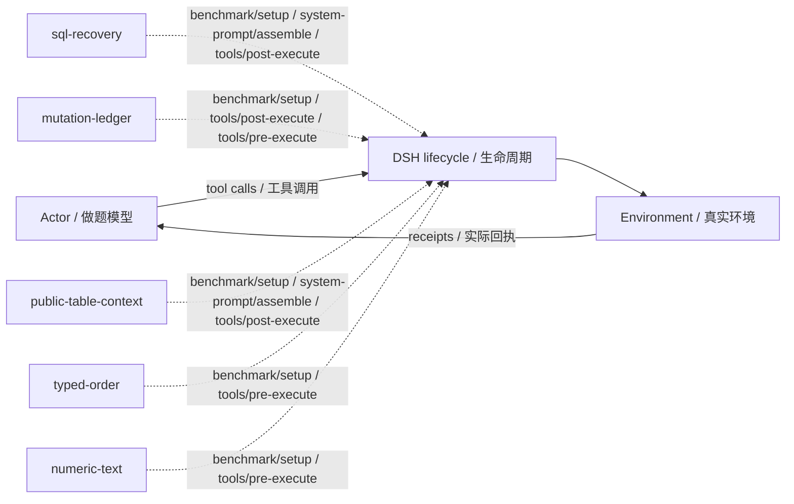

# dbbench · L2：固定子集回放 · v26

L2: fixed-subset replay · training/development-selected final checkpoint / 按训练或开发规则选定的最终版。

**测试 / Test:** 61.22% · 900 valid episodes / 有效场次。

Run ID: `loop-comparison-20r-20261025/dbbench/l2-sol61`。在[结构化结果](../../../../../results/research/runs.json)中按此编号查本组曲线、逐次测试与统计；[配置](../../../../../results/research/protocols/loop-comparison-20r-20261025--dbbench--l2-sol61.json) · [任务清单](../../../../../results/research/tasks/loop-comparison-20r-20261025--dbbench--l2-sol61.json)。

[组合与启用名单 / Composition](composition.json) · [Mermaid source](diagram.mmd) · [全部方法产物 / All artifacts](../../../../../research-artifacts/README.md)

**读图：** 实线是一般模型—工具运行路径；虚线只表示源码中登记的插件挂接，不表示这些插件按顺序执行、每场触发或各自带来独立增益。

**Diagram:** Solid edges show the general actor/tool path. Dashed edges show static source attachments, not ordering, activation in every episode, or independent causal gains.

启用插件与源码钩子 / Active plugins and source hooks

| Plugin source | Source hooks |
|---|---|
| [sql-recovery](plugins/sql-recovery.mjs) | `benchmark/setup` · `system-prompt/assemble` · `tools/post-execute` |
| [mutation-ledger](plugins/mutation-ledger.mjs) | `benchmark/setup` · `tools/post-execute` · `tools/pre-execute` |
| [public-table-context](plugins/public-table-context.mjs) | `benchmark/setup` · `system-prompt/assemble` · `tools/post-execute` |
| [typed-order](plugins/typed-order.mjs) | `benchmark/setup` · `tools/pre-execute` |
| [numeric-text](plugins/numeric-text.mjs) | `benchmark/setup` · `tools/pre-execute` |

本目录保留冻结插件及其本地依赖。完整运行仍需共同DSH基础与本场景环境，见[复现说明](../../../../../docs/REPRODUCING.zh-CN.md)。本次导出没有重跑正式测试，也没有修改插件算法。

This directory retains frozen plugins and local dependencies. It still needs the shared DSH runtime and benchmark environment; see [reproduction](../../../../../docs/REPRODUCING.md). Export did not rerun the benchmark or change the plugin algorithms.
