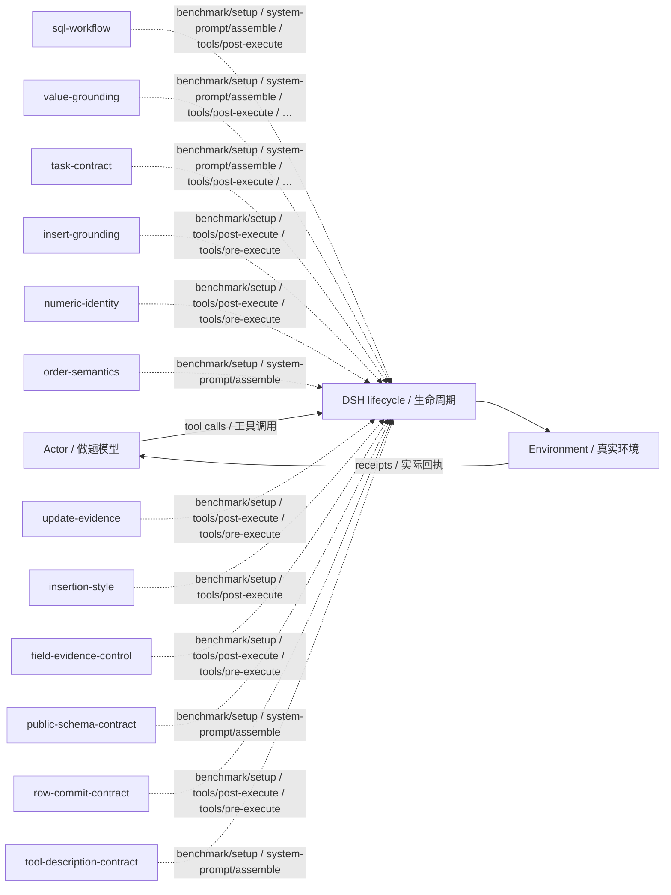

# dbbench · L4：已有最佳起点 · v38

L4: seeded continuation · training/development-selected final checkpoint / 按训练或开发规则选定的最终版。

**测试 / Test:** 62.44% · 900 valid episodes / 有效场次。

Run ID: `loop-expansion-sol40-20261026/dbbench/l4-best-sol61`。在[结构化结果](../../../../../results/research/runs.json)中按此编号查本组曲线、逐次测试与统计；[配置](../../../../../results/research/protocols/loop-expansion-sol40-20261026--dbbench--l4-best-sol61.json) · [任务清单](../../../../../results/research/tasks/loop-expansion-sol40-20261026--dbbench--l4-best-sol61.json)。

[组合与启用名单 / Composition](composition.json) · [Mermaid source](diagram.mmd) · [全部方法产物 / All artifacts](../../../../../research-artifacts/README.md)

**读图：** 实线是一般模型—工具运行路径；虚线只表示源码中登记的插件挂接，不表示这些插件按顺序执行、每场触发或各自带来独立增益。

**Diagram:** Solid edges show the general actor/tool path. Dashed edges show static source attachments, not ordering, activation in every episode, or independent causal gains.

启用插件与源码钩子 / Active plugins and source hooks

| Plugin source | Source hooks |
|---|---|
| [sql-workflow](plugins/sql-workflow.mjs) | `benchmark/setup` · `system-prompt/assemble` · `tools/post-execute` |
| [value-grounding](plugins/value-grounding.mjs) | `benchmark/setup` · `system-prompt/assemble` · `tools/post-execute` · `tools/pre-execute` |
| [task-contract](plugins/task-contract.mjs) | `benchmark/setup` · `system-prompt/assemble` · `tools/post-execute` · `tools/pre-execute` |
| [insert-grounding](plugins/insert-grounding.mjs) | `benchmark/setup` · `tools/post-execute` · `tools/pre-execute` |
| [numeric-identity](plugins/numeric-identity.mjs) | `benchmark/setup` · `tools/post-execute` · `tools/pre-execute` |
| [order-semantics](plugins/order-semantics.mjs) | `benchmark/setup` · `system-prompt/assemble` |
| [update-evidence](plugins/update-evidence.mjs) | `benchmark/setup` · `tools/post-execute` · `tools/pre-execute` |
| [insertion-style](plugins/insertion-style.mjs) | `benchmark/setup` · `tools/post-execute` |
| [field-evidence-control](plugins/field-evidence-control.mjs) | `benchmark/setup` · `tools/post-execute` · `tools/pre-execute` |
| [public-schema-contract](plugins/public-schema-contract.mjs) | `benchmark/setup` · `system-prompt/assemble` |
| [row-commit-contract](plugins/row-commit-contract.mjs) | `benchmark/setup` · `tools/post-execute` · `tools/pre-execute` |
| [tool-description-contract](plugins/tool-description-contract.mjs) | `benchmark/setup` · `system-prompt/assemble` |

本目录保留冻结插件及其本地依赖。完整运行仍需共同DSH基础与本场景环境，见[复现说明](../../../../../docs/REPRODUCING.zh-CN.md)。本次导出没有重跑正式测试，也没有修改插件算法。

This directory retains frozen plugins and local dependencies. It still needs the shared DSH runtime and benchmark environment; see [reproduction](../../../../../docs/REPRODUCING.md). Export did not rerun the benchmark or change the plugin algorithms.
