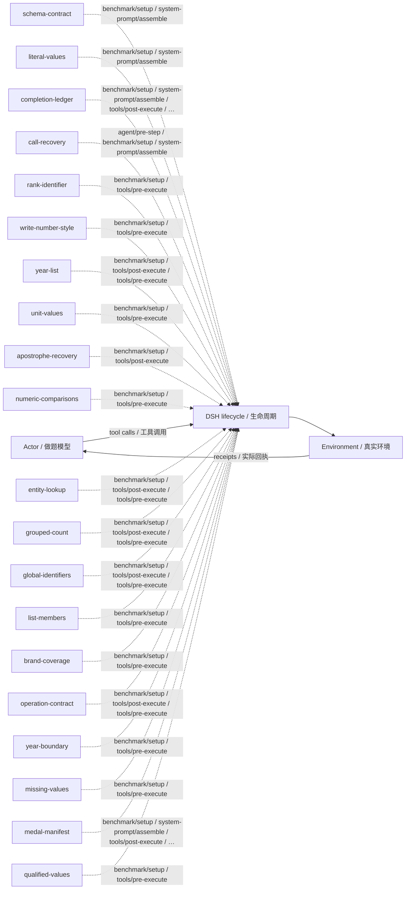

# dbbench · L5：场景化目标与验证 · v38

L5: benchmark-specific objectives · training/development-selected final checkpoint / 按训练或开发规则选定的最终版。

**测试 / Test:** 66.56% · 900 valid episodes / 有效场次。

Run ID: `loop-expansion-sol40-20261026/dbbench/l5-h0-sol61`。在[结构化结果](../../../../../results/research/runs.json)中按此编号查本组曲线、逐次测试与统计；[配置](../../../../../results/research/protocols/loop-expansion-sol40-20261026--dbbench--l5-h0-sol61.json) · [任务清单](../../../../../results/research/tasks/loop-expansion-sol40-20261026--dbbench--l5-h0-sol61.json)。

[组合与启用名单 / Composition](composition.json) · [Mermaid source](diagram.mmd) · [全部方法产物 / All artifacts](../../../../../research-artifacts/README.md)

**读图：** 实线是一般模型—工具运行路径；虚线只表示源码中登记的插件挂接，不表示这些插件按顺序执行、每场触发或各自带来独立增益。

**Diagram:** Solid edges show the general actor/tool path. Dashed edges show static source attachments, not ordering, activation in every episode, or independent causal gains.

启用插件与源码钩子 / Active plugins and source hooks

| Plugin source | Source hooks |
|---|---|
| [schema-contract](plugins/schema-contract.mjs) | `benchmark/setup` · `system-prompt/assemble` |
| [literal-values](plugins/literal-values.mjs) | `benchmark/setup` · `system-prompt/assemble` |
| [completion-ledger](plugins/completion-ledger.mjs) | `benchmark/setup` · `system-prompt/assemble` · `tools/post-execute` · `tools/pre-execute` |
| [call-recovery](plugins/call-recovery.mjs) | `agent/pre-step` · `benchmark/setup` · `system-prompt/assemble` |
| [rank-identifier](plugins/rank-identifier.mjs) | `benchmark/setup` · `tools/pre-execute` |
| [write-number-style](plugins/write-number-style.mjs) | `benchmark/setup` · `tools/pre-execute` |
| [year-list](plugins/year-list.mjs) | `benchmark/setup` · `tools/post-execute` · `tools/pre-execute` |
| [unit-values](plugins/unit-values.mjs) | `benchmark/setup` · `tools/pre-execute` |
| [apostrophe-recovery](plugins/apostrophe-recovery.mjs) | `benchmark/setup` · `tools/post-execute` |
| [numeric-comparisons](plugins/numeric-comparisons.mjs) | `benchmark/setup` · `tools/pre-execute` |
| [entity-lookup](plugins/entity-lookup.mjs) | `benchmark/setup` · `tools/post-execute` · `tools/pre-execute` |
| [grouped-count](plugins/grouped-count.mjs) | `benchmark/setup` · `tools/post-execute` · `tools/pre-execute` |
| [global-identifiers](plugins/global-identifiers.mjs) | `benchmark/setup` · `tools/post-execute` · `tools/pre-execute` |
| [list-members](plugins/list-members.mjs) | `benchmark/setup` · `tools/pre-execute` |
| [brand-coverage](plugins/brand-coverage.mjs) | `benchmark/setup` · `tools/pre-execute` |
| [operation-contract](plugins/operation-contract.mjs) | `benchmark/setup` · `tools/post-execute` · `tools/pre-execute` |
| [year-boundary](plugins/year-boundary.mjs) | `benchmark/setup` · `tools/pre-execute` |
| [missing-values](plugins/missing-values.mjs) | `benchmark/setup` · `tools/pre-execute` |
| [medal-manifest](plugins/medal-manifest.mjs) | `benchmark/setup` · `system-prompt/assemble` · `tools/post-execute` · `tools/pre-execute` |
| [qualified-values](plugins/qualified-values.mjs) | `benchmark/setup` · `tools/pre-execute` |

本目录保留冻结插件及其本地依赖。完整运行仍需共同DSH基础与本场景环境，见[复现说明](../../../../../docs/REPRODUCING.zh-CN.md)。本次导出没有重跑正式测试，也没有修改插件算法。

This directory retains frozen plugins and local dependencies. It still needs the shared DSH runtime and benchmark environment; see [reproduction](../../../../../docs/REPRODUCING.md). Export did not rerun the benchmark or change the plugin algorithms.
