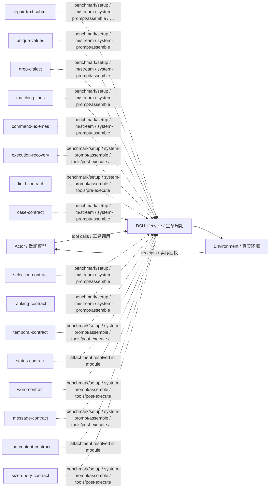

# osbench · L4：已有最佳起点 · v40

L4: seeded continuation · training/development-selected final checkpoint / 按训练或开发规则选定的最终版。

**测试 / Test:** 37.27% · 432 valid episodes / 有效场次。

Run ID: `loop-expansion-sol40-20261026/osbench/l4-best-sol61`。在[结构化结果](../../../../../results/research/runs.json)中按此编号查本组曲线、逐次测试与统计；[配置](../../../../../results/research/protocols/loop-expansion-sol40-20261026--osbench--l4-best-sol61.json) · [任务清单](../../../../../results/research/tasks/loop-expansion-sol40-20261026--osbench--l4-best-sol61.json)。

[组合与启用名单 / Composition](composition.json) · [Mermaid source](diagram.mmd) · [全部方法产物 / All artifacts](../../../../../research-artifacts/README.md)

**读图：** 实线是一般模型—工具运行路径；虚线只表示源码中登记的插件挂接，不表示这些插件按顺序执行、每场触发或各自带来独立增益。

**Diagram:** Solid edges show the general actor/tool path. Dashed edges show static source attachments, not ordering, activation in every episode, or independent causal gains.

启用插件与源码钩子 / Active plugins and source hooks

| Plugin source | Source hooks |
|---|---|
| [repair-text-submit](repair-text-submit.mjs) | `benchmark/setup` · `llm/stream` · `system-prompt/assemble` · `tools/post-execute` |
| [unique-values](unique-values.mjs) | `benchmark/setup` · `llm/stream` · `system-prompt/assemble` |
| [grep-dialect](grep-dialect.mjs) | `benchmark/setup` · `llm/stream` · `system-prompt/assemble` |
| [matching-lines](matching-lines.mjs) | `benchmark/setup` · `llm/stream` · `system-prompt/assemble` |
| [command-lexemes](command-lexemes.mjs) | `benchmark/setup` · `llm/stream` · `system-prompt/assemble` |
| [execution-recovery](execution-recovery.mjs) | `benchmark/setup` · `system-prompt/assemble` · `tools/post-execute` · `tools/pre-execute` |
| [field-contract](field-contract.mjs) | `benchmark/setup` · `system-prompt/assemble` · `tools/pre-execute` |
| [case-contract](case-contract.mjs) | `benchmark/setup` · `llm/stream` · `system-prompt/assemble` |
| [selection-contract](selection-contract.mjs) | `benchmark/setup` · `llm/stream` · `system-prompt/assemble` |
| [ranking-contract](ranking-contract.mjs) | `benchmark/setup` · `llm/stream` · `system-prompt/assemble` |
| [temporal-contract](temporal-contract.mjs) | `benchmark/setup` · `system-prompt/assemble` · `tools/post-execute` · `tools/pre-execute` |
| [status-contract](status-contract.mjs) | 模块内接入 / see module |
| [word-contract](word-contract.mjs) | `benchmark/setup` · `system-prompt/assemble` · `tools/post-execute` |
| [message-contract](message-contract.mjs) | `benchmark/setup` · `system-prompt/assemble` · `tools/post-execute` · `tools/pre-execute` |
| [line-content-contract](line-content-contract.mjs) | 模块内接入 / see module |
| [size-query-contract](size-query-contract.mjs) | `benchmark/setup` · `system-prompt/assemble` · `tools/post-execute` |

本目录保留冻结插件及其本地依赖。完整运行仍需共同DSH基础与本场景环境，见[复现说明](../../../../../docs/REPRODUCING.zh-CN.md)。本次导出没有重跑正式测试，也没有修改插件算法。

This directory retains frozen plugins and local dependencies. It still needs the shared DSH runtime and benchmark environment; see [reproduction](../../../../../docs/REPRODUCING.md). Export did not rerun the benchmark or change the plugin algorithms.
